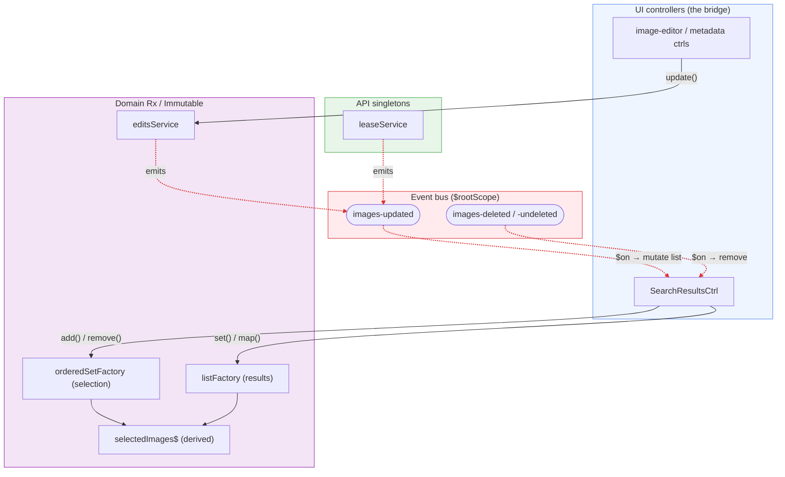

# Kahuna UI tree and state tree (Angular → React migration reference)

This document maps the `kahuna` Angular 1.x frontend (`kahuna/public/js`) into two
separate trees — a **UI tree** (view/component hierarchy) and a **state tree**
(where application state actually lives) — and shows how they map onto each other.
It is intended as a reference for migrating the frontend to React.

The key insight is that almost no state is component-local. State lives in
**singleton services + ui-router resolves + browser storage**, and components are
wired together through a **global event bus** (`$rootScope` events + window
`CustomEvent`s) rather than through props.

## 1. UI tree (view / component hierarchy)

The app has 6 route views, all sharing `gr-top-bar` and an overlay `dnd-uploader`.
Custom elements are `gr-*` / `gu-*` directives.

```mermaid
graph TD
    ROUTER["ui-router &lt;ui-view&gt;"] --> UP[upload/view.html]
    ROUTER --> SE[search/view.html]
    ROUTER --> IM[image/view.html]
    ROUTER --> CR[crop/view.html]
    ROUTER --> TD[takedown/view.html]
    ROUTER --> ERR[image-error.html]

    UP --> TBu[gr-top-bar]
    UP --> FP[file-prompt]
    UP --> UJ[ui-upload-jobs]
    UP --> RU[recent-uploads]
    UP --> DND1[dnd-uploader]
    UJ --> RME[required-metadata-editor]
    RME --> IE1[gr-image-metadata / image-editor]

    SE --> TBs[gr-top-bar]
    TBs --> SQ[search-query]
    SQ --> CH[gr-chips → text/filter/chooser chips]
    TBs --> FU[file-uploader]
    SE --> PF[gr-permissions-filter]
    SE --> PANELS[gr-panels]
    PANELS --> LP["gr-panel left → gr-collections-panel"]
    PANELS --> PC["gr-panel-content → search/results.html"]
    PANELS --> RP["gr-panel right → gr-info-panel"]
    LP --> CPN[gr-collections-panel-node recursive]
    PC --> TOOLBAR[results toolbar]
    TOOLBAR --> BE[gr-batch-export-original-images]
    TOOLBAR --> DL[gr-downloader]
    TOOLBAR --> DI[gr-delete-image]
    TOOLBAR --> AR[gr-archiver]
    TOOLBAR --> SC[gr-sort-control]
    PC --> LT[gu-lazy-table → result items]
    RP --> IMD[gr-image-metadata]

    IM --> TBi[gr-top-bar]
    TBi --> MLT[gr-more-like-this]
    TBi --> DI2[gr-delete-image]
    TBi --> DL2[gr-downloader]
    TBi --> AR2[gr-archiver]
    TBi --> CRI[gr-crop-image]
    IM --> DC[gr-display-crops]
    IM --> IE2[gr-image-metadata]

    CR --> TBc[gr-top-bar]
    CR --> UCB[ui-crop-box directive]

    TD --> TBt[gr-top-bar]
    TD --> TDP[gr-takedown-page React/TSX]
```



### Shared metadata editor subtree

The `gr-image-metadata` editor is reused in the search info-panel, the image view,
and the upload jobs list:

```
gr-image-metadata (gr-images=, gr-user-can-edit=)
├── gr-metadata-templates          (template select/apply/cancel)
├── gr-usage-rights-editor         (usageRights=, onSave&, onCancel&)
├── gr-leases                      (gr-images=, onSave&, onCancel&)
│   ├── gr-datalist
│   └── gr-confirm-delete
├── gr-add-keyword → gr-datalist
├── gr-add-label   → gr-datalist
├── gr-preset-labels → gr-datalist
├── gr-photoshoot  → gr-datalist
├── gr-collection-overlay
└── gr-image-usage
    ├── gr-image-usage-list
    ├── gr-image-usage-photosales
    └── gr-delete-usages → gr-confirm-delete
```

### Layout / transclusion wrappers (pure structure, no state)

`gr-top-bar` / `-nav` / `-actions`, `gr-panels` / `gr-panel` / `gr-panel-content`,
`gr-icon` / `gr-icon-label`.

### Already-React (TSX) leaf components — migration beachheads

These are already decoupled and consumed as Angular directives, so they are the
natural places to grow the React island:

`gr-takedown-page`, `gr-sort-control` (+ extended / tab-swap), `gr-permissions-filter`,
`gr-my-uploads`, `gr-notifications-banner`, `gr-confirmation-modal`,
`gr-usagerights-summary`, `gr-description-warning`, `gr-cql-input`.

## 2. Route / navigation state (ui-router)

| State | URL | Parent | Key resolves / services | Template |
|-------|-----|--------|-------------------------|----------|
| `upload` | `/upload` | (root) | — | `upload/view.html` |
| `search` | `/?cropType&customRatio&defaultCropType` | (root) | `shortcutKeys`, `panels` (panelService) | `search/view.html` |
| `search.results` | `search?query&ids&...` (many filters) | `search` | `selection` (orderedSetFactory), `results` (listFactory), `compactResults$`, `selectedImages$`, `selectedCollections`; named views `results` / `infoPanel` / `collectionPanel` / `multiDrag` | `search/results.html` + named views |
| `image` | `/images/:imageId?crop` | (root) | `image` (mediaApi.find), `optimisedImageUri`, `lowResImageUri` (imgops) | `image/view.html` |
| `crop` | `/images/:imageId/crop` | (root) | `image` + `mediaCropper.canBeCropped` gate | `crop/view.html` |
| `takedown` | `/images/:imageId/takedown` | (root) | `imageId` (40-hex validate), `image`, `ensureCanTakedown` permission gate | `takedown/view.html` |
| `image-error` | (none) | (root) | `message` param | `image-error.html` |

Notes:
- The **search query lives entirely in the URL** (`search.results` params), not in a
  store. This is the source of truth for search.
- All states except `upload` load data through resolve blocks.
- `image-error` is the shared error target, reached from failed resolves in `image`,
  `crop`, and `takedown`.

## 3. State tree (singletons, Rx, storage)

```mermaid
graph TD
    subgraph ROUTE["1. Route / Navigation state (ui-router)"]
      S1["search.results resolves:<br/>selection, results, selectedImages$,<br/>panels, selectedCollections"]
      S2["image resolves: image, cropKey,<br/>optimised/lowRes URIs"]
      S3["crop/takedown resolves + permission gates"]
    end

    subgraph API["2. API client singletons (cache state)"]
      A1["mediaApi (session memoised, root)"]
      A2[loaderApi]
      A3["editsApi (categories memoised)"]
      A4[mediaCropper]
      A5["collections (tree memoised)"]
      A6["leaseService (imageUpdates$, leaseUpdates$)"]
    end

    subgraph DOMAIN["3. Domain / coordination state (Rx + Immutable)"]
      D1["editsService (updateRequestPools,<br/>requestsPromises$, latestCompleted)"]
      D2["orderedSetFactory → selection items$ (OrderedSet)"]
      D3["listFactory → results items$ (List)"]
      D4["archive/label/photoshoot services (batch + poll)"]
      D5["imageService / imageAccessor / imageLogic (pure derive)"]
    end

    subgraph UISTATE["4. UI state services"]
      U1["panelService (state$ hidden/locked, persisted)"]
      U2["collectionsTreeState (expanded nodes)"]
      U3["scrollPosition (in-memory)"]
      U4["cropSettings (crop prefs)"]
    end

    subgraph STORAGE["5. Browser storage"]
      ST1["localStorage: preset-labels, browserUuid,<br/>collectionsTreeOpen, search.seenFrom, *PanelState"]
      ST2["sessionStorage: cropType, customCrop,<br/>isNonFree, defaultNonFreeFilter, sessionUuid"]
      ST3["cookie: SHOULD_BLUR_GRAPHIC_IMAGES"]
    end

    S1 --> D2 & D3 & A1
    D1 --> A1 & A3
    D4 --> A1
    A6 --> D1
    U1 --> ST1
    U2 --> ST1
    U4 --> ST2
    D2 -.combineLatest.-> SEL["selectedImages$ (derived)"]
    D3 -.-> SEL
```



### State mechanics

- **Selection / results**: RxJS `Subject` → `scan` → `shareReplay(1)` over Immutable.js
  `OrderedSet` / `List`. `selectedImages$` is `combineLatest(selection, results)`.
- **API caching**: ad-hoc lazy-memoised promises (`session`, `categories`, `collections`).
- **Save coordination**: `editsService` request-pools updates and uses `apiPoll`
  (waits for reindex) before emitting `images-updated`.
- **Persistence**: thin `storage` factory over local/session storage; `panelService`
  and `cropSettings` auto-sync on every change.

### Browser storage keys

| Key | Storage | Used by | Purpose |
|-----|---------|---------|---------|
| `collectionsTreeOpen` | localStorage | collectionsTreeState | expanded collection nodes |
| `preset-labels` | localStorage | presetLabelService | user's favourite labels |
| `browserUuid` | localStorage | telemetry | persistent browser id |
| `sessionUuid` | sessionStorage | telemetry | per-session id |
| `cropType` | sessionStorage | cropSettings | selected crop aspect |
| `customCrop` | sessionStorage | cropSettings | custom crop definition |
| `defaultCropType` | sessionStorage | cropSettings | default crop to auto-select |
| `search.seenFrom` | localStorage | search/results.js | last-seen image per query |
| `isNonFree` | sessionStorage | search/index.js | show paid images filter |
| `defaultNonFreeFilter` | sessionStorage | search/index.js | paid filter state |
| `{name}PanelState` | localStorage | panelService | panel open/locked state |
| `SHOULD_BLUR_GRAPHIC_IMAGES` | cookie (399d) | graphicImageBlurService | blur sensitive images |

## 4. The glue: global event bus

Because state lives in singletons, cross-component sync happens via `$rootScope`
events and window `CustomEvent`s, not props. This is the hardest part to migrate.

### How this works in Angular

A caller does **not** set a value on `$rootScope`. This is a fire-and-forget
**publish/subscribe** mechanism — nothing is stored on the scope. Angular's
`$rootScope` (and every `$scope`) exposes three methods:

- **`$emit(name, ...args)`** — dispatches an event that travels **up** the scope
  hierarchy (from the current scope toward `$rootScope`).
- **`$broadcast(name, ...args)`** — dispatches an event that travels **down** the
  hierarchy (to all child scopes). More expensive, as it visits every descendant.
- **`$on(name, handler)`** — registers a listener. The handler is called as
  `handler(event, ...args)`, where `event` has fields like `event.stopPropagation()`
  and `event.preventDefault()`.

Because almost everything in this app listens/emits on the single root scope, it is
used as a flat app-wide bus: `$rootScope.$emit('images-updated', [image])` on one
side, `$rootScope.$on('images-updated', (event, images) => …)` on the other. The
direction (`$emit` up vs `$broadcast` down) barely matters here since listeners sit
on the root anyway.

Key properties (and the traps they create for migration):

- **No stored state, no replay.** The payload is passed straight to whoever is
  listening *at that moment*. A listener registered *after* an emit never sees it.
  This is the opposite of the Rx stores in §3, which hold current state and replay it
  to new subscribers (`shareReplay(1)`).
- **Synchronous.** By the time `$emit`/`$broadcast` returns, every handler has run.
  Handlers typically mutate scope data, so the change is picked up by the next
  `$digest` and reflected in the DOM.
- **Listeners must be de-registered.** `$on` returns a deregistration function; the
  common pattern is to call it on `$scope.$destroy` to avoid leaks (e.g.
  `const off = $rootScope.$on(…); $scope.$on('$destroy', off);`). Listeners on
  `$rootScope` outlive component scopes and leak if this is missed.
- **Stringly-typed, untracked.** Event names are bare strings with no registry, so
  the emitter/listener wiring is only discoverable by grep — hence the table below.

Concrete example from this codebase — the save → re-read loop:

```js
// emitter: edits/service.js (after the API confirms the update was reindexed)
$rootScope.$emit('images-updated', [image]);

// listener: search/results.js (patches the matching row in the current results)
const off = $rootScope.$on('images-updated', (event, updatedImages) => {
    updatedImages.forEach(updatedImage => {
        const i = ctrl.images.findIndex(x => x.data.id === updatedImage.data.id);
        if (i !== -1) { ctrl.images[i] = updatedImage; }
    });
});
$scope.$on('$destroy', off); // de-register to avoid a leak
```

There are three related channels in play, which the migration must treat differently:

- **`$rootScope` events** — the in-app Angular bus described above.
- **Window `CustomEvent`s** (`window.dispatchEvent` / `addEventListener`) — used to
  talk to the newer React/TSX components, which have no `$scope`. This is the existing
  Angular↔React seam.
- **`window.parent.postMessage`** — the iframe bridge in `main.js`, forwarding crop
  events to a host page that embeds Grid.

### Event catalogue

| Event | Emitters → Listeners | Role |
|-------|----------------------|------|
| `images-updated` | editsService, archive/label/lease/collections, gr-archiver, gr-downloader → search/results, image, upload-jobs, gr-image-metadata, gr-image-usage, gr-metadata-validity | central "an image changed, re-read it" signal |
| `images-deleted` / `images-undeleted` | gr-delete-image / gr-un-delete-image → results, image, upload-jobs | remove/restore in lists |
| `leases-updated` | leaseService → gr-crop-image, leases, gr-metadata-validity | lease cache invalidation |
| `events:batch-operations:start/progress/complete` | batch-tracking → search/results | batch progress bar |
| `events:batch-apply:*` (labels, keywords, leases, usage-rights, collections, metadata) | list-editor / image-editor / leases → same | "apply to all selected" |
| `events:metadata-template:selected/applied/cancelled` | image-editor → required-metadata-editor | template propagation |
| `events:crop-created/selected/crops-created` | crop, gr-export, gr-batch-export → main.js → `window.parent.postMessage` | iframe embed bridge |
| `events:config-loaded` / `events:user-loaded` | main.js (bootstrap) | app-level config / user |
| `events:error:*`, `pandular:re-establishment:fail` | http interceptor → globalErrors + tracking | global errors |
| `track:event` | everywhere → analytics | telemetry |
| Window `CustomEvent`s (`logoClick`, `queryChangeEvent`, `filterChangeEvent`, `uploadedByEvent`, `setPayableImages`, `imageSelectionChange`, `newNotification`, `panelShow/Hide`) | Angular ↔ TSX components | existing Angular↔React bridge |

## 5. UI → state mapping

| UI node | Reads state from | Writes / signals via |
|---------|------------------|----------------------|
| `search.results` view | listFactory (results), orderedSetFactory (selection), `selectedImages$`, mediaApi.search | selection ops; `events:new-images`; scrollPosition |
| `gr-info-panel` / `gr-image-metadata` | `selectedImages$`, editsService, imageAccessor/Logic, editsApi.categories | `editsService.update` → `images-updated`; `events:batch-apply:*`; `imageSelectionChange` |
| `gr-collections-panel` | collections cache, collectionsTreeState, `selectedImages$` | collections.add/remove → `images-updated`; tree state → localStorage |
| `gr-panel` / `gr-panel-button` | `panelService.state$` | `panelService.toggle*` → `*PanelState` localStorage; `panelShow/Hide` |
| search toolbar (`gr-downloader`/`-delete`/`-archiver`/`-batch-export`) | selection | `images-updated` / `-deleted`; `events:crops-created` → postMessage |
| `image` view | `image` resolve, imgops URIs, mediaCropper | `events:crop-selected`; listens `images-updated/-deleted` |
| `crop` view + `ui-crop-box` | `image` resolve, cropSettings | `user-{x,y,width,height}-change` broadcasts; `events:crop-created` |
| `upload` view (file-uploader, dnd-uploader, upload-jobs) | loaderApi, presetLabelService | `track:event`; `images-deleted`; reuses `gr-image-metadata` |
| `search-query` / `gr-chips` / permissions filter | URL `$stateParams` (query = state) | `queryChangeEvent`, `filterChangeEvent`, `setPayableImages`, `isNonFree` / `defaultNonFreeFilter` storage |
| takedown | `image` resolve + permission gates | React `gr-takedown-page` with `mediaApiRoot` prop |

## 6. UI ↔ state relation diagram

The left column is the **UI tree** (route views and the key components they render);
the right column is the **state tree** (route resolves, API singletons, domain Rx
stores, UI-state services, the event bus, and storage). Edges show the relation:

- **Solid grey arrow (`-->`)** = the UI node *reads* from that state holder.
- **Dotted red arrow (`-.->`)** = the UI node *writes to / emits* that state holder or event.

```mermaid
graph LR
    subgraph UI["UI tree"]
        direction TB
        U_upload["upload view"]
        U_uj["upload-jobs"]
        U_sqUp["file-uploader / dnd-uploader"]
        U_search["search.results view"]
        U_sq["search-query / gr-chips"]
        U_toolbar["results toolbar<br/>(downloader/delete/archiver)"]
        U_panel["gr-panel / gr-panel-button"]
        U_coll["gr-collections-panel"]
        U_meta["gr-info-panel / gr-image-metadata"]
        U_image["image view"]
        U_crop["crop view / ui-crop-box"]
        U_takedown["takedown (gr-takedown-page)"]
    end

    subgraph STATE["State tree"]
        direction TB
        subgraph S_route["Route resolves (ui-router)"]
            R_img["image / cropKey / URIs"]
            R_url["URL search params (query = state)"]
        end
        subgraph S_api["API singletons"]
            A_media["mediaApi"]
            A_loader["loaderApi"]
            A_edits["editsApi (categories)"]
            A_crop["mediaCropper"]
            A_coll["collections (tree)"]
            A_lease["leaseService"]
        end
        subgraph S_domain["Domain Rx / Immutable"]
            D_sel["orderedSetFactory → selection"]
            D_res["listFactory → results"]
            D_selimg["selectedImages$ (derived)"]
            D_edit["editsService (pool + apiPoll)"]
            D_access["imageAccessor / imageLogic"]
        end
        subgraph S_ui["UI-state services"]
            P_panel["panelService (+*PanelState)"]
            P_tree["collectionsTreeState"]
            P_scroll["scrollPosition"]
            P_cropset["cropSettings"]
            P_preset["presetLabelService"]
        end
        subgraph S_bus["$rootScope event bus"]
            E_upd(["images-updated"])
            E_del(["images-deleted / -undeleted"])
            E_batch(["events:batch-apply:*"])
            E_cropev(["events:crop-created/selected"])
        end
    end

    U_upload --> A_loader
    U_upload --> P_preset
    U_sqUp --> A_loader
    U_sqUp -.-> E_del
    U_uj --> D_edit
    U_uj -.-> E_del

    U_search --> D_res
    U_search --> D_sel
    U_search --> D_selimg
    U_search --> A_media
    U_search --> P_scroll
    U_sq --> R_url
    U_sq -.-> R_url

    U_toolbar --> D_sel
    U_toolbar -.-> E_upd
    U_toolbar -.-> E_del
    U_toolbar -.-> E_cropev

    U_panel --> P_panel
    U_panel -.-> P_panel

    U_coll --> A_coll
    U_coll --> P_tree
    U_coll --> D_selimg
    U_coll -.-> E_upd

    U_meta --> D_selimg
    U_meta --> D_edit
    U_meta --> A_edits
    U_meta --> D_access
    U_meta -.-> E_upd
    U_meta -.-> E_batch

    U_image --> R_img
    U_image --> A_crop
    U_image -.-> E_cropev
    U_image --> E_upd

    U_crop --> R_img
    U_crop --> P_cropset
    U_crop -.-> E_cropev

    U_takedown --> R_img
    U_takedown --> A_media

    subgraph LEGEND["Legend"]
        direction LR
        LA["UI node"] -->|reads| LB["state"]
        LC["UI node"] -.->|writes / emits| LD["state / event"]
    end

    %% dotted write/emit edges (indices) in red
    linkStyle 3,5,12,14,15,16,18,22,27,28,31,35,39 stroke:#d33,stroke-width:2px

    %% subgraph background colours
    style UI fill:#eef5ff,stroke:#5b8def
    style STATE fill:#f7f7f7,stroke:#999
    style S_route fill:#fff3e0,stroke:#e8a33d
    style S_api fill:#e8f5e9,stroke:#4caf50
    style S_domain fill:#f3e5f5,stroke:#9c27b0
    style S_ui fill:#e1f5fe,stroke:#039be5
    style S_bus fill:#ffebee,stroke:#d33
    style LEGEND fill:#ffffff,stroke:#bbb
```



### How to read the hot paths

- **Selection fan-out**: `orderedSetFactory` (selection) + `listFactory` (results) feed
  the derived `selectedImages$`, which three UI nodes (`gr-info-panel`,
  `gr-collections-panel`, results toolbar) all read. In React this becomes two stores
  plus one selector.
- **The write-back loop**: edit/collection/archive UI nodes emit `images-updated`, and
  nearly every list/detail view listens to it to re-read. That single event is the
  app's cache-invalidation channel.
- **URL as state**: `search-query` both reads and writes the ui-router URL params —
  there is no separate query store.

### Relation table

The same edges as the diagram, in tabular form, **sorted by backing service**
(R = reads, W = writes / emits):

| UI node | State / event holder | Backing service / source | R / W |
|---------|----------------------|--------------------------|-------|
| file-uploader / dnd-uploader | `images-deleted` | `$rootScope` bus | W |
| upload-jobs | `images-deleted` | `$rootScope` bus | W |
| results toolbar | `images-updated` | `$rootScope` bus | W |
| results toolbar | `images-deleted` | `$rootScope` bus | W |
| gr-collections-panel | `images-updated` | `$rootScope` bus | W |
| gr-info-panel / gr-image-metadata | `images-updated` | `$rootScope` bus | W |
| gr-info-panel / gr-image-metadata | `events:batch-apply:*` | `$rootScope` bus | W |
| image view | `images-updated` (listens) | `$rootScope` bus | R |
| image view | `events:crop-*` | `$rootScope` bus | W |
| crop view / ui-crop-box | `events:crop-*` | `$rootScope` bus | W |
| results toolbar | `events:crop-*` | `$rootScope` bus → main.js postMessage | W |
| gr-collections-panel | collectionsTreeState | `components/gr-collections-panel/gr-collections-panel.js` | R |
| crop view / ui-crop-box | image resolve | `crop/index.js` (resolve) | R |
| upload-jobs | editsService | `edits/service.js` | R |
| gr-info-panel / gr-image-metadata | editsService | `edits/service.js` | R |
| image view | image resolve (mediaApi/imgops) | `image/index.js` (resolve) | R |
| search.results view | listFactory (results) | `lib/data-structure/list-factory.js` | R |
| search.results view | orderedSetFactory (selection) | `lib/data-structure/ordered-set-factory.js` | R |
| results toolbar | orderedSetFactory (selection) | `lib/data-structure/ordered-set-factory.js` | R |
| search.results view | `selectedImages$` | `search/index.js` (resolve) | R |
| gr-collections-panel | `selectedImages$` | `search/index.js` (resolve) | R |
| gr-info-panel / gr-image-metadata | `selectedImages$` | `search/index.js` (resolve) | R |
| search-query / gr-chips | URL search params | `search/index.js` (ui-router state) | R |
| search-query / gr-chips | URL search params | `search/index.js` (ui-router state) | W |
| gr-collections-panel | collections | `services/api/collections-api.js` | R |
| gr-info-panel / gr-image-metadata | editsApi (categories) | `services/api/edits-api.js` | R |
| upload view | loaderApi | `services/api/loader.js` | R |
| file-uploader / dnd-uploader | loaderApi | `services/api/loader.js` | R |
| search.results view | mediaApi | `services/api/media-api.js` | R |
| takedown | mediaApi | `services/api/media-api.js` | R |
| image view | mediaCropper | `services/api/media-cropper.js` | R |
| gr-info-panel / gr-image-metadata | imageAccessor / imageLogic | `services/image-accessor.js`, `services/image-logic.js` | R |
| gr-panel / gr-panel-button | panelService | `services/panel.js` | R |
| gr-panel / gr-panel-button | panelService (+`*PanelState`) | `services/panel.js` + `util/storage.js` | W |
| upload view | presetLabelService | `services/preset-label.js` | R |
| search.results view | scrollPosition | `services/scroll-position.js` | R |
| takedown | image resolve | `takedown/index.ts` (resolve) | R |
| crop view / ui-crop-box | cropSettings | `util/crop.js` | R |

### Where the domain Rx stores get their data

The domain Rx / Immutable stores **do not subscribe to the event bus**. They are fed
by **direct method calls** from UI controllers, each via a private `Rx.Subject`:

- `listFactory` (results) ← `set()` / `map()` / `removeAt()`
  ([list-factory.js](../../kahuna/public/js/lib/data-structure/list-factory.js))
- `orderedSetFactory` (selection) ← `add()` / `remove()` / `toggle()`
  ([ordered-set-factory.js](../../kahuna/public/js/lib/data-structure/ordered-set-factory.js))
- `selectedImages$` is purely derived: `combineLatest(selection, results)`
- `editsService` ← `update()` calls (its own `requestsPromises` subject)

The event bus flows the **other way**: domain/API services *emit* `images-updated`,
and UI controllers *bridge* those events back into the stores by listening
(`$rootScope.$on`) and then mutating. `search/results.js` even carries a `TODO`
noting the results list "should listen to these events and update itself" — it does
not; the controller does.



**Migration implication:** this controller-as-bridge pattern is exactly what a store
subscription (or React Query cache invalidation) replaces. Instead of a controller
doing `$on('images-updated')` then hand-patching an array, the store itself owns the
update: emit becomes `queryClient.invalidateQueries(['image', id])` (or a store
action), and components re-render from the store directly.

## 7. Migration takeaways

1. **Search query lives in the URL** — keep it in the router (React Router search
   params / TanStack Router) as the source of truth.
2. **`selectedImages$` is derived state** (`combineLatest(selection, results)`).
   Model selection + results as two stores (Zustand/Redux) and derive
   selection-with-data via a selector.
3. **API memoisation** (`mediaApi`, `editsApi`, `collections`) → React Query / SWR
   cache keys.
4. **`images-updated` is a cache-invalidation bus** → `queryClient.invalidateQueries(['image', id])`.
   Mapping every `$emit('images-updated')` to an invalidation is the single
   highest-leverage migration step.
5. **`editsService` pooling + `apiPoll`** → React Query mutations with optimistic
   update + refetch-until-reindexed.
6. **Panel / crop / tree UI state + storage** → small Zustand slices with a `persist`
   middleware (keys enumerated above).
7. **The TSX components + window `CustomEvent` bridge already exist** — that is the
   incremental strangler-fig seam; expand those islands rather than big-bang.
