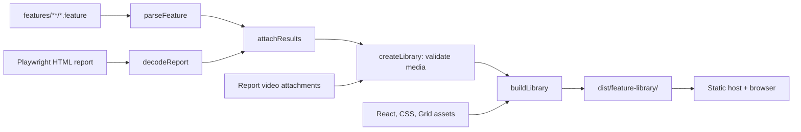

# Feature library developer guide

The feature library presents Grid's Gherkin specifications alongside recorded
browser scenarios. It is a **static, read-only React application**, not a backend
service: a build converts feature files and an existing Playwright HTML report into
a JSON snapshot, bundles the UI, and copies its recordings and assets.

This guide covers maintaining the viewer. For running Grid itself and capturing
new recordings, see the [e2e guide](../README.md).

## Start here

Use Node.js 22.12 or newer and npm. From the repository root:

```bash
cd e2e-tests
npm ci
npm run features:serve
```

Open the printed URL, normally `http://localhost:4173`. The server binds to
`127.0.0.1` and tries up to ten higher ports if the requested port is occupied.
In a dev container, forward the printed port. Stop it with Ctrl-C.

All remaining commands in this guide run from `e2e-tests`, **not** this directory.
Scripts and dependencies live in [the parent package.json](../package.json).

| Command | Purpose |
| --- | --- |
| `npm run features:serve` | Typecheck, build once, then serve the exported directory. |
| `npm run features:serve -- --port 4180` | Choose the initial preview port. |
| `npm run features:build` | Typecheck and generate a static export without starting a server. |
| `npm run features:build -- --report /path/to/playwright-report` | Build from a different HTML report; `features:serve` accepts the same option. |
| `npm run features:typecheck` | Check all feature-library TypeScript and TSX, including tests. |
| `npm run features:test` | Run importer, report-matching and HTTP server tests. |
| `npm run features:test:browser` | Build, then exercise the UI in headless Chromium with isolated fixtures. |

The viewer and its tests do not require Docker, Scala, or a running Grid stack.
The browser test additionally requires Playwright's Chromium:

```bash
npx playwright install chromium
```

On Linux, missing browser system libraries may require the repository's
`npx playwright install --with-deps chromium` setup step.

### Edit, build, refresh

There is **no watch mode or hot reload**. Edit source here, run
`npm run features:build` in another terminal, and refresh the browser. A running
preview serves the newly written files. Restart `features:serve` after changing
the server implementation, or when choosing a different report directory.

Do not edit the generated `dist/feature-library/` files: rebuilding replaces them.
Avoid concurrent builds because they write the same output directory.

Feature definitions always come from the current working tree's
[features directory](../features). The default report is `e2e-tests/playwright-report/`.
A missing report is allowed: the catalogue still displays definitions and planned
scenarios. An existing but malformed report fails the build instead of silently
discarding its results.

To update recordings, follow the e2e setup and run `npm run test:video`, then rebuild
the library. That command does run browser scenarios against Grid; it is not needed
for ordinary viewer development.

## Source map

| File | Responsibility and useful entry points |
| --- | --- |
| [app.tsx](app.tsx) | React components, filters, navigation, clipboard feedback and video controls. Start at `App` and `FeatureLibrary`. |
| [styles.css](styles.css) | Grid theme variables, typography, layout and responsive rules. |
| [types.ts](types.ts) | Shared `LibraryManifest` contract between importer and browser. |
| [library.ts](library.ts) | Gherkin parsing, Playwright archive decoding, result matching and attachment validation. Start at `createLibrary`. |
| [build.ts](build.ts) | esbuild bundle, asset/media copying, JSON output and stale-video cleanup. |
| [serve.ts](serve.ts) | Optional local static server with video byte-range support. |
| [index.html](index.html) | HTML shell, React root, stylesheet and generated JavaScript entry. |
| [tsconfig.json](tsconfig.json) | Strict, no-emit TypeScript checking scoped to this directory. |
| [library.test.ts](library.test.ts) | Node tests for the importer and server, plus report-fixture helpers. |
| [app.test.ts](app.test.ts) | Node test that drives Playwright Chromium against a temporary site. |

The implementation uses React and `lucide-react`, without a router or server-side
rendering framework. `tsx` executes the Node tools and tests; TypeScript checks types;
esbuild produces a minified browser ES module targeting ES2022. The production
bundle and all required assets are local, with no runtime CDN dependency.

## Data flow



### Import and matching

1. `featureFiles` recursively finds regular `.feature` files in sorted path order.
2. `parseFeature` uses Cucumber's parser, not a custom Gherkin parser. It flattens
   rule scenarios, inherits feature/rule backgrounds and tags, and retains tables,
   doc strings and outline examples. Cucumber's compiled scenarios, called
   *pickles*, provide substituted outline names for matching.
3. `decodeReport` extracts the base64 ZIP embedded in Playwright's HTML report.
   It reads the report index and prefers detailed per-file test records when present.
4. `attachResults` matches generated spec paths back to feature paths, checks the
   rule when applicable, then compares scenario titles or compiled outline names.
   Generated spec line numbers are deliberately not used: they differ from Gherkin
   source line numbers. Matching tests contribute all their projects and retries.
5. `createLibrary` validates video files and returns `{ manifest, media, warnings }`.
   The `media` map associates an export-relative destination with an absolute source
   file. This function reads inputs but does not write the export.

If a test could match more than one source scenario, the affected scenario is
`unmatched` and receives no runs. Do not replace this with fuzzy title or filename
matching: showing another scenario's recording is worse than showing no recording.

Playwright's embedded HTML archive is an **internal format**, not its public JSON
reporter format. Changes to Playwright or `playwright-bdd` can affect decoding,
generated paths or outline titles. After upgrading either, test against a newly
generated real HTML report as well as the synthetic fixtures.

### Manifest contract

[types.ts](types.ts) is the source of truth. The main hierarchy is:

```text
LibraryManifest
  generatedAt
  report: { startedAt, duration } | null
  features[]
    source metadata
    scenarios[]
      description, tags, background[], steps[], examples[]
      status
      runs[]
        project, retry, status, outcome, timing
        recordings[]: { contentType, available, src? }
```

- `generatedAt` is the build's ISO timestamp; it is not the report's run date.
- `report.startedAt` is epoch milliseconds. Durations are milliseconds.
  `Run.startedAt`, when supplied, is an ISO date string.
- `retry` is zero-based. The UI displays attempt numbers starting at one.
- `Recording.path` is temporary importer state and is removed before serialization.
  Available recordings have an export-relative `src`; unavailable ones are not playable.
- Scenario IDs use slugs of the feature-relative path (without `.feature`), optional
   rule name and scenario name, separated by `/`: `upload/select-a-file` or
   `search/image-search/find-term`. Nested feature directories are preserved.
   Slugs are lowercased, accents removed and punctuation/whitespace replaced with
   hyphens; remaining non-ASCII letters and numbers are URL-encoded. Names must
   contain letters or numbers. Duplicate IDs fail the build with both source locations,
   including collisions caused by slug normalization or different feature files.
- IDs survive line shifts and scenario reordering. Renaming a file, rule or scenario,
   or moving a scenario to another file/rule, can change its ID and invalidate links.
   Rebuilding replaces the previous hashed IDs; legacy hash links have no aliases.
- The browser trusts the generated manifest's shape; TypeScript annotations do not
  perform runtime JSON validation. Ship the bundle and manifest together when changing
  the contract, and supply defaults if supporting older snapshots.

Scenario status is derived in the following precedence order:

| Status | Condition |
| --- | --- |
| `unmatched` | A report match is ambiguous. |
| `failed` | Any matching test has Playwright outcome `unexpected`. |
| `flaky` | Otherwise, any matching test has outcome `flaky`. |
| `passed` | Otherwise, any matching test has outcome `expected`. |
| `skipped` | Otherwise, any matching test has outcome `skipped`. |
| `planned` | No matching results and the scenario inherits or declares `@todo`. |
| `not-run` | No matching results and no `@todo` tag. |

`Run.status` describes an individual attempt; `Run.outcome` is Playwright's
expectation-relative result. The current aggregate label `passed` maps to `expected`,
so an expected failure is not necessarily an actually passing attempt. Video
availability is independent of status: a passed scenario may have no recording.

Definitions and reports are not automatically tied to the same source revision.
When using `--report` for an older run, use its corresponding feature definitions.
The viewer does not rerun tests or establish that edited steps were executed.

### Export and hosting

`buildLibrary` writes to the fixed `e2e-tests/dist/feature-library/` directory:

```text
index.html
app.js
styles.css
library.json
grid-logo.svg
fonts/
media/
```

The logo and Open Sans fonts are copied from Kahuna's existing assets. Media files
are copied, so an archived export survives deletion of the original test results.
Subsequent builds overwrite the snapshot and remove exporter-named videos that
are no longer referenced. Archive the whole directory before building another run.

Any HTTP static host can serve the export; no application backend, database, Node
runtime or Grid stack is needed on the host. Do not open it with `file://`: the UI
fetches its JSON via HTTP. Preserve relative asset paths, use the directory URL
with a trailing slash, and serve video MIME types and byte ranges correctly for
seeking. Hash-based scenario links do not require an SPA route-rewrite rule.

The local server accepts GET/HEAD, streams files and handles single byte ranges.
It checks resolved paths, including symlinks, against the export root. The importer
similarly checks video paths against the report root before copying. Keep both
checks when changing file handling.

There is no built-in authentication. Recordings may contain sensitive browser data;
review exports and use an appropriately restricted host. Deploy the output directory,
not the repository or raw report directories. Prefer versioned snapshot directories
or an atomic deployment so users do not receive mixed bundles, manifests and media.

## UI responsibilities

All components currently live in [app.tsx](app.tsx). Extract a component into a
separate file when it becomes independently useful; there is no required component
framework or global state library.

| Component | Owns or renders |
| --- | --- |
| `App` | Fetches the adjacent manifest; loading, error and retry states. Aborts obsolete requests. |
| `FeatureLibrary` | Builds searchable entries; owns filters, selected scenario and toast state. |
| `PageHeader` | Grid logo, report date and whole-library totals. "With video" counts scenarios, not clips. |
| `Catalogue` | Controlled filter inputs and scenario links; keeps the selection visible while scrolling. |
| `ScenarioDetail` | Context, navigation, copy link, specification and then recordings. |
| `RecordingPlayer` | Local attempt selection, playback speed and media-error state; native video controls and download. |
| `Steps`, `DataTable`, `StatusBadge` | Presentation of typed data, with no data fetching. |

Important behaviours to preserve:

- `filterEntries` combines feature/status filters with case-insensitive search.
  Every query word must occur in `Entry.searchText`; the searchable text is assembled
  in `FeatureLibrary`, not in the input component.
- Initial selection prefers a valid URL fragment, then a recorded scenario, then
  the first definition. Explicit selection pushes history; filter changes replace
  the current entry and retain the selection if it is still visible.
- `pushState` and `replaceState` do not emit `hashchange`. Callers must also update
  React state. Browser history can clear filters to reveal its target scenario;
  unknown fragments are ignored, including the accessibility skip-link target.
- `ScenarioDetail` is keyed by scenario ID. This resets player state and expanded
  details when selecting another scenario. The last supplied playable recording
  is initially selected; recordings are not sorted by timestamp in the UI.
- `useEffectEvent` gives DOM listeners current state without repeatedly installing
  them. Effects clean up listeners, request abort controllers and notification timers.
- Gherkin text is rendered as React text, not injected HTML. Retain this escaping
  for descriptions, table cells and doc strings.

## Common changes

### Change layout, typography or controls

1. Find the owning component in the table above and its selectors in
   [styles.css](styles.css). For example, `.intro`, `.totals` and `.total` control
   the summary band; `.specification` and `.recording-section` control detail sections.
2. Preserve the Grid theme variables and bundled fonts. Main-app references are
   [Kahuna's stylesheet](../../kahuna/public/stylesheets/main.css) and
   [top-bar styles](../../kahuna/public/js/components/gr-top-bar/gr-top-bar.css).
3. Keep the CSS and JavaScript mobile breakpoint aligned at 760px. The catalogue
   scrolls vertically on desktop and horizontally on mobile. Its `.scenario-item`
   must remain positioned to contain the absolutely positioned `.sr-only` labels.
4. Use labelled native controls and `lucide-react` icons. Retain keyboard focus,
   accessible names, disabled states and the video stage's stable aspect ratio.
5. Update intentional style/order assertions in [app.test.ts](app.test.ts), rebuild,
   and inspect both desktop and mobile layouts. Do not remove overflow assertions
   just because a new layout fails them.

### Add a filter or searchable field

1. For a new filter, update `Filters`, `defaultFilters`, and the relevant options in
   `app.tsx`. A status-like option belongs in `statusOptions`; a distinct control
   belongs in `Catalogue` and calls `onFiltersChange` with the full next state.
2. Implement the condition in `filterEntries`. For example, a "With examples"
   option would test `scenario.examples.length > 0` alongside the existing filters.
3. To extend text search, add the field to the `searchText` construction in
   `FeatureLibrary`. Rendering it in `ScenarioDetail` alone does not make it searchable.
4. Extend `fixtureManifest` and browser assertions with matching and nonmatching
   entries. Check combined filters, zero results, Clear filters, and back/forward
   navigation when the current selection is hidden.

### Add data to the UI

1. Decide whether the value comes from Gherkin, the report, or existing browser data.
   Derived presentation values usually do not need a new manifest field.
2. For persisted data, update the relevant interface in [types.ts](types.ts).
   Populate source fields in `parseFeature` and execution fields in `attachResults`;
   add report types/decoding support if necessary. Keep filesystem work in `createLibrary`.
3. Add focused importer tests for the value and its missing/optional form. Update
   `fixtureManifest` in the browser test to provide realistic examples.
4. Render through typed props and handle absent data. Rebuild the manifest and UI
   together. If adding a new status, also update `labels`, `statusIcons`, filters,
   status CSS and the documented precedence rules.

### Add an asset or change media handling

1. Add the asset to the export copy/bundle step in [build.ts](build.ts). Keep runtime
   URLs relative so the site can be hosted below a path prefix.
2. Add its MIME type in [serve.ts](serve.ts) if not already supported. Preserve
   GET/HEAD and range behaviour for recordings.
3. Include the asset in the temporary site's copy setup in [app.test.ts](app.test.ts)
   and assert that it loads. That test copies an explicit asset list, not all output files.
4. For a new video format, update both importer extension selection and server MIME
   handling. Currently `video/mp4` gets `.mp4`; other video MIME types get `.webm`.
   Verify decoding and seeking in a real browser rather than only testing file existence.

### Add a specification

Add or edit a `.feature` file under [features](../features), then rebuild. Discovery
is automatic; there is no UI registration list. Use descriptive scenario names that
are unique within their rule/feature context. Planned scenarios can use `@todo`.
To get a recording, implement the steps and run the recorded e2e suite as described
in the [parent guide](../README.md). A definition alone does not create a test result.

## Tests and review

```bash
npm run features:typecheck
npm run features:test
npm run features:test:browser
```

[library.test.ts](library.test.ts) uses Node's test runner through `tsx`. Its
`reportTest` and `htmlReport` helpers create minimal test records and embedded ZIPs.
Tests cover parsing, inherited steps, rules/outlines, retries/projects, ambiguous
names, missing reports/media, path containment and HTTP range handling. Add cases
here for importer or server behaviour rather than requiring a live Grid stack.

[app.test.ts](app.test.ts) also uses Node's test runner, but drives Chromium with
Playwright. It copies the built UI into a temporary directory, writes a fixture
manifest, generates a real short WebM recording, and starts a temporary static server.
It checks navigation, filters, theme/fonts, media controls, errors and layout at
1440, 768, 390 and 320 pixels. Reuse that fixture/test for adjacent UI changes.

The browser command builds first, so a corrupt local report can fail it before the
isolated test begins. The tests themselves do not use the local report's contents.
Do not run these tests through Grid's `npm test` or the main Playwright configuration:
those commands run the separate BDD suite and may start the application stack.

Before submitting a change:

- Run the relevant commands above; UI changes need the browser check, not just typechecking.
- Inspect normal, planned, unrecorded and empty-result states in the preview.
- Check keyboard access, long scenario names and mobile wrapping when changing layout.
- Exercise real report imports after dependency or matching changes; synthetic fixtures
  cannot prove compatibility with a new Playwright report format.
- Update this guide and function documentation when changing contracts or workflows.
- Commit source and dependency changes, not generated exports or recordings.

## Troubleshooting

| Symptom | Check |
| --- | --- |
| Edits do not appear | Rebuild and refresh; there is no watcher. Verify the printed port and restart after server changes. |
| `npm` cannot find the script/package | Run from `e2e-tests`, where the package scripts live. |
| No recordings | Inspect the chosen HTML report and its attachments. Rebuild after `test:video`; a normal run may replace a previously recorded report. |
| A scenario has no result | Compare feature path, rule and name with the report; check that source and report revisions correspond. |
| A scenario is `unmatched` | Resolve duplicate/ambiguous names or add a focused matching test. Do not guess a video association. |
| Unsupported archive or JSON error | Check `decodeReport` against the installed Playwright HTML format; `--report` expects the HTML report directory, not a JSON/blob report or `test-results/`. |
| Video listed in the report but not playable | Check build warnings, file existence and report-root containment; then check the exported media URL and MIME type in browser developer tools. |
| WebM decoder error in an editor browser | Try regular Chromium/Chrome. Embedded editor browsers may lack the necessary codec support. |
| Video plays but seeking fails | Confirm the host supports byte-range responses and serves the complete media file. |
| Logo or fonts missing | Build from a full checkout containing Kahuna's assets and deploy the entire export; check Network responses. |
| Browser test cannot launch Chromium | Run the Playwright browser installation step and install required system libraries. |
| Copy link fails on a hosted site | Use HTTPS or localhost for Clipboard API access; the UI falls back to a message to copy the address manually. |