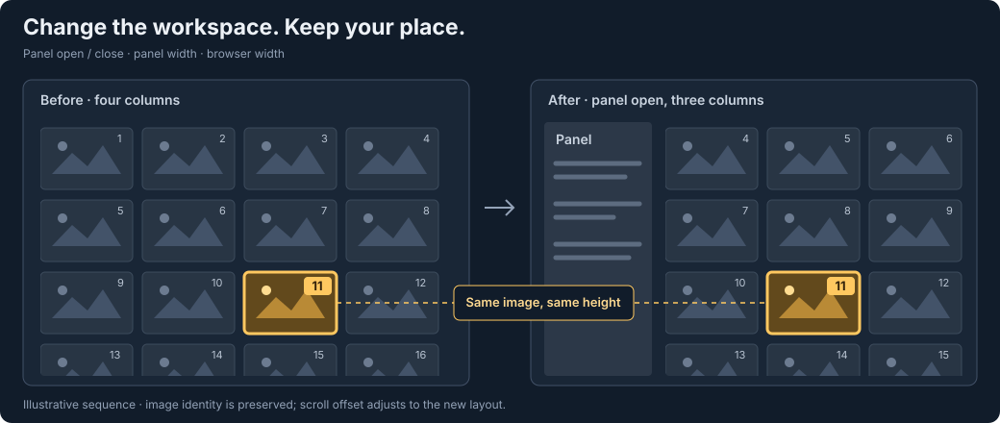
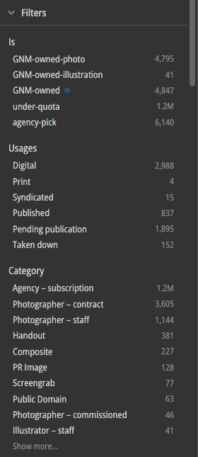
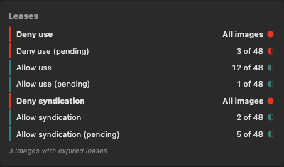
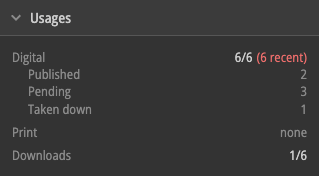

# Kupua vs Kahuna — Feature Inventory

**Current implementation, 20 October 2026.** A product-facing comparison of
API-backed Kupua with Kahuna. Sections and entries put the larger editorial
workflow improvements before supporting controls and polish. Shared capabilities
are identified as such; the final section lists the remaining gaps. Selected
illustrations distinguish actual UI captures from synthetic examples and diagrams.

Kupua is a read-only search-and-browse frontend. Its image-data reads go through
media-api. This inventory describes the implemented application, not a claim that
it is deployed for production users. Deployment and remaining media-delivery work
belong to the [API build plan](<../03 Ce n'est pas une pipe dream/api-build/api-build-00-plan.md>).

## Reading the endpoint annotations

**New endpoints** means the additional media-api routes currently used by Kupua,
not that those routes are intrinsically restricted to Kupua. All eight POST routes
below perform reads. Paths are media-api paths, without the development proxy prefix.

Each feature names its **direct** or **conditional** dependencies. **None** means
that the feature itself needs no new endpoint: fullscreen, for example, is a
browser/UI operation. Loading the image or traversing beyond the loaded buffer is
a separate capability, cross-referenced rather than attributed to fullscreen.
The same distinction applies to table rendering, panel resizing and keyboard controls.

| New endpoint | Responsibility | Main consumers below |
|---|---|---|
| `POST /images/search-after` | Ordered image pages, forward/backward cursor reads, target lookup | Browsing, anchor restoration, traversal |
| `POST /images/window` | Image pages at shallow offsets; start offset must be below 10,000 | Shallow arbitrary-position landing |
| `POST /images/rank` | Exact count before a sort tuple | Landing refinement and anchor positioning |
| `POST /images/sort-profile` | Scalar anchors, date statistics/buckets, keyword pages | Deep-seek estimates and scrubber distributions |
| `POST /images/keys` | Source-free IDs and sort tuples | Indexed position maps and off-buffer selection ranges |
| `POST /images/count` | Total and configured ticker counts | Counts, tickers and new-arrival polling |
| `POST /images/aggregations` | Field buckets and supported filter counts | Facets, dynamic typeahead and collection counts |
| `POST /images/mget` | Batched image lookup by ID | Selection hydration and missing selection metadata |

**Existing routes are not new endpoints:** standalone detail uses `GET /images/:id`;
AI search uses `GET /images` with the new opt-in `aiQuery` contract; AI capability
is discovered through the existing media-api root. Image rendition delivery is
also separate from these eight image-data endpoints.

Sources: [media-api routes](../../../../media-api/conf/routes),
[API datasource](../../../src/dal/api-data-source.ts),
[request/response adapter](../../../src/dal/grid-api-search-adapter.ts).

---

## 1. Browsing large result sets without losing your place

### 1.1 Image-anchored position preservation

**Kahuna:** saves a pixel scroll offset against a URL. That represents a position
in a particular layout, not an image identity; changing the column layout or the
result ordering can change which image occupies that offset.

**Kupua:** preserves an identified image and its placement across supported search,
sort, density and layout transitions. Explicit focus, the selection anchor, the
remembered detail image and the visible centre serve different transition-specific
roles. Grid column reflow captures an anchor before layout and restores it before
paint; panel resizing does not require a server round trip to preserve position.

The rules are deliberate, not universal: ordinary sorting in Click-to-Open mode
without selection clears to the top; query changes can preserve the remembered
detail image or visible centre; history uses the destination entry's anchor.
The benefit is continuity with explicit exceptions, not a promise that every
operation keeps the same image at the same pixel.

**New endpoints:** `POST /images/search-after` for target lookup and around-target
loading after a search/sort change; conditionally `POST /images/rank` for its rank
or `POST /images/keys` for the indexed position map. Pure layout anchoring needs none.

Sources: [focus and position rules](<02-focus-and-position-preservation.md>),
[continuity chooser](../../../src/lib/search-continuity.ts),
[Kahuna scroll restoration](../../../../kahuna/public/js/services/scroll-position.js).

### 1.2 Keep your image in place when panels or the browser resize

**Kahuna:** restoring a saved pixel offset does not compensate for images moving
between rows when the grid changes width.

**Kupua:** opening or closing a panel, dragging its edge, or resizing the browser
can change the grid's column count without losing the image being used as the
position anchor. Reflow captures a resolvable selection anchor, otherwise explicit
focus, otherwise the visible centre image, and restores placement before paint.
It works while simply browsing, without requiring a visible focus ring.

This is image-based continuity through a layout change, not a fresh search. The
new geometry and the top/bottom scroll limits still constrain the final placement;
it is not a guarantee of identical pixels for every possible resize.

*Illustrative before/after diagram, not a recorded app transition. The image's
identity stays fixed while scroll offset compensates for the new layout.*

**New endpoints:** **none** for layout preservation. The anchor and loaded image
positions are already available in the browser. Opening a panel may independently
load its contents, but that is not required to perform the reflow compensation.

Sources: [grid reflow](../../../src/components/ImageGrid.tsx),
[anchor geometry](../../../src/lib/grid-scroll-anchor.ts),
[transition rules](<02-focus-and-position-preservation.md>),
[Kahuna scroll restoration](../../../../kahuna/public/js/services/scroll-position.js).

### 1.3 Adaptive scrubber and arbitrary-position navigation

**Kahuna:** browsing uses the results page's scrolling and search/date controls;
it has no equivalent distribution-labelled seek track.

**Kupua:** the scrubber changes behaviour with result size:

- **Up to 1,000:** a scrollbar over the small result set.
- **1,001–65,000:** global scrolling backed by an ID/cursor position map.
- **Above 65,000:** a seek control; dragging previews the destination and releasing
  requests a landing window.

Ticks represent document-count positions rather than evenly spaced dates. Missing
sort values have a distinct null zone and upload-time labels. Deep seeks use
numeric/date estimates or keyword buckets, then locate the returned window. A deep
landing is approximate; reported ranks and supported coverage boundaries are exact.
Special multi-valued date distributions are approximate evidence, not exact ranks.

**New endpoints:** `POST /images/sort-profile` for distributions and estimates;
`POST /images/keys` for indexed maps; conditionally `POST /images/window` for shallow
landing, `POST /images/search-after` for cursor landing and `POST /images/rank` for
rank refinement. Not every scrubber interaction calls every endpoint.

Sources: [Scrubber](../../../src/components/Scrubber.tsx),
[search store](../../../src/stores/search-store.ts),
[scroll architecture](<03-scroll-architecture.md>),
[Kahuna results](../../../../kahuna/public/js/search/results.html).

### 1.4 Virtualised browsing beyond Kahuna's 100,000-result cap

**Kahuna:** caps the browsable result list at 100,000 and requests pages using
offset/length pagination. Its lazy table renders image-grid cells, not a spreadsheet.

**Kupua:** uses cursor paging and a sliding buffer, normally capped at 1,000 images,
so ordinary browsing does not stop at a fixed result depth. The three navigation
tiers make both sequential browsing and arbitrary-position access practical without
keeping the whole image set in memory or the DOM.

API browsing currently runs **without a PIT**. A frozen upload-time boundary keeps
new uploads out until accepted; it is not snapshot isolation against all subsequent
changes. Index migrations are not supported. AI search has a separate bounded-result
contract (§2.2), not unlimited cursor browsing.

**New endpoints:** `POST /images/search-after` for paging;
`POST /images/window` for shallow offset reads; `POST /images/keys` for the indexed
tier; `POST /images/sort-profile` and `POST /images/rank` when seeking/refining deep
positions. The ordinary offset endpoint is not a deep-pagination replacement.

Sources: [API datasource](../../../src/dal/api-data-source.ts),
[search store](../../../src/stores/search-store.ts),
[Kahuna results controller](../../../../kahuna/public/js/search/results.js),
[Kahuna media-api client](../../../../kahuna/public/js/services/api/media-api.js).

### 1.5 Back, forward and reload restore an image-based destination

**Kahuna:** uses UI-Router's remembered search state, an in-memory search boundary
and the saved pixel scroll offset when returning from its separate image route.

**Kupua:** assigns history entries an identity and stores a destination snapshot
with an image anchor, placement, focus treatment and arrival state. Back/forward
and reload can restore that destination rather than reuse the departing view's
pixel offset. Missing history anchors fall back to the top without focus.

Detail opens as a history entry; returning can keep the laid-out list mounted.
Density is an independent per-tab preference, not something Back changes. Snapshots
are session-local and bounded to 50 entries, not durable cross-device sessions.

**New endpoints:** conditionally `POST /images/search-after` and
`POST /images/rank` when restoring unloaded data; an available map from
`POST /images/keys` can supply positioning. Snapshot storage, history bookkeeping
and resident detail return need no new endpoint.

Sources: [history architecture](<04-browser-history-architecture.md>),
[URL synchronization](../../../src/hooks/useUrlSearchSync.ts),
[Kahuna search states](../../../../kahuna/public/js/search/index.js).

### 1.6 Useful fallback when a query removes the anchor image

**Kahuna:** a changed search starts a new results context; its pixel restoration
is not a search for the old anchor's surviving neighbours.

**Kupua:** eligible ordinary query/filter transitions retain nearby visible image
identities, check which survive the new query and choose the nearest surviving
candidate. This is not the image at the old numerical rank. Without an eligible
survivor, it returns to the first page. Explicit-focus and history transitions have
their own fallback rules rather than always adopting a neighbour.

**New endpoints:** `POST /images/search-after` for target and neighbour checks;
conditionally `POST /images/rank` or a position map from `POST /images/keys` to
position the resolved image, as in §1.1.

Sources: [continuity chooser](../../../src/lib/search-continuity.ts),
[anchor resolution](../../../src/stores/search-store.ts),
[Kahuna search states](../../../../kahuna/public/js/search/index.js).

### 1.7 Velocity-aware loading and stable backward extension

**Kahuna:** configures four preloaded rows in its lazy grid.

**Kupua:** widens forward-loading lookahead from 50 towards 200 images as scrolling
speeds up. When pages are prepended or evicted, viewport compensation keeps existing
content from moving merely because the in-memory window changed. This reduces
loading gaps without claiming that every network or rendering stall is eliminated.

**New endpoints:** `POST /images/search-after` for extending the buffer. Velocity
measurement, virtualisation and viewport compensation are client-side.

Sources: [data window](../../../src/hooks/useDataWindow.ts),
[scroll effects](../../../src/hooks/useScrollEffects.ts),
[Kahuna lazy-grid configuration](../../../../kahuna/public/js/search/results.html).

---

## 2. Search and discovery

### 2.1 Faceted Filters panel with counts

**Kahuna:** provides CQL, fixed toolbar filters and ticker shortcuts, rather than
a general panel listing the values present across aggregatable fields.

**Kupua:** exposes field values and counts in a Filters accordion: credit, source,
category, file type and other supported fields, plus usage and configured predicate
sections. Users can discover the contents of a result set instead of guessing CQL
values. Active and excluded values remain visible even at zero counts.

Fields initially show 10 rows; expansion requests at most 100 buckets, not every
possible value. Aggregations are demand-loaded, with timing and slow-request
circuit-breaker controls. In AI mode the ordinary facet scope is the loaded result
IDs, not the entire eligible AI pool.

*Actual cropped API-backed TEST UI. Counts are examples at capture time, not fixed
product totals. No individual-image metadata or thumbnails are included in this crop.*

**New endpoints:** `POST /images/aggregations`; additionally
`POST /images/count` for configured ticker-backed counts used in filter displays.
The reveal/collapse interaction itself is client-side.

Sources: [FacetFilters](../../../src/components/FacetFilters.tsx),
[search store](../../../src/stores/search-store.ts),
[Kahuna results toolbar](../../../../kahuna/public/js/search/results.html).

### 2.2 Semantic search alongside explicit CQL filtering

**Kahuna:** offers capability-gated AI search through its existing search query
and `useAISearch` mode, including AI preview and pool-count presentation.

**Kupua:** has a separate semantic-query input. CQL and other filters constrain the
eligible pool; semantic text ranks the matches. It publishes up to 200 images,
shows loaded-result and pool totals separately, and can re-sort the loaded set by
relevance or upload time without another AI request. Returning to ordinary search
uses the same continuity machinery as other query transitions.

AI results do not use cursor pagination, position maps or new-arrival polling.
The UI is gated by the server's advertised AI capability. Selecting a collection
leaves AI mode and applies the collection search context.

**New endpoints:** none for AI execution: existing `GET /images` has the **new
opt-in `aiQuery` contract**, with capability discovery through existing `GET /`.
Dynamic facets/typeahead use `POST /images/aggregations` with their respective
scopes (§2.1/2.4); AI pool metadata arrives with the AI response, not a required
separate count read.

Sources: [AI input](../../../src/components/AiSearchInput.tsx),
[AI API adapter](../../../src/dal/grid-api-search-adapter.ts),
[AI contract](../ai-search-catching-up-workplan.md),
[Kahuna AI results](../../../../kahuna/public/js/search/results.js).

### 2.3 Broader primary sorting, including table-header sorting

**Kahuna:** offers five dropdown options: upload date in both directions, taken
date in both directions, and newest added to collection.

**Kupua:** offers 13 ordinary dropdown fields: Uploaded, Taken on, Last modified,
Last used, Added to collection, Image type, Credit, Source, Uploader, Category,
Width, Height and File type. Sortable table headers, including configured alias
columns, provide another entry point to sorting. AI mode restricts enabled sorts
to relevance and upload time.

There is one semantic primary sort, with deterministic fallback ordering.
Shift-clicking a header does not add a second user-selected sort. Where the active
focus/selection policy preserves an image, sorting also invokes §1.1.

**New endpoints:** `POST /images/search-after` for ordinary re-sorted results;
conditionally `POST /images/rank` or `POST /images/keys` for preserved positioning.
Arbitrary navigation within the resulting order uses §1.3's endpoints. Choosing a
header/direction and re-sorting the resident AI set are client-side.

Sources: [field registry](../../../src/lib/field-registry.tsx),
[sort controls](../../../src/components/SearchFilters.tsx),
[ImageTable](../../../src/components/ImageTable.tsx),
[Kahuna sort options](../../../../kahuna/public/js/components/gr-sort-control/gr-sort-control-config.ts).

### 2.4 Contextual CQL typeahead

**Kahuna:** supplies static lists, deployment-configured suggestions and dedicated
service resolvers for selected fields through the shared CQL component.

**Kupua:** uses field-aware aggregation resolvers for dynamic suggestions, with
counts and search-context scoping. Key suggestions do not wait for a network
request; value resolvers run once the field/value input calls for them. Supported
unregistered field paths can also request suggestions. Static lists stay local;
text-only fields without suitable aggregation support do not gain value suggestions.

When editing a field's value, suggestions exclude that field's own query constraint
while retaining the other filters. Editing a credit therefore offers alternative
credits, not just the one already selected. The `is:` choices also carry counts
where supported, including configured ticker-backed predicates, rather than only
a static list of names.

**New endpoints:** `POST /images/aggregations` for dynamic value suggestions and
supported predicate counts; `POST /images/count` supplies ticker-backed counts
reused from the store. Field-name suggestions, static options and local filtering
of returned options need no new endpoint.

Sources: [typeahead fields](../../../src/lib/typeahead-fields.ts),
[lazy typeahead](../../../src/lib/lazy-typeahead.ts),
[Kahuna suggestions](../../../../kahuna/public/js/search/structured-query/query-suggestions.ts).

### 2.5 Counts, ticker shortcuts and controlled new arrivals

**Both:** show result counts, configured ticker shortcuts and an action to reveal
new arrivals. This is a preserved editorial workflow, not a Kupua-only invention.

**Kupua:** separates count/ticker reads from image-page reads. Ordinary browsing
holds an upload-time boundary until the user accepts new arrivals; accepting them
clears selection and refreshes the result context. Tickers can show configured
sub-counts. In AI mode, the loaded-result count, pool count and loaded-set facets
have distinct meanings.

**New endpoints:** `POST /images/count` for ordinary counts, tickers and arrival
polling; `POST /images/search-after` for refreshed ordinary images. AI pool counts
come from existing `GET /images` with `aiQuery`.

Sources: [StatusBar](../../../src/components/StatusBar.tsx),
[search store](../../../src/stores/search-store.ts),
[Kahuna counts and tickers](../../../../kahuna/public/js/search/results.html).

### 2.6 Modifier-click search without contradictory duplicate terms

**Kahuna:** metadata values support click-to-search, Shift to add an inclusion and
Alt to add an exclusion.

**Kupua:** carries modifier-aware metadata searching into supported table cells,
metadata pills and the Filters panel. Shift/Alt-click on a metadata value or
supported table cell updates an existing matching term: opposite polarity is
flipped, and an already-matching inclusion/exclusion is not duplicated. It does
not build a query that both includes and excludes the same value.

Facet controls additionally toggle matching clauses off and support Alt exclusion;
they are not simply links that replace the entire search. This makes the same
field values useful both for reading metadata and refining it.

**New endpoints:** none specific to the click behaviour. Facet values come from
`POST /images/aggregations` (§2.1); the resulting ordinary query loads through
`POST /images/search-after` and the shared browsing paths.

Sources: [metadata search](../../../src/components/metadata-primitives.tsx),
[query-term updates](../../../src/dal/adapters/elasticsearch/cql-query-edit.ts),
[table cells](../../../src/components/ImageTable.tsx),
[facet controls](../../../src/components/FacetFilters.tsx),
[Kahuna metadata](../../../../kahuna/public/js/components/gr-image-metadata/gr-image-metadata.html).

### 2.7 Dots make non-default date filters and sorting visible at a glance

**Kupua:** a small accent dot on the top-bar date control marks an active date
constraint; a dot on the sort control marks a departure from the current
ordinary/AI default. A glance tells you that the results are constrained or ordered
differently, without opening either menu or interpreting every label. The dots
sit on the controls without shifting their layout.

*Actual API-backed TEST toolbar: both controls are non-default. The dots flag
state, not errors or unread notifications.*

For custom date entry, Kupua uses native date inputs with local-date entry and UTC
URL bounds; Kahuna uses Pikaday-backed ranges and text inputs.

**New endpoints:** none specific to these controls. Applying a constraint uses the
ordinary search endpoints; changing a loaded AI sort is local.

Sources: [DateFilter](../../../src/components/DateFilter.tsx),
[SearchFilters](../../../src/components/SearchFilters.tsx),
[Kahuna date range](../../../../kahuna/public/js/components/gu-date-range/gu-date-range.html).

---

## 3. Image detail, mobile browsing and fullscreen

### 3.1 Detail stays inside the search workspace

**Kahuna:** opens image detail on a separate `/images/:id` route.

**Kupua:** opens a route-driven detail overlay while keeping the search list
mounted underneath. Resident images open from the buffer; a standalone link can
load its image independently. Closing detail uses the history/return policy rather
than treating every inspection as a fresh search. A legacy image URL redirects to
the overlay route.

**New endpoints:** none for opening/rendering the overlay. A non-resident image
uses existing `GET /images/:id`. Restoring an unloaded search position is the
conditional browsing dependency in §1.5, not a new detail endpoint.

Sources: [ImageDetail](../../../src/components/ImageDetail.tsx),
[detail return](../../../src/hooks/useReturnFromDetail.ts),
[legacy image route](../../../src/routes/image.tsx),
[Kahuna image view](../../../../kahuna/public/js/image/view.html).

### 3.2 Phone-friendly browsing and portrait inspection

**Kahuna:** its desktop-oriented image page and search controls do not provide
Kupua's integrated phone browsing, swipe traversal and portrait inspection workflow.

**Kupua:** adapts both the layout and the interactions for a phone, rather than
just shrinking the desktop interface:

- **Portrait detail:** the image sits above full-width metadata and Usages in one
  vertical scroll. On wider screens, metadata returns to a side column. The narrow
  layout reserves 55% of the small viewport height for the image, leaving a useful
  route into the information below it.
- **Swipe through the result set:** horizontal touch swipes move between images in
  detail and fullscreen, with the same prefetch and off-buffer traversal as desktop.
- **Return naturally:** swipe down from ordinary detail to return to the grid;
  after traversal, return placement brings the last-viewed image into view.
- **Tap for fullscreen; pinch for detail:** a tap enters fullscreen, where pinch
  zoom and panning support closer inspection. Zoomed panning takes precedence over
  navigation gestures. Detail fullscreen also supports downward swipe to exit when
  unzoomed, rather than requiring desktop keyboard controls.
- **Touch selection:** long-press entry, range chaining and a floating selection
  count/clear control make multi-image work possible without Shift or hover (§5.7).
- **Phone-appropriate input:** touch uses Click-to-Open, not desktop focus and
  double-click. Initial search autofocus is suppressed so the keyboard does not
  cover the results; chip deletion avoids unnecessarily dismissing it (§7.5).

This is a substantially more usable mobile browsing/inspection workflow, not full
desktop feature parity. On small screens the toolbar's free-only/date and sort
controls are hidden to leave room for search. Responsive layout follows viewport
width, while touch-specific behaviour follows coarse-pointer detection.

**New endpoints:** **none** for responsive layout, fullscreen or gesture handling.
Conditionally `POST /images/search-after` loads off-buffer traversal (§3.4);
`POST /images/keys` enumerates off-buffer selection ranges and `POST /images/mget`
loads missing selection metadata (§5.7). A standalone image still uses existing
`GET /images/:id`. There is no separate mobile endpoint.

Sources: [responsive detail and touch fullscreen](../../../src/components/ImageDetail.tsx),
[swipe carousel](../../../src/hooks/useSwipeCarousel.ts),
[swipe dismissal](../../../src/hooks/useSwipeDismiss.ts),
[zoom and pan](../../../src/hooks/usePinchZoom.ts),
[touch selection controls](../../../src/components/SelectionFab.tsx),
[responsive toolbar](../../../src/components/SearchFilters.tsx),
[Kahuna image view](../../../../kahuna/public/js/image/view.html).

### 3.3 Fullscreen peek directly from the list

**Kahuna:** exposes native fullscreen from the image-detail page.

**Kupua:** `f` or middle-click can open a lightweight fullscreen preview directly
from the grid/table, without mounting detail or fetching metadata. A same-URL
history entry lets Back dismiss the preview. It does not introduce a `fullscreen`
search parameter. Detail also has its own fullscreen mode.

While fullscreen and unzoomed, horizontal two-finger trackpad gestures provide
Back/Forward navigation, compensating for Chrome disabling its native history
swipe in fullscreen. This is distinct from touch carousel swipes between images;
when zoomed, horizontal input pans the image instead.

Leaving a preview on its entry image preserves list placement; after traversal,
return placement brings the current image into view. Fullscreen is a presentation
capability; traversal is separate (§3.4).

**New endpoints:** **none**. Browser fullscreen, preview state and dismissal are
client-side. Fetching image bytes is not a new media-api image-data endpoint.

Sources: [FullscreenPreview](../../../src/components/FullscreenPreview.tsx),
[fullscreen trackpad handling](../../../src/hooks/usePinchZoom.ts),
[fullscreen exit](../../../src/lib/fullscreen-exit.ts),
[Kahuna fullscreen](../../../../kahuna/public/js/image/controller.js).

### 3.4 Previous/next traversal with adaptive image prefetch

**Kahuna:** image inspection is organized around individual image routes, not a
shared next/previous traversal window over the search results.

**Kupua:** keyboard and touch traversal share one ordered-result navigator in
detail and fullscreen. Adjacent loaded images are immediately available; approaching
a buffer edge triggers extension. Image prefetch follows direction and cadence:
normal traversal warms nearby images, while rapid bursts use a sparser lookahead
to avoid downloading every image the user passes. Traversal replaces the current
detail history entry rather than adding one per image.

**New endpoints:** conditionally `POST /images/search-after` when traversal extends
beyond loaded results. Resident traversal, image-byte prefetch and history
replacement need no new endpoint. Recovery/position restoration uses §1.5.

Sources: [image traversal](../../../src/hooks/useImageTraversal.ts),
[image prefetch](../../../src/lib/image-prefetch.ts),
[Kahuna image controller](../../../../kahuna/public/js/image/controller.js).

### 3.5 Interactive fullscreen zoom and pan

**Kahuna:** requests image renditions for display, but its image page does not
provide Kupua's combined fullscreen zoom/pan interaction.

**Kupua:** supports pinch, wheel, click/tap and keyboard zoom, with panning and
momentum. Higher-resolution media can be requested as zoom increases. Zoomed
panning takes precedence over swipe traversal, so inspecting a detail does not
accidentally navigate to another image.

**New endpoints:** none. Zoom/pan is client-side; rendition fetching is media
delivery, not one of the new image-data endpoints.

Sources: [zoom hook](../../../src/hooks/usePinchZoom.ts),
[ImageDetail](../../../src/components/ImageDetail.tsx),
[Kahuna image view](../../../../kahuna/public/js/image/view.html).

### 3.6 AVIF image delivery bypasses imgops — with a provisional thumbnail path

**Kahuna:** requests display renditions through Grid's optimised image links,
choosing the separate `optimisedPng` path when that asset is present.

**Kupua:** currently bypasses imgops completely for image display. Its dedicated,
Kupua-configured imgproxy Docker service reads full-size originals from S3, resizes
them and produces AVIF for detail/fullscreen display. AVIF supports transparency,
so this display path does not need separate `optimisedPng` assets or a PNG-specific
rendition branch. This removes Kupua's dependency on those assets, not their use
elsewhere in Grid. The container uses the stock imgproxy image with custom
configuration, rather than a separately maintained image-processing fork.

**Counterpoint:** thumbnails currently come straight from the S3 thumbnail bucket
through Kupua's local S3 proxy, without passing through imgproxy or Grid's canonical
media links. They are not being converted to AVIF by this path. This direct-S3
thumbnail arrangement is a development shortcut and is not expected to survive
canonical media delivery unchanged. The active build plan replaces local `/s3`
and `/imgproxy` delivery with canonical entity links; the current bypass is not a
settled production architecture.

**New endpoints:** none of the eight new media-api endpoints. Image bytes use the
separate `/imgproxy` and `/s3` development services; media-api image-data integration
does not by itself complete media delivery.

Sources: [image URL builders](../../../src/lib/image-urls.ts),
[imgproxy Docker configuration](../../../docker-compose.yml),
[S3 thumbnail proxy](../../../scripts/s3-proxy.mjs),
[Kahuna rendition selection](../../../../kahuna/public/js/imgops/service.js),
[canonical delivery plan](<../03 Ce n'est pas une pipe dream/api-build/api-build-00-plan.md>).

---

## 4. Table, Justified and adaptable workspace

### 4.1 A real metadata table, not only an image grid

**Kahuna:** its lazy table is the virtualisation mechanism for fixed-size image-grid
cells. It is not a row-and-column metadata view.

**Kupua:** offers a virtualised table with one image per row and registry-backed
metadata columns, including dates, credit, rights badges, identifiers and dimensions.
It supports comparing and auditing metadata without opening each image separately.
Table-header sorting is covered in §2.3.

**New endpoints:** none specific to table rendering. It consumes the same loaded
images and browsing infrastructure as the grid (§1.4), not a table-specific endpoint.

Sources: [ImageTable](../../../src/components/ImageTable.tsx),
[field registry](../../../src/lib/field-registry.tsx),
[Kahuna grid template](../../../../kahuna/public/js/search/results.html).

### 4.2 Whole-image Justified rows

**Kahuna:** presents fixed-size image-grid cells, without an equivalent justified
density.

**Kupua:** offers image-only Justified rows that preserve each image's aspect ratio
and adjust thumbnail sizes to the available width. Portrait, landscape and panoramic
images remain uncropped, making composition easier to inspect while browsing.
The layout uses the same windowed results, selection, keyboard navigation and
detail/fullscreen viewers as the other densities, rather than a separate gallery.

**New endpoints:** none specific to packing or rendering the layout. It shares
the existing browsing and seek infrastructure (§1.4).

Sources: [JustifiedGrid](../../../src/components/JustifiedGrid.tsx),
[shared image rendering](../../../src/components/ImageGrid.tsx),
[geometry contracts](component-detail.md#justified-density-componentsjustifiedgridtsx-libwindowed-justified-layoutts),
[Kahuna grid template](../../../../kahuna/public/js/search/results.html).

### 4.3 Switch between table, grid and Justified without abandoning the working position

**Kahuna:** provides a fixed image-grid presentation, without a table/grid/Justified density
preference.

**Kupua:** switches between table, grid and Justified using the shared result buffer and
transition-specific anchoring. The density choice persists across reload in the
same tab but is not part of the URL or a history destination. Detail and fullscreen
provide closer inspection without becoming additional persisted density values.

**New endpoints:** none for switching layout. No new search is required simply
to change density; the shared buffer continues to load normally when needed.

Sources: [UI preferences](../../../src/stores/ui-prefs-store.ts),
[scroll effects](../../../src/hooks/useScrollEffects.ts),
[Kahuna grid template](../../../../kahuna/public/js/search/results.html).

### 4.4 Configurable, resizable and auto-fit table columns

**Kahuna:** has no equivalent metadata table to configure.

**Kupua:** supports column visibility through a header context menu, drag resizing
and double-click auto-fit; a second double-click restores the previous width.
Dragging a resize handle to the horizontal viewport edge auto-scrolls the table
while continuing the resize, rather than stopping at the visible boundary.
Visible columns and widths persist locally. A proxy horizontal scrollbar and
keyboard horizontal scrolling keep wide tables usable.

**New endpoints:** none. Column configuration, sizing and persistence are client-side.

Sources: [ImageTable](../../../src/components/ImageTable.tsx),
[column menu](../../../src/components/ColumnContextMenu.tsx),
[column store](../../../src/stores/column-store.ts).

### 4.5 Resizable panels that stay open while browsing

**Kahuna:** uses fixed-width panels. Visible unlocked panels hide on scroll; locked
panels can participate in layout.

**Kupua:** panels remain open while browsing and occupy layout space rather than
covering the content. Drag handles resize them; widths persist locally. `[` and
`]` toggle the panels, and double-clicking a resize handle closes its panel.
Opening/closing panels and changing their widths preserve the working image
through grid reflow, just as browser resizing does (§1.2).

**New endpoints:** none for panel visibility, resize or anchoring. Opening Filters
may demand-load `POST /images/aggregations` (§2.1); that belongs to its contents,
not the panel shell.

Sources: [PanelLayout](../../../src/components/PanelLayout.tsx),
[panel store](../../../src/stores/panel-store.ts),
[Kahuna panels](../../../../kahuna/public/js/components/gr-panels/gr-panels.js),
[Kahuna panel styles](../../../../kahuna/public/js/components/gr-panels/gr-panels.css).

### 4.6 Choose Click-to-Open or explicit Click-to-Focus

**Kahuna:** ordinary image clicks open detail outside selection mode.

**Kupua:** offers that familiar Click-to-Open interaction and an explicit-focus
mode in which a single click highlights and double-click opens. Focus and selection
are separate concepts. Touch/coarse-pointer use always takes the Click-to-Open
path without overwriting the saved desktop preference.

**New endpoints:** none for the preference or focus affordance. Subsequent
focus-preserving search changes use §1.1's endpoints.

Sources: [SettingsMenu](../../../src/components/SettingsMenu.tsx),
[UI preferences](../../../src/stores/ui-prefs-store.ts),
[Kahuna image preview](../../../../kahuna/public/js/preview/image.html).

### 4.7 Change the image-blur preference without reloading

**Both:** support blurring potentially graphic images.

**Kupua:** changes its persisted preference in the current workspace. Kahuna's
preference service stores a cookie and reloads the page when toggled. This is a
workflow difference, not a claim that content blurring is unique to Kupua.

**New endpoints:** none for the preference or blur rendering; it uses loaded image
data and local state.

Sources: [SettingsMenu](../../../src/components/SettingsMenu.tsx),
[blur rules](../../../src/lib/graphic-image-blur.ts),
[Kahuna blur preference](../../../../kahuna/public/js/services/graphic-image-blur.js).

---

## 5. Multi-image selection

### 5.1 Range selection beyond the loaded image buffer

**Kahuna:** Shift-click takes a slice of `ctrl.images`, its loaded image array.
This is bounded by loaded images, not necessarily just the visible viewport.

**Kupua:** selects directly when both endpoints are in its current buffer; otherwise
it walks ordered IDs/cursors between the endpoints. Off-buffer walks are capped at
5,000 images and report truncation. Request ownership prevents an obsolete range
from changing a newer selection. Desktop Shift-click retains the original anchor.

**New endpoints:** conditionally `POST /images/keys` for off-buffer enumeration and
`POST /images/mget` for missing selected-image metadata. An in-buffer range avoids
the keys walk, but can still need mget: the selection metadata cache is separate
from the search buffer.

Sources: [range selection](../../../src/hooks/useRangeSelection.ts),
[API range walk](../../../src/dal/api-data-source.ts),
[Kahuna Shift-click](../../../../kahuna/public/js/search/results.js).

### 5.2 Selection-wide lease assessment, not just a lease count

**Kahuna:** its multi-image lease view reports aggregate current and inactive lease
counts, without the per-type breakdown available in Kupua.

**Kupua:** shows which selected images have allow-use, deny-use, allow-syndication
or deny-syndication leases, separating active and pending states where applicable.
Each row has an **All images / N of M** indicator and matching allow/deny colour.
Images with expired leases are condensed into a footnote rather than mixed with
future leases under one inactive total.

The breakdown counts images with a lease type, not every lease record, so multiple
leases of the same type on one image do not inflate that row. Activity is evaluated
from start/end dates when rendered. Counts use the selected images whose metadata
has resolved, not an assumption that every pending selected ID has been checked.
This makes the selection's restrictions much easier to assess, without adding lease
editing to Kupua.

*Illustrative 48-image scenario from the existing
[lease UI showcase](<07-lease-ui-showcase.html>),
not a live selection. The filled and partial circles distinguish all from some.*

**New endpoints:** conditionally `POST /images/mget` for missing selection metadata.
Lease classification, per-type counts and presentation are client-side; there is
no new lease-summary endpoint.

Sources: [selection lease summary](../../../src/components/MultiImageMetadata.tsx),
[date-based activity](../../../src/lib/syndication/calculate-syndication-status.ts),
[Kahuna multi-image lease view](../../../../kahuna/public/js/leases/leases.html).

### 5.3 Usages across a selection

**Kahuna:** shows usages for an individual image on its image page, but does not
provide this selection-wide usage summary.

**Kupua:** the selection's Usages section shows:

- How many images have digital and print usages, with publication-status breakdowns.
- How many have recent digital/print usages within seven days.
- How many have syndication or download usages, and how many have no usage records.

These are counts of images, not a sum of usage records. A single image can appear
in more than one platform/status group, so the rows are not mutually exclusive.
Denominators reflect the resolved selected images supplied to the panel while
metadata loads. Editors can assess a group without opening every image's usage tab.

*Actual six-image selection in the API-backed TEST app. These rows count images,
not usage records; an image can contribute to more than one status/platform.*

**New endpoints:** conditionally `POST /images/mget` for unresolved selected images.
The summary aggregates already-loaded usages locally; it needs no new usage-service
or selection-summary endpoint.

Sources: [MultiUsagesSummary](../../../src/components/UsagesSection.tsx),
[selection-panel wiring](../../../src/routes/search.tsx),
[Kahuna individual-image usages](../../../../kahuna/public/js/image/view.html).

### 5.4 Selection-wide metadata with value frequencies

**Kahuna:** already has multi-image metadata presentation and editing, including
indicators for multiple values. Multi-image metadata itself is not a Kupua invention.

**Kupua:** reconciles loaded selection metadata into shared/partial values and
frequency-based lists. Tooltips expose counts; full and partial membership have
different visual treatments. Configured alias fields participate too: for example,
“Do all selected images share the same colour model?” becomes a selection-wide
question the panel can answer. Kahuna confines its Additional Metadata/alias section
to a single image. This helps identify which values dominate a selection, not just
whether the values differ.

**New endpoints:** conditionally `POST /images/mget` when selected-image metadata
is missing. Reconciliation, frequency counts and rendering are client-side, with
no server-side selection-summary endpoint.

Sources: [MultiImageMetadata](../../../src/components/MultiImageMetadata.tsx),
[reconciliation](../../../src/lib/reconcile.ts),
[Kahuna multi-image metadata](../../../../kahuna/public/js/components/gr-image-metadata/gr-image-metadata.js),
[Kahuna Additional Metadata visibility](../../../../kahuna/public/js/components/gr-image-metadata/gr-image-metadata.html).

### 5.5 Selection survives reload and sort, not every new search

**Kahuna:** creates an in-memory ordered selection in the search-results state's
resolve. It does not restore a selection from sessionStorage after reload.

**Kupua:** persists selected IDs and the anchor per tab. Selection survives reload,
user sort-only changes, density changes and ordinary detail open/close. By default,
query/filter navigation and accepting new arrivals clear it. Reload hydration can
remove unavailable IDs only after a complete successful lookup; failed reads keep
membership intact.

**New endpoints:** `POST /images/mget` for reload hydration and reconciliation of
availability. Persisting IDs or retaining selection across a local view change
needs no new endpoint.

Sources: [selection store](../../../src/stores/selection-store.ts),
[navigation policy](../../../src/hooks/useUrlSearchSync.ts),
[Kahuna selection ownership](../../../../kahuna/public/js/search/index.js).

### 5.6 Bounded metadata presentation for large selections

**Kupua:** uses a 5,000-entry metadata LRU and batched lookup. API hydration sends
up to 200 IDs per request with at most four requests in flight. Multi-value chip
fields initially render 20 frequency-ordered values, with explicit expansion.

Full reconciliation is coalesced into an idle callback, not divided into incremental
scan chunks. Large explicit expansions and full recomputation can still be costly;
cached metadata can cover only part of the selected IDs. The cache and range-walk
limits do not establish a maximum selection size or a comparative speed multiplier.

**New endpoints:** `POST /images/mget` for missing metadata. The cache, reconciliation
scheduling and reveal/collapse controls are client-side; expansion does not itself
fetch more image metadata.

Sources: [selection store](../../../src/stores/selection-store.ts),
[API bulk lookup](../../../src/dal/grid-api-search-adapter.ts),
[MultiImageMetadata](../../../src/components/MultiImageMetadata.tsx),
[reconciliation](../../../src/lib/reconcile.ts).

### 5.7 Touch long-press selection and range chaining

**Kahuna:** its search-selection controls use tickboxes and click/Shift-click.

**Kupua:** long-press enters selection or extends a range from the current anchor;
the touched endpoint becomes the next anchor. Long-pressing the selected anchor
does not deselect it. Tickboxes remain immediate, and touch users get a floating
selection count/clear control. Movement cancels an uncommitted long-press so that
scrolling is not mistaken for selection.

**New endpoints:** none for the gesture or selection controls; conditionally
`POST /images/keys` for off-buffer range enumeration and `POST /images/mget`
whenever selected-image metadata is uncached, including on-screen selections (§5.1).

Sources: [long-press detection](../../../src/hooks/useLongPress.ts),
[touch selection policy](../../../src/lib/handleLongPressStart.ts),
[SelectionFab](../../../src/components/SelectionFab.tsx),
[Kahuna selection controls](../../../../kahuna/public/js/search/results.html).

---

## 6. Collections and metadata

### 6.1 Collection-tree counts

**Kahuna:** presents the collection hierarchy without Kupua's subtree-count display.

**Kupua:** adds counts built from a `collections.pathId` aggregation. The tree itself
comes from the existing collections service. Counts use the default free/deleted/
replaced scope, not the current search, and sum path contributions: an image in
multiple descendant paths can be counted more than once in a parent. They are
orientation counts, not distinct-image cardinalities for every subtree.

**New endpoints:** `POST /images/aggregations` for counts. Fetching and rendering
the collection tree needs no new media-api endpoint.

Sources: [collection store](../../../src/stores/collection-store.ts),
[CollectionTree](../../../src/components/CollectionTree.tsx),
[collection semantics](<06-collections.md>).

### 6.2 Collection sorting with previous-sort memory

**Kahuna:** has a collection sort option and control logic that resets to the default
when a collection query is removed. It is not simply stuck on collection sort.

**Kupua:** entering a collection remembers the prior ordinary sort, leaves AI mode
and selects newest-added-to-collection in the same parameter transition. Leaving
the collection restores the remembered sort if collection sort is still active;
a deliberate intervening sort is not blindly overwritten.

**New endpoints:** none for the context memory or atomic parameter change.
The resulting ordinary search uses `POST /images/search-after`; preserved-position
work can use `POST /images/rank` or `POST /images/keys` (§1.1).

Sources: [search context transitions](../../../src/lib/search-params-schema.ts),
[Kahuna collection-sort control](../../../../kahuna/public/js/components/gr-sort-control/gr-sort-control.tsx).

### 6.3 Single-image leases distinguish active, pending and expired

**Kahuna:** lists individual leases in their supplied order and uses an active/
inactive distinction for presentation.

**Kupua:** orders use leases before syndication, deny before allow, then active,
pending and expired within each type. Future leases remain legible and explicitly
labelled pending, with “Starts in…” wording; expired leases are dimmed. Active
leases emphasize expiry rather than a past start date.

Tooltips include the relevant exact start/expiry timestamp alongside who created
the lease and when. State is calculated from the start/end dates when rendered,
rather than trusting the indexed active flag. This improves the lease cards; it
does not override server-supplied cost, validity or syndication status (§6.7).
The complementary multi-image assessment is in §5.2.

**New endpoints:** none specific to the lease display. Lease data arrives with the
image; standalone detail uses existing `GET /images/:id`. A selected image missing
from the selection metadata cache can require `POST /images/mget`.

Sources: [single-image lease cards](../../../src/components/ImageMetadata.tsx),
[date-based activity](../../../src/lib/syndication/calculate-syndication-status.ts),
[Kahuna lease cards](../../../../kahuna/public/js/leases/leases.html).

### 6.4 Promoted and consistently formatted metadata

**Kahuna:** distributes metadata between explicit panel sections and Additional
Metadata, including deployment-configured aliases.

**Kupua:** uses one registry for table columns and metadata presentation, with shared
accessors, formatting and search behaviour. Byline title, source and supplier
reference have explicit placements rather than relying on a generic additional-data
accordion. Visibility/empty-field rules still apply; not every registered field is
shown everywhere.

**New endpoints:** none specific to presentation. Fields arrive with the image;
standalone detail uses existing `GET /images/:id`, and selection loading uses
`POST /images/mget` (§5.4).

Sources: [field registry](../../../src/lib/field-registry.tsx),
[ImageMetadata](../../../src/components/ImageMetadata.tsx),
[Kahuna metadata template](../../../../kahuna/public/js/components/gr-image-metadata/gr-image-metadata.html).

### 6.5 Individual usage history inside the search workspace

**Both:** expose individual-image usage history. Kahuna presents it on the image
page; Kupua also makes it available for the focused/selected image in the search
workspace. Kupua does not replace Grid's usage-writing workflows.

**Kupua:** groups supplied usages by status, orders them newest first and renders
platform indicators, dates and supported reference links. Presentation uses
already-loaded data rather than independently polling a usage service. The separate
selection-wide summary (§5.3) is a Kupua addition, not shared Kahuna functionality.

**New endpoints:** none specific to usage rendering. Missing selection images may
require `POST /images/mget`; ordinary/standalone image loading supplies their usages.

Sources: [UsagesSection](../../../src/components/UsagesSection.tsx),
[component ownership](<component-detail.md#usages-componentsusagessectiontsx>),
[Kahuna image view](../../../../kahuna/public/js/image/view.html).

### 6.6 Deleted-image visibility and a who/when banner

**Both:** default ordinary searches suppress deleted images. Kupua's new ordinary
read routes apply the server's deleted-search uploader restriction. Typing
`is:deleted` does not itself grant broader access. Existing-route differences are
tracked in the [bug backlog](../bug-backlog.md), not treated as universal parity.

**Kupua:** when a returned image includes deletion metadata, displays a dedicated
banner with who deleted it and a relative time, with the absolute time on hover.
Automatic reaping has a readable label. Deletion replaces other invalidity bullets;
restrictions remain independently visible. Kahuna's validity banner uses its generic
deleted/unusable message rather than this who/when presentation.

**New endpoints:** none specific to the banner. Deleted-search authorization applies
to the new read routes through their shared server policy; selecting `is:deleted`
is not a separate endpoint or a client-side permission bypass.

Sources: [ImageMetadata](../../../src/components/ImageMetadata.tsx),
[shared query controller](../../../../media-api/app/controllers/ImageQueryController.scala),
[Kahuna validity banner](../../../../kahuna/public/js/components/gr-metadata-validity/gr-metadata-validity.html).

### 6.7 Server-authoritative cost, validity and syndication presentation

**Both:** use media-api's derived image fields for rights-related presentation.

**Kupua:** server-supplied cost, validity, invalid reasons and syndication status
win when present; missing fields use local fallback derivation. Selection bulk
lookup does not publish enrichment, so selection summaries can use those fallbacks.
Local date-based lease classification does not override an available server status.

Accepted AI results replace the enrichment map with their own response's data;
they do not retain an earlier ordinary result's overlay. Selection hydration has
separate ownership and does not provide the same enrichment guarantee. Display
labels are not the authority for server search eligibility or actions, and local
lease calculation is not an unconditional correction to server syndication status.

**New endpoints:** no separate enrichment endpoint. Ordinary page enrichment arrives
through `POST /images/search-after` or `POST /images/window`; existing `GET /images`
with `aiQuery` and `GET /images/:id` supply AI/detail enrichment respectively.
`POST /images/mget` supplies selection images without publishing enrichment.

Sources: [image derivation](../../../src/lib/derive-enriched-image.ts),
[response adapter](../../../src/dal/grid-api-search-adapter.ts),
[enrichment ownership](<component-detail.md#enrichment-system-libcost-storesenrichment-storets-libderive-enriched-imagets>).

---

## 7. Keyboard, links and interaction polish

### 7.1 Navigate results without leaving the search box

**Kahuna:** supports arrow/page navigation from inputs, but its result Home/End
shortcuts do not have the same input allowance.

**Kupua:** propagates vertical arrows, Page Up/Down and Home/End from the search
editors to list navigation while retaining horizontal arrows for text editing.
Registered single-character actions use Alt while editing: for example Alt+f and
Alt+[ / Alt+]. Outside an editable field, their bare-key forms also work.

**New endpoints:** none for key handling. Navigating to unloaded data can use
`POST /images/search-after`, `POST /images/window`, `POST /images/keys`,
`POST /images/sort-profile` or `POST /images/rank` according to §1.3's landing path;
opening fullscreen or toggling a panel does not.

Sources: [keyboard navigation](<keyboard-navigation.md>),
[shortcut registry](../../../src/lib/keyboard-shortcuts.ts),
[Kahuna shortcuts](../../../../kahuna/public/js/components/gu-lazy-table-shortcuts/gu-lazy-table-shortcuts.js).

### 7.2 Page navigation based on visible rows

**Kahuna:** page scrolling snaps from the current row offset and steps by a page.

**Kupua:** page movement uses visible-row geometry to avoid skipping a partly seen
row or needlessly repeating fully seen rows. Explicit focus changes keyboard
navigation from scroll-only to focus movement; an active selection suppresses that
hidden focus behaviour. Table horizontal movement remains separate.

**New endpoints:** none for page geometry or focus policy. If the destination is
not loaded, it uses the same conditional browsing endpoints listed in §7.1.

Sources: [list navigation](../../../src/hooks/useListNavigation.ts),
[page-navigation rules](<keyboard-navigation.md>),
[Kahuna shortcuts](../../../../kahuna/public/js/components/gu-lazy-table-shortcuts/gu-lazy-table-shortcuts.js).

### 7.3 Shared URL vocabulary and legacy image links

**Kahuna:** represents searches in URL parameters and individual images at
`/images/:id`.

**Kupua:** retains the shared search-parameter vocabulary and redirects legacy
image URLs to its search detail overlay. A schema and context canonicalization
control accepted parameters and supported sorts. Pagination and density are not
shareable URL state; AI has its own separate semantic-query contract.

This is not byte-for-byte compatibility with every Kahuna bookmark: unsupported
sort tokens normalize to a supported default, and common parameter names alone do
not promise identical behaviour for every combination.

**New endpoints:** none for URL parsing or redirection. Destination loading uses
ordinary browsing, existing `GET /images/:id`, or the existing AI route as appropriate.

Sources: [URL schema](../../../src/lib/search-params-schema.ts),
[legacy image route](../../../src/routes/image.tsx),
[Kahuna search parameters](../../../../kahuna/public/js/search/index.js).

### 7.4 Useful history entries rather than one entry per edit or image

**Kupua:** a typing session pushes an entry preserving the predecessor, then
settled CQL/AI edits replace that entry. Discrete changes such as a filter, sort or
detail open push; traversal replaces; panel state and density do not enter history.
This makes Back useful without making users retrace every keystroke or every image
in a long traversal. Kahuna's search navigation is organized around state transitions,
rather than this shared typing-session and overlay policy.

**New endpoints:** none for history-entry policy. Restoring unloaded destinations
has the conditional dependencies in §1.5.

Sources: [history rules](<04-browser-history-architecture.md>),
[SearchBar](../../../src/components/SearchBar.tsx),
[Kahuna search transitions](../../../../kahuna/public/js/search/results.js).

### 7.5 Preserve editor position and avoid unwanted mobile autofocus

**Kupua:** preserves the CQL editor selection around tab/window switching, avoids
autofocus on touch devices and already-open detail, and handles touch chip deletion
without unnecessarily dismissing the keyboard. Kahuna's CQL wrapper sets autofocus
on its input and does not implement these Kupua-specific editor lifecycle hooks.

**New endpoints:** none. These are local editor/focus behaviours; value suggestions
have the separate dependency in §2.4.

Sources: [CqlSearchInput](../../../src/components/CqlSearchInput.tsx),
[Kahuna CQL wrapper](../../../../kahuna/public/js/components/gr-cql-input/gr-cql-input.ts).

### 7.6 Feedback for seeking and arriving images

**Both:** show loading/new-arrival state. Kupua adds targeted presentation: a status
pulse while finding/positioning an image, a scrubber loading indicator, and an
arrival animation distinguishing newly accepted images from existing results.
These communicate ongoing work; a flash at position zero is not a required or
advertised part of the interaction.

**New endpoints:** none for animation. The work being signalled uses the positioning
endpoints in §1.1/1.3 and the count/refresh endpoints in §2.5.

Sources: [StatusBar](../../../src/components/StatusBar.tsx),
[Scrubber](../../../src/components/Scrubber.tsx),
[styles](../../../src/index.css),
[Kahuna loading/arrival UI](../../../../kahuna/public/js/search/results.html).

---

## 8. Remaining gaps and boundaries

Kupua remains read-only. These gaps matter when considering it as a full Kahuna
replacement.

**New endpoints:** no dependency is assigned to an unimplemented feature; the
routes above implement browsing reads, not these missing workflows.

### 8.1 Metadata and usage-rights editing

Kahuna edits image metadata and usage rights. Kupua displays them but does not wire
editing actions. Receiving an action descriptor or showing a rights label does not
make it an editor or grant write permission.

Sources: [Kupua metadata](../../../src/components/ImageMetadata.tsx),
[Kahuna metadata editor](../../../../kahuna/public/js/components/gr-image-metadata/gr-image-metadata.html),
[Kahuna rights editor](../../../../kahuna/public/js/usage-rights/usage-rights-editor.html).

### 8.2 Upload and crop/export workflows

Kahuna provides upload and crop workflows. Kupua does not upload images or provide
a crop/image-operations editor. Its image-inspection zoom is not an editing tool.

Sources: [Kahuna upload](../../../../kahuna/public/js/upload),
[Kahuna crop](../../../../kahuna/public/js/crop),
[Kupua detail](../../../src/components/ImageDetail.tsx).

### 8.3 Bulk actions, downloads and sharing selections

Kahuna's selection toolbar provides actions including archive, delete/undelete,
download, export and selection URL sharing. Kupua's selection work is membership,
browsing and metadata inspection; it does not provide those corresponding action
workflows. Downloads are a gap even though they are not themselves metadata writes.

Sources: [Kahuna toolbar](../../../../kahuna/public/js/search/results.html),
[Kupua selection controls](../../../src/components/StatusBar.tsx),
[selection guide](<05-selections.md>).

### 8.4 More Like This

Kahuna includes similar-image discovery. Kupua has text-based semantic search,
but the shared More Like This contract/client work remains deferred. AI search
should not be described as absent, nor as already supplying image-to-image discovery.

Sources: [AI workplan](../ai-search-catching-up-workplan.md),
[Kahuna discovery integration](../../../../kahuna/public/js/search/results.js).

### 8.5 Runtime configuration, permission-aware UI and production delivery

Kupua sends authenticated reads through Grid. The new ordinary read routes enforce
tier and deleted-search restrictions; this does not resolve every existing-route
query or visibility discrepancy tracked in the [bug backlog](../bug-backlog.md).
Kupua still uses local/vendored client configuration rather than Kahuna's full
runtime-configured UI. AI capability discovery is implemented, not a general config
or permission service.

Permanent hosting/ingress and canonical image delivery remain separate work.
The API-backed prototype still uses the imgops-bypassing imgproxy/AVIF pipeline
and provisional direct-S3 thumbnail path described in §3.6. Replacing image-data
reads does not finish deployment, signed-rendition renewal or downloads.

Sources: [client configuration](../../../src/lib/grid-config.ts),
[API ownership](<component-detail.md#grid-api-adapter-dalgrid-api-dalgrid-api-search-adapterts>),
[API build plan](<../03 Ce n'est pas une pipe dream/api-build/api-build-00-plan.md>).

### 8.6 Help and deployment-specific workflows

Kahuna includes search-syntax and keyboard-help surfaces, configurable usage-rights
help, and deployment-specific features such as BBC rights presentation and Photo
Sales dispatch. Kupua does not yet provide equivalent integrated help and
organization-specific workflows. Their absence is separate from search/browse parity.

Sources: [Kahuna syntax help](../../../../kahuna/public/js/search/syntax/syntax.html),
[Kahuna components](../../../../kahuna/public/js/components),
[Kahuna toolbar](../../../../kahuna/public/js/search/results.html).
