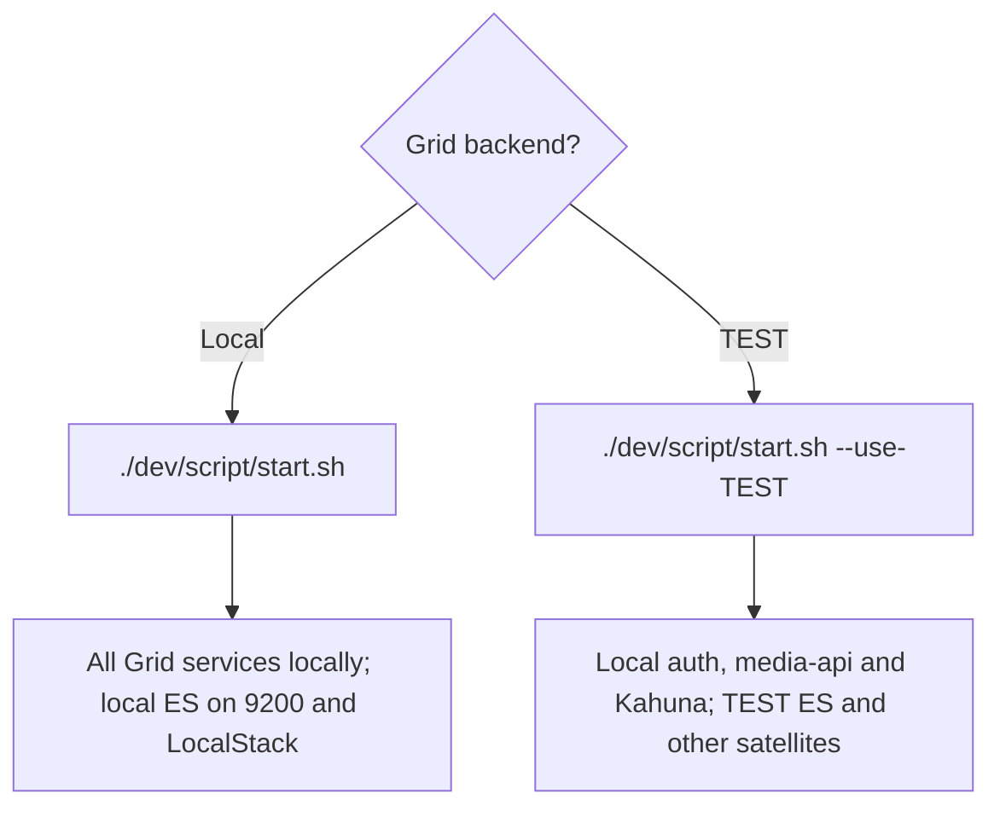
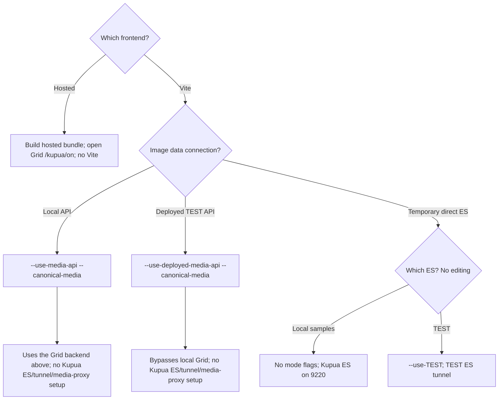

# Deployed via Kahuna

How Kupua runs when Kahuna serves it, and where every piece of server-owned data comes from.
The startup map below separates Grid's backend choices from Kupua's frontend and
image-delivery choices. The implementation sections describe the current state.

## Data-mode policy

Hosted Kupua is the future application and always uses media-api, never the
direct-Elasticsearch datasource or direct ES requests. API failure, empty results
or missing/invalid hosted configuration must not select ES. Direct-ES remains
temporary laptop support intended for eventual removal under separate authorization;
it is not an alternative hosted architecture.

Failure must not crash the shell, but required API data is not optional enrichment
over an ES baseline. Distinguish failed requests from successful empty results and
show an appropriate unavailable/error state at the owning UI. Genuinely optional
enrichment may be omitted. Do not build alternate data paths or retry machinery
merely to conceal API failure. Existing display defaults and calculations on
already-returned fields are not datasource fallback.

## Serving and configuration

### Frontend bundle versus server settings

- `npm --prefix kupua run build:hosted` builds with `VITE_HOSTED=true` and
  `VITE_USE_MEDIA_API=true` into `kahuna/public/kupua`, with settings only from
  `hosted/.env.hosted` ([vite.config.ts](../../../vite.config.ts)).
- Kahuna serves that page to users who opted in: `/kupua/on` sets the cookie, `/kupua/off`
  clears it and returns to Kahuna ([KahunaController.scala](../../../../kahuna/app/controllers/KahunaController.scala)).
  The page carries its own Content Security Policy.

Local Kahuna serves the last hosted bundle built from the local checkout, including
any uncommitted source at build time. It does not use Vite or the normal `kupua/dist`
output. The built page is reread per request, so a hosted rebuild followed by browser
reload does not require restarting local Grid. Grid's no-flags/`--use-TEST` choice
selects backing services, not a different frontend bundle. Remote hosting serves the
bundle packaged in the deployed artifact; pushing source alone does not update it.

The hosted build's env file supplies build-time settings, not editing rollout policy.
Kahuna supplies the initial API address and site settings, not editing gates or satellite
addresses. `/kupua/on`, building the bundle and choosing a TEST data source do not
themselves enable editing.

### Startup decision map

Commands below are written from the repository root. The two `start.sh` scripts are
different programs; their identically named `--use-TEST` flags are not interchangeable.

**Grid chooses the services and backing resources. Kupua chooses how the frontend
connects and how images are delivered.** First choose a Grid mode if you need local
Grid, then a frontend. These examples do not authorize shared-environment work.

#### 1. Choose Grid's backend

**Data-loss warning:** Grid's TEST branch runs `docker compose down`. The current
Grid ES container has no persistent data mount, so this can discard the local index
without `--clean`; see [GRID-021](../bug-backlog.md#grid-021). The local branch stops
matching TEST tunnel processes and starts Docker Compose. Neither branch repairs
missing LocalStack resources: that belongs to
[Grid setup](../../../../docs/01-setup/03-running-setup.md), which regenerates local
configuration. Preserve custom settings before rerunning setup.

#### 2. Choose Kupua's frontend

The API examples above use **canonical media**: image URLs returned by media-api.
Omitting `--canonical-media` selects legacy local delivery proxies and TEST setup.
Kupua's `--use-TEST` cannot be combined with either API selector; Grid's own launcher
independently chooses the local API's backend. Both API modes with canonical media
skip Docker, ES discovery, tunnels and media proxies. Both canonical API paths still
load TEST site settings from S3 before Vite serves the application.
Legacy API proxy delivery assumes TEST images; use canonical media for an all-local corpus.

The diagrams show the simplest paths. The table includes the legacy variants:

| Command | What it starts or selects | Effect on Kupua |
|---|---|---|
| `./dev/script/start.sh` | Grid's local services and local dependencies | Kahuna can serve the existing hosted bundle after `/kupua/on`; no Kupua Vite server is needed. |
| `./dev/script/start.sh --use-TEST` | Local Grid services configured against TEST backing services; downloads media-api and Kahuna TEST configuration | Kahuna still serves the locally built Kupua bundle, but its API/data and effective server settings come from this Grid setup. |
| `./kupua/scripts/start.sh --use-media-api --canonical-media` | Kupua's Vite server, reading the already-running local Grid API and its returned media URLs | Does not select or change Grid's backing data and skips Kupua ES/tunnel/media-proxy setup. |
| `./kupua/scripts/start.sh --use-media-api` | Kupua's Vite server and legacy TEST discovery/setup for its media proxies | Reads the already-running local Grid API; the TEST setup does not reconfigure that Grid API. |
| `./kupua/scripts/start.sh --use-deployed-media-api --canonical-media` | Kupua's Vite server reading deployed TEST media-api directly, with returned media URLs and TEST S3 settings | No local Grid, Docker, ES discovery, tunnel or media proxy setup; omitting `--canonical-media` retains legacy setup. |
| `./kupua/scripts/start.sh --use-deployed-media-api` | Same deployed TEST API, with legacy TEST setup and local media proxies | Not the local-API path; live verification of this transport change is pending. |
| `./kupua/scripts/start.sh` | Kupua's sample ES, normally port 9220, separate from Grid's local ES on 9200 | Temporary direct-ES path; no editing. |
| `./kupua/scripts/start.sh --use-TEST` | Kupua's direct-Elasticsearch TEST mode | Not an API-mode editing topology; direct-ES editing is unavailable. |

Source: [Grid launcher](../../../../dev/script/start.sh) and
[Kupua launcher](../../../scripts/start.sh). Starting Grid against shared backing
services requires separate authorization; these examples do not grant it.

#### Every recognized start flag

The mode choices above compose with the modifiers below. These are the flags the
two start scripts recognize, not setup flags or every environment/config setting.

| Grid flag (`./dev/script/start.sh`) | Meaning |
|---|---|
| `--use-TEST` | Stop local Compose services; open/reuse TEST ES tunnel; download TEST API/Kahuna config; run local auth/API/Kahuna only (`runMinimal`). Without it, use local dependencies and `runAll`. |
| `--with-local-auth` | Skip the AWS credential precheck for an already configured local-auth setup. |
| `--no-auth` | Also skips that precheck. The launcher does not itself disable auth or rewrite its provider; generated configuration owns that. |
| `--debug` | Enable JVM debugging on port 5005. |
| `--ship-logs` | Set `LOCAL_LOG_SHIPPING=true`. |

Auth flags do not choose a data environment or grant TEST access. Grid's launcher
does not validate unknown arguments or use a positional service name to choose apps;
its mode chooses the [sbt service group](../../../../build.sbt#L82).

| Kupua flag (`./kupua/scripts/start.sh`) | Meaning |
|---|---|
| `--use-media-api` | Use the already-running local API. Without canonical media, also enter legacy TEST startup setup. |
| `--use-deployed-media-api` | Use deployed TEST media-api; legacy TEST setup only without canonical media. |
| `--use-TEST` | Select temporary direct-TEST ES mode; cannot combine with an API selector. Does not reconfigure local Grid. |
| `--canonical-media` | API modes only: use returned media URLs instead of local S3/imgproxy delivery. |
| `--skip-es` | In default local direct-ES mode, skip ES startup/wait and sample-data checking. Does not skip the TEST setup branch. |
| `--skip-data` | Skip local sample-data loading, not TEST discovery or other infrastructure setup. |
| `--skip-install` | Skip dependency installation/checks, not infrastructure setup. |

**Combination rules:** the two API selectors are mutually exclusive. Canonical
media without an API selector is rejected. Explicit `--use-TEST` with either API selector
is rejected before side effects. API modes without canonical media retain legacy TEST
media setup internally, without changing the selected image-data API. Canonical API paths omit ES/sample setup,
so `--skip-es` and `--skip-data` add nothing there. Use canonical media, not those skip
flags, to avoid deployed-API tunnel setup. Unknown Kupua flags are rejected; `--media-api` and
`--deployed-media-api` are not accepted spellings.

#### Login and verification are separate choices

Follow the [service transport rules](#local-test-and-hosted-service-transport): local
metadata/auth use local proxies; exact allowlisted TEST origins use direct requests
with TEST-scoped browser cookies. Hosted uses its discovered addresses directly.
Changing data or media-delivery flags does not enable editing: Joshua's startup
preference, image capabilities and server authorization still apply. New metadata
controls remain preparation-only; connecting a different service needs its own checks.

Operator checks observed successful local-API label addition with both all-local Grid
and Grid's mixed TEST setup. The all-local retest after the direct-TEST change returned
acknowledgement and canonical observation after corpus replenishment. These checks do
not measure latency or establish every mutation workflow. Synthetic fixtures cover transport and cookie
handling, not every deployment or capacity. **Deployed-media-api remains live-unverified
for this transport change**, with or without canonical media; a commit is not evidence
that it was exercised. Legacy setup combinations are source-described, not newly certified.

### Editing support by frontend

This table describes implemented code support, **not enablement or live verification**.
Supported label editing captures one label and up to 100 images per submission, requires
the temporary startup preference and valid service discovery, and remains subject to image capabilities and server
authorization. Thumbnail/full-image delivery does not change operation support.

The actual API-mode single/multi metadata panels also expose the ordinary text/date,
Location, People, Keywords, Photoshoot and collection-membership controls described in
the [UI register](../gradually-growing-teeth.kupua-edits-steps.md#ordinary-metadata-ui-coverage).
These new controls prepare explicit **Not sent** intents only; enabling the startup
preference does not connect their saves. Their preparation is independent of that
preference and is not a grant of mutation authority. Only Labels currently uses the
existing connected command path. Archive/unarchive, configured-domain editors and
other workflow families retain their separately selected roadmap work.

| Frontend path | Add label | Remove label | Enablement source |
|---|---|---|---|
| Vite with `./kupua/scripts/start.sh --use-media-api`, with or without `--canonical-media`; local Grid may use local or TEST backing data | Code-supported | Code-supported | Saved origin-scoped startup preference |
| Vite with `./kupua/scripts/start.sh --use-deployed-media-api`, with or without `--canonical-media` | Code-supported | Code-supported | Same preference; real cross-origin deployment remains unverified |
| Kahuna-hosted `/kupua/on`, local Grid or deployed DEV/TEST | Code-supported | Code-supported | Same preference, no Kahuna editing configuration |
| Direct-ES, including `./kupua/scripts/start.sh --use-TEST` alone | Unavailable | Unavailable | No editing enablement in this mode |

Kahuna's current opt-in is limited to DEV/TEST and excludes iframe pickers; this table
does not extend those stage boundaries. The real operator add/remove trial used Vite
with local Grid. Compiled-hosted fixtures and the actual Kahuna configuration producer
have regression coverage; real Kahuna-hosted and shared TEST editing remain separate
verification/authorization boundaries, not claims established by the local trial.

### Editing preference and service discovery

Settings > **Hi, Joshua**, with the Material Vaping Rooms icon, and Shift+F12 open one
temporary **Allow editing** checkbox. **Apply and reload** saves `kupua-allow-editing`
in localStorage and reloads. Missing, malformed or inaccessible storage is off. The
preference is captured at startup, not rechecked as a live switch. Other same-origin
tabs pick it up on their next reload; different frontend origins are independent.
`/kupua/on` is a path, not another storage area. Changing backing data at an unchanged
frontend origin retains the preference. Drafts and receipts survive SPA navigation,
not reloads. No automatic replay or durable operation system is introduced.

This is temporary, removable scaffolding. The eventual API-backed app has editing
available according to server permissions and resource capabilities, with no rollout
switch. Direct-ES remains read-only while retained. Former env, per-operation, bulk and
Kahuna mutation gates are removed, not layered beneath this preference.

Media-api's existing root directory is read once per page and retained in memory,
including failure. Its `edits` relation supplies metadata-editor's service origin;
`session` supplies the exact auth `/session` URL. Reload picks up changed addresses.
There is no per-edit rediscovery, polling, localStorage address cache or guessed host.
Service discovery is not permission: every mutation still needs the captured image's
own edits resource and exact advertised label resource, plus server authorization.
Missing/invalid discovery leaves the dependent action unavailable, never selecting ES.

#### Local, TEST and hosted service transport

The advertised address selects each service's transport independently. Kupua's API
mode flag identifies media-api, not the location of every satellite or its backing
Elasticsearch. In particular, local Grid started with `--use-TEST` can advertise TEST
metadata-editor while auth remains local; guessing one shared domain suffix is wrong.

| Frontend and advertised service | Metadata/auth transport |
|---|---|
| Vite; exact allowlisted local service origin | Fixed local Vite proxy. |
| Vite; exact allowlisted TEST service origin | Direct credentialed browser request to TEST. |
| Vite; explicitly configured custom service origin | Matching fixed custom Vite proxy. |
| Hosted Kupua | Direct requests to validated discovered origins, unchanged by the laptop routing choice. |
| Direct-ES mode | No editing; no satellite proxies registered. |

The distinction matters for login cookies. A TEST-scoped cookie accompanies requests
to TEST, not requests to a local-origin Vite proxy. Signing into TEST in the same
browser does not make that cookie available to the local proxy. Direct TEST requests
let the browser attach the appropriate cookie normally; Kupua neither copies cookies
between environments nor acquires credentials for Vite. Local services retain local
authentication and proxy transport.

Direct requests also require the destination service to permit the frontend origin
through CORS, including credentials and the required methods/headers. Grid's effective
allowlist comes from `security.cors.allowedOrigins`; changing a local configuration
does not change a deployed TEST service's policy. TEST metadata-editor already permits
`https://kupua.media.local.dev-gutools.co.uk`: credentialed direct GET and POST/DELETE
preflight checks establish that no additional CORS configuration is needed for this
origin on that service. They do not establish mutation permission or successful writes,
and must not be generalized to other services. Normal TEST login is still required.

Service routing needs no unauthenticated startup directory request, ES lookup or SSH
tunnel. Optional `VITE_GRID_METADATA_ORIGIN` and `VITE_GRID_AUTH_ORIGIN` remain explicit
custom routing settings, not rollout switches. Known local/TEST destinations need no
manual settings. Reloading the page picks up changed advertised addresses without
restarting Vite; changing Vite's proxy configuration itself requires a restart.

Vite admits only supported exact method/path shapes for proxied traffic, never an
arbitrary request-supplied upstream URL. Direct TEST requests do not pass through
Vite's guard: command/resource validation, redirect refusal and server authorization
still apply. Transport selection is implemented in
[proxy-target.ts](../../../src/dal/grid-api/proxy-target.ts); the
[API contract](../../../src/dal/grid-api/README.md#step-2-command-boundary) owns the
detailed validation and command outcomes.

This command router currently covers metadata-editor and auth, not every Grid
service. Collections has a separate credentialed read path: Vite API mode follows
media-api's advertised `collections` link, while hosted builds retain Kahuna's injected
address. Neither uses a laptop collections override or falls back to another service
when discovery fails. Local direct-ES uses localhost:9010; direct-TEST has no tree.
Collection-count caching remains per tab and rights scope, but resets when the resolved
Collections service address changes. Unchanged addresses retain cached empty and
nonempty results; replacing an index behind the same addresses is not detected. See
the [Collections guide](06-collections.md#4-store-shape-collection-storets) for cache
identity, request coordination and a targeted development reset. Cropper remains a
dry-run editor that prepares but does not send its request. Connecting cropper saves,
collection mutations, leases or other workflows requires that service's own validated
resource/command path and authentication/CORS checks. Reuse the transport principle,
not an unrestricted forwarding mechanism; this section does not enable those writes.

The directory does not replace site settings. Kahuna still supplies initial media-api
bootstrap, collections address, per-user paid-image default and allowlisted display/domain
settings below. Future domain fields/templates/uploads can add the ordinary settings
they actually need; service locations remain discoverable. No future settings or new
backend config endpoint are front-loaded here.

### Common batch and observation policy

[batch-execution.ts](../../../src/lib/batch-execution.ts) owns **100 target images,
three concurrent image-edit executions, at least 250 ms between starts and one waiting
operation**. Labels are its first consumer; intent, command resources and label presence/
absence postconditions stay label-specific. Later edit families reuse common scheduling
instead of introducing another rollout flag or scheduler.

Concurrency limits unfinished work when services are slow; pacing limits starts when
responses are fast. These are distinct common constants, not dashboard controls. Three
executions does not mean three separate operator batches or three HTTP requests/second:
each execution includes prerequisite reads and a possible write. A 429 delays unsent
starts by at least one second without replaying the uncertain write. The chosen values
are prototype bounds, not measured capacity or protection against other clients/tabs.

Dispatch can start work for 120 seconds. Final canonical observation lasts up to ten
seconds after dispatch settles, with a hard 130-second observation cap from activation.
One group uses at most three mget attempts at least one second apart; after an early
read, remaining attempts wait for dispatch to settle. All 100 images fit in one existing
200-ID mget request per check, instead of individual polling loops. Early canonical
partial bodies can publish while other work remains. The 1,000-ID freshness budget and
at most one current standalone full-projection follow-up remain. Stop remaining affects
only unsent commands; in-flight writes retain their eventual outcomes even after readback
ends. Acknowledgement, uncertainty and canonical visibility remain distinct.

These client policies do not establish safe shared capacity. GRID-019's table/GSI
capacity decision and explicit authorization remain boundaries for general activation;
no live capacity campaign or infrastructure repair is part of this work.

### Runtime payload

Kahuna injects `window.__KUPUA_CONFIG__` before any module runs
([KupuaPage.scala](../../../../kahuna/app/lib/KupuaPage.scala)):

| Key | Used for |
|---|---|
| `mediaApiUri` | Base for every media-api call; satellite services are discovered from its root links |
| `collectionsUri` | Collections tree |
| `showPaid` | Initial and Home search defaults (`nonFree`) |
| `gridConfig` | Kahuna's client settings: staff organisation, field aliases, image types, download-as-usage, reaper, agency picks (ingredients, colour), ticker definitions, deny-syndication warning, graphic-image blurring |

Each value is validated ([hosted-config.ts](../../../src/lib/hosted-config.ts)); missing or
invalid display settings use [grid-config.ts](../../../src/lib/grid-config.ts) defaults.
An absent or invalid media-api address prevents API dispatch, never selecting ES. Service
API fetches send the user's session cookie (`credentials: "include"`); thumbnail `` requests
follow the browser's separate image/CORS/cookie rules.

Hosted builds pin hosted/API mode even if the invoking shell has laptop-mode flags.
Kahuna no longer reads or injects Kupua editing rollout, metadata-editor or auth fields.
Its ordinary editing, opt-in hosting, stage/iframe restrictions and existing CSP remain.
The startup preference connects existing Labels execution; otherwise Labels remains
disconnected. The other new metadata/membership editors remain preparation-only in
either preference state.
No shared-system enablement is approved. The selected local trial and deployment limits belong to
[Step 5](../gradually-growing-teeth.kupua-edits-steps.md#step-5-give-one-label-operation-real-teeth).

The shared [command boundary](../../../src/dal/grid-api/README.md#step-2-command-boundary)
owns admission, authentication invalidation and explicit outcomes. Session expiry/account changes
require a full reload after authentication; mutations are never automatically replayed.
Built-page fixtures use synthetic origins, cookies and browser-policy responses, not
the deployed ingress. Actual credentialed preflight, CSRF and login-return behavior
remain deployment verification boundaries. No global CSP/CORS/CSRF policy was relaxed.

## Server data sources

| Data | Server source | Kupua owner |
|---|---|---|
| Search results, positions, scrolling | media-api `POST /images/search-after`, `POST /images/window` | [grid-api-search-adapter.ts](../../../src/dal/grid-api-search-adapter.ts) |
| Totals and ticker counts | media-api `POST /images/count` | [api-data-source.ts](../../../src/dal/api-data-source.ts) |
| Facets, `is:` counts (deleted, under-quota, owned photo/illustration), usage counts | media-api `POST /images/aggregations` | [api-data-source.ts](../../../src/dal/api-data-source.ts), [search-store.ts](../../../src/stores/search-store.ts) |
| AI search | media-api `GET /images` with `aiQuery` | [grid-api-search-adapter.ts](../../../src/dal/grid-api-search-adapter.ts) |
| Single image (detail) | media-api `GET /images/:id` | [grid-api-search-adapter.ts](../../../src/dal/grid-api-search-adapter.ts) |
| Selected images | media-api `POST /images/mget` | [grid-api-search-adapter.ts](../../../src/dal/grid-api-search-adapter.ts) |
| Cost, validity, invalid reasons, rights, actions, syndication status, usages, leases, persistence | Fields of each media-api image entity, kept with the response that supplied them (see below) | [derive-enriched-image.ts](../../../src/lib/derive-enriched-image.ts) |
| Supplier quotas | media-api `GET /usage/quotas` | [quota-store.ts](../../../src/lib/cost/quota-store.ts) |
| Usage Rights categories (names, search aliases, replaced values) | metadata-editor `usage-rights-list`, found via media-api's `edits` root link | [usage-rights-catalogue.ts](../../../src/lib/usage-rights-catalogue.ts) |
| Collections tree | collections service `GET /collections` | [collection-store.ts](../../../src/stores/collection-store.ts) |
| Collection counts | media-api aggregations on `collections.pathId` | [collection-store.ts](../../../src/stores/collection-store.ts) |
| Thumbnails | `thumbnail.secureUrl` in each image | [image-urls.ts](../../../src/lib/image-urls.ts) |
| Full images | imgops `optimisedPng`/`optimised` link in each image | [image-urls.ts](../../../src/lib/image-urls.ts) |

**Server fields per image.** Search pages and AI results publish their entities' fields to the
shared enrichment store, replaced by each new search. Detail keeps its own for the open image.
Selection reads attach them to each returned image object, so they live as long as the selected
image's cached metadata. Consumers prefer, in order: the detail's own, the current search's, the
selection read's, then local rules.

**Categories.** Labels use server names. The `category:` typeahead lists Grid's configured
categories with counts that include the stored values each one replaces. The Filters Category
rows fold replaced values into their category; values no category claims keep their own row.
Searches send the category's search alias, which media-api expands.

**Counts follow the server.** Every count shown is either returned by media-api for the current
search or summed from its aggregation buckets using server-supplied category data. `is:` counts
are the server's own filter counts, so they always match what the `is:` search returns.

**Field aliases.** Searches on configured aliases, including `matchViaExistence` ones (e.g. C2PA,
where absence means `false`), are compiled by media-api, which also returns their values.

**Media delivery.** With the default hosted `VITE_MEDIA_DELIVERY=canonical` setting,
Kupua uses the URLs in each image. Laptop API modes opt in with `--canonical-media`. For thumbnails,
[media-api](../../../../media-api/app/lib/ImageResponse.scala) supplies an HTTPS CloudFront path
when a thumbnail domain is configured, otherwise a presigned S3 URL. The CloudFront branch does
not append a signing query; `secureUrl` does not mean every thumbnail URL is presigned, nor does
an unsigned-looking path establish public access. Full-image imgops links embed signed source
URLs that expire after roughly 15-25 minutes; a page reload fetches fresh ones.

An existing build-environment limitation remains: unlike the pinned hosted/API mode
flags, an explicit shell `VITE_MEDIA_DELIVERY` can override the hosted env file.
Do not build hosted assets with a laptop proxy-delivery override. Step 2 does not
change image delivery or certify that conflicting configuration.

Thumbnails use ordinary `` elements without `crossOrigin`. Justified zoom reuses these
images as DOM tiles; it requires no origin-clean pixel access, CORS change or media proxy.

## Still local in deployed mode

| What | Why |
|---|---|
| Image border colours per category | Display only; no server source |
| Local cost and validity rules ([lib/cost/](../../../src/lib/cost/)), category label table, `grid-config.ts` defaults | Used only when a server value is missing |

## Configuration by mode

Vite API modes started through Kupua's launcher load TEST site settings from S3.
Hosted injection and temporary direct-ES modes stay unchanged. Direct-ES retains
[hardcoded defaults](../../../src/lib/grid-config.ts): eight field aliases and an empty
image-type vocabulary. Direct `npm run dev` does not enable the launcher-only S3 loader;
API fixtures can inject synthetic settings without AWS. The operator verified live
local-API acquisition and Image Type display; deployed-API acquisition has not been
separately exercised. Synthetic tests cover the parser, SDK and Vite integration.

| Kupua mode | Image data | Site settings source | Direction |
|---|---|---|---|
| Vite, no API selector or TEST flag (temporary direct-ES) | Local sample ES | Hardcoded defaults | Unchanged; eventual removal |
| Vite, `--use-TEST` alone (temporary direct-ES) | Direct TEST ES | Hardcoded defaults | Unchanged; eventual removal |
| Vite, `--use-media-api`; Grid without `--use-TEST` | Local API / local ES | TEST S3 settings | Shared loader |
| Vite, `--use-media-api`; Grid with `--use-TEST` | Local API / TEST ES | Same TEST S3 settings | Shared loader |
| Vite, `--use-deployed-media-api` | Deployed TEST API | Same TEST S3 settings | No hosted KupuaPage dependency |
| Hosted by local Kahuna; Grid without `--use-TEST` | Local API / local ES | Effective local Kahuna settings, injected | Unchanged |
| Hosted by local Kahuna; Grid with `--use-TEST` | Local API / TEST ES | Local settings plus downloaded TEST Kahuna overrides, injected | Unchanged |
| Hosted by deployed DEV/TEST Kahuna | Deployment's API | Deployment's effective Kahuna settings, injected | Unchanged |
| Future hosted replacement, including PROD when authorized | Deployment's API | PROD opt-in is not enabled | Server injection; no developer AWS credentials |

### Vite S3 loader

The launcher enables loading on every invocation with either API selector, before
application modules initialize, including the local-API canonical fast path.
`--canonical-media`, `--use-TEST` and skip modifiers must not select a different settings
source or bypass loading in API mode. Vite prints `[config] Loading TEST S3 site settings...`
and `[config] TEST S3 site settings loaded`, without config contents or credentials.
Fetch once per Vite startup; restart to refresh. Acquisition or validation failure stops
startup with a sanitized error, not silently substituted mock settings.

The [Node loader](../../../scripts/test-site-settings.ts) uses `AWS_PROFILE` (default
`media-service`) for two fixed GetObject reads in `eu-west-1`, independently of thumbnail
proxies, ES discovery and tunnels. It reads `s3://grid-conf/TEST/common.conf`, then
`s3://grid-conf/TEST/kahuna/kahuna.conf`, with a 15-second request timeout, no SDK retries
and a 1 MiB limit per object. Strict in-memory HOCON parsing merges common then Kahuna;
includes and transform resolution are explicitly blocked and environment lookup is
disabled; strict mode alone is not the executable-transform guard. It projects the
complete existing hosted `gridConfig` contract: organisation,
aliases, image types, download-as-usage, reaper, agency-pick rules/colour, tickers,
deny-syndication warning/text and default graphic-image blurring. Both acquisition paths
use [shared settings validation](../../../src/lib/site-settings.ts), with equivalent
ticker derivation. Only validated settings are injected before application modules run;
consumers do not depend on acquisition. Raw config and credentials stay out of browser
responses, logs and generated files. Service addresses, user permissions and editing gates
are not imported from S3. Changes to the stored files' syntax or read permissions can fail
startup and require operator investigation; no raw parser excerpts are logged.

This deliberately means **TEST frontend settings for every Vite API run**, not exact
introspection of the selected server. S3 contents can differ from a running process's
loaded snapshot. Usage Rights names, search aliases and replacement mappings remain on
the existing metadata-editor catalogue path; image policy/capabilities remain API-owned.
Do not front-load future domain/template settings or add backend endpoints for this loader.

### Local Grid configuration remains separate

[Setup](../../../../dev/script/setup.sh) generates local configs; it has no TEST branch.
The [Grid launcher](../../../../dev/script/start.sh) with `--use-TEST` downloads only the
media-api and Kahuna service configs, not the deployed common config. Setup can overwrite
or remove `~/.grid/common.conf`. The operator must therefore continue restoring the needed
`field.aliases` and `imageTypes` settings after setup, for Grid both with and without
`--use-TEST` unless higher-priority config supplies them. Aliases configure API search/value
extraction as well as Kahuna's display catalogue; image types supply Kahuna's vocabulary.
Loading settings into Vite does not configure Grid or repair that setup gap.

Temporary direct-ES mode still computes policy/query inputs locally and can lag Grid; it
does not support `matchViaExistence` aliases. In API modes, media delivery remains independent:
canonical uses returned URLs; legacy delivery uses local proxies. Neither changes the
site-settings source above.
