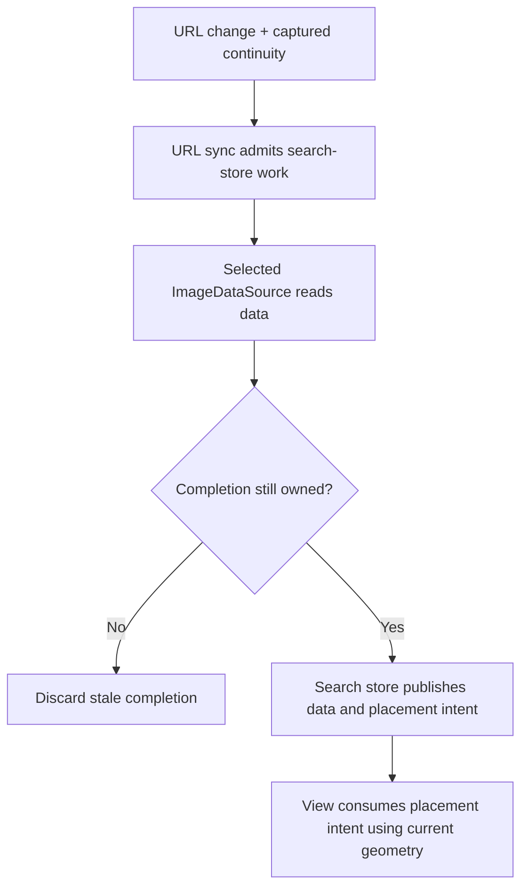

# State Management in Kupua

Kupua is a React Grid client prototype using Zustand and TanStack Router/Table/Virtual.
Its state model supports browsing an ordered result set without tying the data's
lifetime to the currently mounted view. This describes the implementation today,
not a proposed replacement architecture.

## The Product Constraints

Compared with [Kahuna's offset-addressed thumbnail results](../../../../kahuna/public/js/search/results.js#L223), capped at 100,000,
Kupua supports arbitrary-position browsing across millions through a custom
scrubber and bounded result window. Moving the scrubber can request a distant
window; it is not simply scrolling already-loaded DOM rows.

Kupua also adds a metadata-table presentation alongside the thumbnail grid.
These are views of the same search, not separate result sets. "Density" means the
grid/table preference; detail and fullscreen reuse the browsing context. Changing
presentation should not discard a pending browsing destination.

Focus (optional), selection and viewport position are separate. Focus is one image used for
keyboard/traversal continuity, potentially outside the loaded window. Selection
is a set of ticked IDs. The visible viewport can move independently of both; an
image near its centre can supply a fallback anchor. Preservation policy varies
by transition, rather than promising identical placement everywhere.

## State Owners

| Responsibility | Owner and boundary |
|---|---|
| Search/detail intent | TanStack Router's URL parameters. [URL sync](../../../src/hooks/useUrlSearchSync.ts) canonicalizes them, mirrors search parameters into Zustand and admits searches. The displayed image is URL state; density is not. |
| Browsing data and work | [Search store](../../../src/stores/search-store.ts): results, global buffer offset, total, ID-to-position lookup, cursors, focus, seek/restore intent and asynchronous ownership. It also contains polling, facet caches and sort distributions; it is not a narrowly isolated result cache. |
| Selection and summaries | [Selection store](../../../src/stores/selection-store.ts): selected IDs, range anchor, bounded metadata cache, hydration and reconciliation. Membership does not depend on resident rows. Sort/density changes preserve it; new search/Home clears it by default. |
| Server fields and image capabilities | [Enrichment store](../../../src/stores/enrichment-store.ts): per-image API overlays, including resource links/actions, for committed search results. Standalone detail owns its overlay; selection reads attach theirs to cached image objects. |
| Simulated editing and freshness | [Label operations](../../../src/lib/label-operation.ts) own immutable targets, transport receipts and injected bounded observation. [Touched-ID facts](../../../src/lib/image-read-freshness.ts) retain issuance fences, metadata comparison evidence and authority ownership, not complete images. Normal editing dispatches neither commands nor observation reads. |
| General user permissions | [Grid API instance](../../../src/lib/grid-api-instance.ts): one on-demand, page-lifetime permission read in API mode, shared between callers. No separate store, identity persistence or startup request; these facts do not replace per-image capabilities or server authorization. |
| Viewport and presentation | [Data window](../../../src/hooks/useDataWindow.ts) exposes indexed access and visible-range reporting; [scroll effects](../../../src/hooks/useScrollEffects.ts) applies placement to the virtualizer/DOM. Components and hooks retain local disclosure, gesture and pending-presentation state. |

Zustand is not the whole state system. Module-scoped controllers, generation
counters, pending handoffs and caches coexist with store state. Geometry/container
refs bridge imperative consumers; visible-range observations have their own
external-store subscription. React selector subscriptions, imperative `getState()`
reads and local refs serve different notification needs.

## Search and Upload Scope Admission

The [browsing context](../../../src/lib/browsing-context.tsx) admits either
`/search` or `/upload` to the same search store, data window and renderers.
URL synchronization belongs to the active route, not the search toolbar.
Only one context is mounted against the shared geometry and buffer.

Upload is media-api-only, using the existing startup mode rather than another
switch. Direct-ES mode admits an empty Upload scope to cancel old work and shows
an explicit unavailable state with Search as an alternative; it makes no batch
page/count reads. Its return affordance is hidden there. Existing direct-ES search
and the adapter remain unchanged; the Upload workplan forbids extending that path.

Upload's fixture-facing `uploadBatchMembership` holds immutable canonical-ID
membership snapshots independently of the route. `set(batch, ids)` deduplicates
IDs and advances the revision when membership changes. `SearchParams.imageScope`
carries its key, revision and typed IDs; the browser URL carries only `batch`.
This is not the selection store, an image cache, authority or a job owner.
Membership is currently in memory only: reload can make a batch unavailable.
Jobs, outcomes, drafts and descriptor persistence remain separately owned future work.

Resolved batches clear unrelated search filters and admit paid/free images.
Missing batches and disconnected recent uploads admit explicit empty scopes;
known-empty batches publish empty results after existing cancellation, without
page/count reads. Nonempty Upload scopes use media-api POST ID filters, including the
intersection with singleton cursor probes. Local keys/revisions never reach the
server. Query keys distinguish scopes and revisions, and existing request
generations/signals reject obsolete results. Membership revisions, not library
arrival polling, own batch growth.

Same-batch revision admission keeps the current viewport mounted so continuity
can be captured before publication; only a different context blocks the old view.
Home clears the internal scope before preloading ordinary library data, capturing
Upload's departure first so that preload cannot overwrite its saved return state.

Upload hides selection controls and the list metadata panel. Library selection
remains dormant, including for gestures, layout anchors and mutation targeting;
it is neither cleared nor replaced with the batch. Detail actions still have
their explicit image target. Metadata search links leave Upload for search.
The selection recognizer itself is disabled in Upload, not merely its callbacks.
Pull-to-refresh ignores dormant library selection and preserves it when refreshing;
ordinary Search keeps its existing selection-mode policy.
Global activity remains reachable in compact Upload: the root suppresses it only
when Search's expanded selection sheet supplies an inline replacement. Existing
operation targets stay captured independently of the currently displayed batch.
The [navigation adapter](../../../src/lib/browsing-navigation.ts) retains only
departure URL, density and existing position snapshots, not a second result buffer.
See [history](04-browser-history-architecture.md#search-and-upload-return) for return rules.

## From Intent to Pixels

**Ordinary query/sort transition.** This is a schematic of an accepted read path,
not every request, failure or navigation branch.

URL sync replaces URL-managed store parameters, including clearing removed values;
detail-only navigation does not admit a new search. The datasource is either
media-api or direct ES, not a viewport owner. Cancellation/generation checks guard
publication of results, positions, cursors and contributing API enrichment.
Supplied server fields override local fallbacks; absent overlay fields retain them.
**Data arrival, accepted publication and presentation completion are distinct.**

**Content-only publication.** [Image publication](../../../src/lib/image-publication.ts)
stages one accepted group, replaces resident bodies at existing slots with at most
one buffer copy, groups authoritative enrichment and explicitly updates selected
or cached metadata without changing selection membership. It preserves unrelated
references, coordinates and list-owned AI relevance. Equal image ratios retain
[geometry identity](../../../src/lib/result-geometry.ts), so content changes do not
invalidate Justified packing or scrolling prediction. Ordinary page replacements
have their own geometry identity. Off-screen-only publication does not replace the
buffer. Selection advances one metadata revision and requests at most one existing
reconciliation. Store notifications are sequential, not a transaction supplied by
React batching: staged freshness facts identify old presentation, and stale metadata
cannot admit editing even when an explicit context supplies newer capabilities.

**Unavailable content.** Explicit lifecycle publication replaces retained content with
an identity/dimensions-only body marked unavailable or deleted. It shares the existing
1,000-ID fact capacity, fences old bodies and grants, and retains list-owned AI scores.
A newer admitted read can recover unavailable content only if its metadata passes the
existing floor; ordinary reads cannot refute explicit deletion. Failed reads, omissions
and singleton 404s never establish deletion. No lifecycle endpoint or command is wired.
The registered mounted container checks complete residency and actual non-scrollable
geometry only on deletion publication. A fitting set compacts locally, updates count
and positions, preserves surviving focus and settles stationary end demand without a
read. Otherwise slots keep their dimensions, without media or actions. Uncertain filter
membership keeps fresh content in place; there is no local CQL evaluation or query rerun.
Metadata-only publication never compacts retained deleted slots, even if a density
change or resize has since made the complete set fit.

API reads capture issuance before awaiting, including reads whose IDs are not yet
known. Existing request owners still control cancellation and publication. For
touched IDs, search, selection hydration and singleton acceptance additionally
reject pre-operation or below-floor metadata. Hydration omissions cannot undo a
newer publication's membership or anchor. A newer accepted metadata projection can
change the label again; equal/missing clocks do not resolve contradictions. A full
projection can replace a retained lean one when their metadata agrees exactly.
After every body is evicted, an older projection stays unresolved, not fresh or
deleted. Current negative authority is handled independently of body rejection;
captured grants are checked again at action admission without requiring a rerender.
Ordinary accepted touched reads refresh selected metadata through its existing action.

Standalone detail registers its current requested-ID effect, not another body cache.
Matching lean readback can request one full singleton follow-up for that owner.
Publication retains full-only metadata and rejects obsolete same-ID completions.
A departed detail no longer gates surviving owners; a newly mounted owner uses its
own guarded full read. Failure leaves editing unavailable without inventing absence.
An empty owner settles a failed or absent initial read even after an operation fence;
the fence protects a newer published body, not an indefinitely empty loading state.
Observation accepts returned authority independently of matching the intended label,
so a nonmatching response can withdraw a captured grant without publishing its metadata.

Simulation permits one active single-label group of at most 200 targets, three
grouped mget attempts at least a second apart and a ten-second deadline beginning
before fake dispatch. Commands and observation settle independently: a held command
does not block verified partial publication, and unknown outcomes are never promoted
to acknowledgements or replayed. Document-lifetime protection retains at most 1,000
distinct admitted IDs; admission refuses overflow rather than evicting facts.
Each fact retains an exact serialized comparison of metadata, userMetadata and
usageRights, permitting identical equal-version re-entry after body eviction while
rejecting conflicts. Retention and admission-time serialization depend on metadata
size: the identity cap is not a byte bound.
There is no new polling or buffer scan without retained fences, no permanent
page-scanning subscription and no rank/map refresh attached to metadata publication.
An ordering revision advances at dispatch and accepted metadata changes. Exact
acquisitions capture it without cancelling cursor work or clearing display positions.
Acknowledgement, matching labels and observer expiry do not settle ordering.

Ordinary searches use three result-count regimes: small sets fill to residency,
intermediate sets use global virtual coordinates with a background position map,
and large sets seek between bounded windows. The map accelerates lookup; it is
not permission to render. AI results instead form a finite loaded pool with local
sorting. These are different data strategies behind the browsing experience.

Display positions, raw response scan frontiers and current rank have distinct roles.
Stale maps guide indexed browsing; exact identity actions resolve current query
tuples and rank. Page admission pairs bodies with response tuples, handles negative
authority independently and captures raw frontiers before filtering. Response tuples
have a 2,000-entry cache plus an anchor, independent of image-body lifetimes.

An exact acquisition can restart once per identity after an ordering revision,
under the same request owner; neighbour fallback is separately bounded. Count reads
carry that owner's cancellation to both client transports. Deliberate ordinal/edge
actions publish bounds, data and placement together, while scrubber and queued
browsing positions retain display intent. [Range selection](05-selections.md#6-range-selection--never-silently-drop)
verifies endpoints under its own membership and cancellation owner.

Under ordering uncertainty, cursor continuation can discover matches beyond a
retained count without admitting newer uploads. Accepted rows raise a scalar display
high-water mark, preserved across eviction and browsing refills until a fresh
coordinate acquisition. The admitted count still selects the tier. Two terminal
facts, qualified by search, revision, cursor and display boundary, settle raw-empty
traversal without inferring deletion or shrinking indexed space. Later explicit
demand can try again; PIT-less pages do not promise exact enumeration.
[Scroll architecture](03-scroll-architecture.md#normal-scrolling-all-tiers) owns
extent presentation, edge reporting and retained Justified packing.

Cancellation is consequently not one global reset. A density change may cancel a
view-owned refill or obsolete placement while a useful search or user-requested
destination continues. Selection-range work has its own membership/anchor owner.
Unlike [Kahuna's loaded-image range selection](../../../../kahuna/public/js/search/results.js#L759), Kupua can walk IDs between unloaded
endpoints; fetching metadata and accepting membership are separate operations.

## Identity and Persistence

Three identities must not be conflated:

- `buildSearchKey`: query/sort/filter fingerprint, excluding image display and
  pagination fields. Used to qualify cached positions and continuity.
- `kupuaKey`: one browser-history entry. Two entries can have identical search
  parameters but different represented positions.
- Request generations, abort signals and action owners: whether asynchronous
  work still has authority to publish. Matching query text alone is insufficient.

[Kahuna's scroll-position service](../../../../kahuna/public/js/services/scroll-position.js#L18)
records a pixel offset; Kupua additionally represents
history destinations with image identity, offset and viewport-relative placement.
Back/reload reconstruction fetches current data: it is not replay of an immutable
result snapshot. API mode does not currently open a PIT.

The URL is shareable intent, not a session dump. Per-tab `sessionStorage` retains
history snapshots, detail cursor/offset hints, density, selection IDs/anchor and
collection cache data. Selection persistence is debounced, not transactional;
metadata and reconciliation are rebuilt. Browser-local `localStorage` holds panel,
column and interaction preferences. Result buffers, request owners and enrichment
are runtime state. Storage failure degrades these conveniences, not authorization.

## Engineering Consequence

Read an operation's producer, acceptance guard and presentation consumer together.
Changing a store field is not necessarily a complete state transition. The current
architecture's strength is preserving distinct lifetimes; its cost is coordination
spread across stores, hooks and module state. A new global epoch or another store
does not by itself simplify that coordination.

For exact contracts, use [focus/position](02-focus-and-position-preservation.md),
[history](04-browser-history-architecture.md), [selection](05-selections.md) and
the [component reference](component-detail.md).