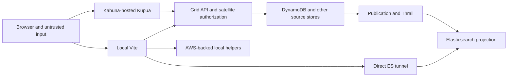

# Kupua Security Audit

### **The important ones are either already fixed or the fixes are considered. Archiving.**

**4 November 2026. Restricted review draft, not a public issue or deployment certificate.**

Baseline: `13e000e80cf3d5c94f576e51a8effceea08a051a`, the current local HEAD at inspection.
This is a source-led audit with isolated verification, not a penetration test of TEST or PROD.
Technical findings are included, but credential values, signed URLs, private infrastructure
identifiers and user identities are deliberately excluded. Review disclosure with Grid's
maintainers before committing this document to the public repository.

**Post-baseline comparison (4 November 2026):** This amendment treats
[guardian/grid#5176](https://github.com/guardian/grid/pull/5176) and
[guardian/cql#145](https://github.com/guardian/cql/pull/145) as merged. These source changes do
not establish deployment or dependency adoption. The audited checkout still contains the old
authentication predicate and installed CQL 1.8.6 clipboard helper, so the findings distinguish
upstream repair from this baseline.

## 1. Decision Summary

**Keep editing disabled while repairing the immediate trust-boundary defects. Continue building
a useful disconnected editor, then connect one complete, explicitly authorized operation.**
The existing [editing roadmap](gradually-growing-teeth.kupua-edits-steps.md) is fundamentally
the right sequence. Do not connect every backend write before building the controls, and do
not mistake an inert button for evidence that an editing workflow works.

The most important findings are:

1. **The local proxy's write guards are bypassable.** Actual Vite requests reached an isolated
   upstream despite writes being disabled. This affects the shared-ES safety argument, not
   just a hypothetical future editor. See SEC-01.
2. **The installed search-input dependency's rich-paste sink was reproduced.** CQL PR #145
   replaces active-document parsing with an inert template in upstream source, but Kupua's
   audited lock/install remain on the old helper; external-clipboard delivery remains
   browser-dependent. See SEC-02.
3. **The login return-host suffix flaw has an upstream repair.** Merged Grid PR #5176 adds
   DNS-label-boundary validation and tests, but the audited checkout and deployed state were not
   updated or verified. See SEC-10.
4. **Some backend mutation handlers authenticate a user without enforcing the image-edit
   permission advertised by media-api.** Labels, usage rights and leases need an explicit
   server-side policy decision and enforcement. Client capability checks cannot repair this.
   See SEC-03 and SEC-04.
5. **Laptop development exposes privileged services more broadly than the documentation
   suggests.** Vite listens on all interfaces and republishes ES, media and model access;
   local endpoint identity and temporary credential handling also have gaps. See SEC-05-07.
6. **The public-history check needs a qualified conclusion.** The scanner found mostly
   code/fixture candidates, a historical vendored token field requiring triage, and actual
   signed-resource material in a different remote-tracking history, not this HEAD's ancestry.
   No active credential compromise was established. See SEC-15.

There are also inherited visibility inconsistencies, unsafe read-only assumptions and
operation-specific completion/concurrency defects. Those must be fixed at their owners,
not hidden behind a larger frontend queue.

**Being the sole operator limits ordinary workload; it does not establish an access-control
boundary.** Other authenticated Grid users, untrusted clipboard content, a compromised browser
dependency, and a reachable laptop proxy are separate threat sources. Conversely, this audit
does not demonstrate anonymous internet access, a deployed compromise, or an active attack.

### What The Last Commit Does

The named commit adds Kupua's default-off, named command boundary and changes local Vite guards.
Its changed paths are under Kupua; it does not add permission checks to the satellite handlers.
The current Kahuna host reads rollout configuration and injects it into browser JavaScript.
That is **server-supplied configuration, not server-enforced mutation admission**.

The [command owner](../../src/lib/grid-commands.ts#L28) and
[host configuration](../../../kahuna/app/lib/KupuaPage.scala#L49) prevent accidental application
submissions when disabled. A direct authenticated request, or script already executing in the
application origin, need not use that owner. Existing pages also do not receive changed server
flags until reload. Neither a flag change nor Stop can undo a request already dispatched.

## 2. Scope And Method

The operator confirmed one repository deliverable: this document. No product fixes, other
documentation changes, commits, deployments, shared-service requests, live Grid image downloads or
infrastructure scans were authorized or performed. The running local application was not used.
Pre-existing changes in the devcontainer and development/E2E infrastructure were left untouched.

### Audit Plan Executed

1. Read AGENTS, the current worklog, the hosted guide in full, the editing roadmap and migration
   routing/build material. Treat historical reports as questions to recheck, not current proof.
2. Delegate five read-only reviews: hosted trust/authentication; commands/backend authorization;
   laptop infrastructure; browser/public-repository exposure; availability/write lifecycles.
3. Trace candidate findings to their deciding code, existing assertions and upstream admission.
   A sixth independent review challenged the proxy, paste and lease findings.
4. Reproduce the strongest new client/proxy claims with synthetic inputs and isolated transports.
   Do not send authorization, failure, load or deletion probes to shared infrastructure.
5. With separate operator approval, download a temporary scanner and examine local Git history
   offline. A further bounded reviewer classified current-source scanner candidates.
6. Reconcile duplicates, remove refuted claims, qualify deployment unknowns, and write this
   decision-oriented report. Appendix C records coverage and exclusions.

**Evidence labels:** reproduced means the stated isolated check ran; source-confirmed means
the controlling code was inspected but the behavior was not executed; conditional means an
explicit environment or policy prerequisite remains unresolved. High/Medium/Low describe
security or integrity consequences under those prerequisites, not measured incident frequency.
No CVSS score or Critical finding is asserted without sufficient deployment evidence.

## 3. Topologies And Trust Boundaries

| Topology | Actual request path | What protects it | Important limitation |
| --- | --- | --- | --- |
| Laptop, disposable local data | Browser -> Vite -> local ES; optional development services | Development guards and disposable target ownership | A port number is not proof that the target is disposable. Direct mode also enables a Bedrock plugin by default. |
| Laptop, direct shared ES | Browser -> Vite -> operator's tunnel -> shared ES; local media helpers use operator AWS access | Adapter checks, Vite checks, tunnel/network/IAM access | Grid's per-image user authorization is absent. The tunnel is not made read-only by a frontend flag. SEC-01/05 are particularly consequential here. |
| Laptop, local media-api backed by shared ES | Browser -> local Vite/API ingress -> local Grid process -> shared ES and satellite services | Grid authentication/authorization plus local guards | Backend startup and server-side clients bypass Vite. Starting a process is not necessarily a read-only act. |
| Laptop UI, deployed media-api | Browser -> explicit deployed API origin; local development tooling may still exist | Deployed service authentication/authorization and browser policy | Those absolute requests bypass the local API guard. Media delivery can be canonical or local according to explicit configuration. |
| Hosted by Kahuna | Kahuna serves built assets and bootstrap; browser -> media-api/auth/satellite origins; images -> canonical media origins | Server auth, object policy, HTTPS, CORS/CSRF/CSP, validated command targets | No Vite proxy exists. Browser rollout gates are accidental-write prevention, not an authorization layer. |

Sources: [hosted guide](00%20Architecture%20and%20philosophy/09-deployed-via-Kahuna.md),
[DAL selection](../../src/dal/index.ts), [transport topology](../../src/dal/grid-api/proxy-target.ts),
[Vite](../../vite.config.ts), [startup](../../scripts/start.sh),
[Kahuna page selection](../../../kahuna/app/controllers/KahunaController.scala#L43).

The hosted stage gate currently admits DEV/TEST and leaves iframe pickers on Kahuna.
The opt-in cookie is a frontend selector, not an operator allowlist; the
[on/off actions](../../../kahuna/app/controllers/KahunaController.scala#L111) do not establish
an exclusive one-person cohort. Actual ingress and Grid authentication still matter.
The deployed artifact, effective configuration and membership of that cohort were not inspected.

Assets needing protection include image bytes and metadata, restricted/unpublished information,
rights and lease integrity, source/event/index consistency, AWS/session credentials, editorial
availability and model expenditure. Attacker classes differ: an unauthenticated network client
is relevant to laptop listeners; a basic authenticated human is relevant to missing edit checks;
a Syndication key is relevant to restricted reads; script executing in Kupua can act with the
browser's session even when an authentication cookie itself is HttpOnly.

## 4. Prioritized Findings

| ID | Severity | Boundary | Evidence | Decision |
| --- | --- | --- | --- | --- |
| SEC-01 | High | Local proxy write prevention | Reproduced | Repair before trusting shared-target Vite guards. |
| SEC-02 | High potential impact (baseline) | Browser rich paste | Baseline sink reproduced; CQL fix assumed merged | Kupua still installs the old helper; adopt and regression-test the inert-template fix. |
| SEC-03 | High for rights; Medium for labels | Metadata authorization | Source-confirmed | Agree and enforce backend policy before live label activation. |
| SEC-04 | High | Lease authorization/target ownership | Source-confirmed | Repair before lease editing; privately triage existing service exposure. |
| SEC-05 | High if reachable | Laptop network/data/model access | Source-confirmed; network reachability unknown | Default to loopback and explicitly authorize any remote access. |
| SEC-06 | High potential integrity impact | Destructive helper target identity | Source-confirmed | Do not rely on port/flag checks to authorize fixture writes. |
| SEC-07 | Medium | Temporary AWS credential handling | Source-confirmed | Fix creation permissions and failure cleanup. |
| SEC-08 | High, policy-dependent | Syndication image visibility | Source-confirmed; known GRID-016 | Private maintainer resolution before broader exposure. |
| SEC-09 | Medium | Restricted image subresources | Source-confirmed | Apply the parent visibility policy consistently. |
| SEC-10 | Medium (baseline) | Authentication return destination | Source-confirmed; Grid repair merged | PR #5176 satisfies the code-level boundary fix; confirm this baseline's successor and deployed rollout. |
| SEC-11 | Medium | Read-only rehearsal | Source-confirmed | Classify operations by effects, not HTTP verb alone. |
| SEC-12 | Medium | Local API TLS trust | Source-confirmed | Restore certificate verification with a trusted local CA. |
| SEC-13 | Medium | Ordinary E2E/shared-system isolation | Source-confirmed | Pin owned fixtures and fail closed on ambiguous targets. |
| SEC-14 | Medium; shared impact can be High | Backend/model resource admission | Source-confirmed bounds gaps | Establish proportionate budgets; do not load-test shared TEST. |
| SEC-15 | Historical exposure; current severity unresolved | Public/local Git history | Offline scanner plus redacted triage | Resolve ownership/publication/validity without copying secrets. |

### SEC-01: Proxy Matching Bypasses The Write Guards

**High; reproduced; laptop topology.** The guards mount Connect middleware on a prefix boundary,
while Vite's string proxy keys accept any path starting with that prefix. A prefix-adjacent
request can therefore skip a guard and still be rewritten to the intended upstream endpoint.
The ES guard additionally checks only a path shape, not the HTTP method, and accepts suffixes
that upstream URL parsing can normalize away.

Evidence: [ES guard](../../vite.config.ts#L34), [API guards](../../vite.config.ts#L69),
[proxy keys/rewrites](../../vite.config.ts#L172). The installed Vite implementation was checked:
Connect accepts end-of-path, slash or dot after the mount; Vite uses `startsWith`; the proxy
then builds the outgoing URL. This is not a middleware registration-order error.

**Verification:** real guards from the current configuration ran in an isolated Vite server,
with every upstream replaced by a loopback recorder, environment loading suppressed and AWS
plugins excluded. Canonical denied ES/API/metadata write paths returned 403 and never arrived.
Their prefix-adjacent counterparts arrived with the original write method while rollout was
disabled. A raw dot-segment ES request arrived at its normalized target. No Grid/ES service ran.

The following are synthetic fixture paths, not commands to run against a real system. A 204
means the recorder received the request, not that an actual service accepted an operation.

| Method and incoming fixture path | Response | Recorded upstream path |
| --- | --- | --- |
| `PUT /es/audit-fixture` | 403 | None |
| `PUT /esaudit-fixture` | 204 | `/audit-fixture` |
| `POST /grid-metadata/metadata/fixture/labels` | 403 | None |
| `POST /grid-metadatametadata/fixture/labels` | 204 | `/metadata/fixture/labels` |
| `DELETE /api/images/fixture` | 403 | None |
| `DELETE /apiimages/fixture` | 204 | `/images/fixture` |
| `DELETE /es/fixture/_search` | 204 | `/fixture/_search` |
| Raw `PUT /es/_search/../audit-fixture` | 204 | `/audit-fixture` |

**Impact and limits:** a reachable shared-ES tunnel behind this proxy can receive unintended
writes. Satellite requests still require backend credentials and authorization. The target
origin remains configured; arbitrary-host SSRF is not established. Browsers normalize some dot
paths before transmission, but the prefix-adjacent bypass needs no traversal.

**Repair/acceptance:** use the same boundary-aware admission for proxy selection and guards;
validate the final canonical upstream path and method, including exact permitted PIT operations.
Extend the existing [proxy fixture](../../e2e/local/grid-mutations.spec.ts#L28) with these cases
and assert zero upstream arrivals on refusal. Do not test against a real tunnel.

### SEC-02: Rich Paste Could Execute Code Before CQL Discarded The HTML

**High potential impact at the audited baseline; sink reproduced; external-clipboard delivery
conditional.** Kupua used the installed CQL 1.8.6 component directly. Its clipboard helper
created an ordinary detached element in the active document and assigned clipboard HTML to
`innerHTML` before checking for ProseMirror markers. Detached is not inert: resource events can
execute handlers. Falling back to plain text afterward does not undo execution.

Evidence: [registration](../../src/components/CqlSearchInput.tsx#L95),
[locked dependency](../../package-lock.json), installed
[clipboard helper](../../node_modules/@guardian/cql/src/cqlInput/editor/utils.ts#L865) and
[paste hook](../../node_modules/@guardian/cql/src/cqlInput/editor/plugins/cql.ts#L404).
The shipped distribution contains the same path. ProseMirror parses its own HTML copy but
passes the original event to this hook; its parsing does not sanitize `event.clipboardData`.
[Kahuna's CSP](../../../kahuna/app/KahunaComponents.scala#L71) allows inline scripts;
[Kupua's adjustment](../../../kahuna/app/lib/KupuaPage.scala#L72) preserves that allowance.

**Verification:** an intercepted synthetic HTTPS page loaded the actual installed CQL bundle,
created the real custom element and dispatched a synthetic rich-paste event. A malformed data
image's harmless event handler set a boolean; the editor displayed only the plain-text fixture.
The marker changed under the source-equivalent relevant CSP. A second page allowing only
nonced inline scripts blocked the handler with `script-src-attr`, while text paste still worked.
No external network request, real user clipboard or live application was involved.

**Limits:** this proves the composed dependency sink, not that every OS/browser preserves the
same HTML through an external copy/paste. Effective deployed policy and package provenance were
not independently attested. This is not asserted as a published CVE or a zero-interaction attack.
The package is also used outside Kupua; notify its maintainers privately.

**Upstream repair (assumed merged):** CQL PR #145 changes the clipboard helper from a detached `div`
to a `template` and checks recognized markers through `template.content`. This avoids parsing
clipboard markup in an active document while retaining its native ProseMirror marker path. The
PR diff adds no regression test. Kupua's manifest allows `^1.8.6`, but the audited lockfile and
installed helper are still 1.8.6 and use the old `div`; the upstream change therefore does not
repair this checkout. Treat SEC-02 as open for Kupua until a release containing the fix is
installed and a focused browser regression plus ordinary-paste control passes. Tighten CSP as
defense in depth, preserving bootstrap/WebAssembly needs; a nonce must not be treated as a fix
for unsafe data handling. Script executing in the app can bypass client rollout flags.

### SEC-03: Labels And Usage Rights Omit The Advertised Edit Check

**High for rights integrity, Medium for labels; source-confirmed; inherited backend behavior.**
The discriminating principal is a human with basic Grid access who is neither the image's
uploader nor granted `EditMetadata`. Authentication alone admits label add/remove and usage-rights
replacement/removal; metadata replacement applies the object-aware filter.

Evidence: [permission filter](../../../metadata-editor/app/controllers/EditsController.scala#L66),
[labels](../../../metadata-editor/app/controllers/EditsController.scala#L123),
[metadata comparison](../../../metadata-editor/app/controllers/EditsController.scala#L155),
[rights](../../../metadata-editor/app/controllers/EditsController.scala#L216), and
[advertised image links](../../../media-api/app/lib/ImageResponse.scala#L147).
The new [command contract](../../src/dal/grid-api/README.md) already acknowledges the labels gap.

**Limits:** this is not anonymous access. Restricted machine-key tiers cannot generally use
these write methods. Kupua has no connected editor caller and remains default-off. Universal
label editing might be an intended exception, but that requires an explicit policy decision;
the same ambiguity must not silently justify unrestricted licensing changes.

**Repair/acceptance:** align each handler with the agreed server policy, reusing object-aware
authorization where applicable. Mocked controller tests must prove denied users cause neither
store mutation nor publication, with uploader/editor positive controls. Showing or hiding an
`edits` link, or checking it again in JavaScript, is not this repair.

### SEC-04: Lease Writes Omit Object Authorization And Can Mix Targets

**High; source-confirmed; inherited backend behavior.** Media-api advertises lease actions only
with image write permission, but lease mutation handlers authenticate without that check.
The bulk-add handler ignores its route image ID and writes body `mediaId` values. Replacement
can clear the route image's leases while storing entries naming another image.

Evidence: [advertised actions](../../../media-api/app/lib/ImageResponse.scala#L197),
[controller admission](../../../leases/app/controllers/MediaLeaseController.scala#L97),
[bulk addition](../../../leases/app/controllers/MediaLeaseController.scala#L107),
[replacement helper](../../../leases/app/controllers/MediaLeaseController.scala#L74),
[component wiring](../../../leases/app/LeasesComponents.scala#L14), and
[lease validity effects](../../../media-api/app/lib/ImageExtras.scala#L28).

**Impact and limits:** this can alter allow/deny-use policy, not just presentation. The relevant
unauthorized actor is again a basic human user, not a ReadOnly/Syndication API key whose provider
blocks write methods. Broad internal service access is a separate intended trust relationship.
Mixed-target replacement does not imply coherent projection: notification uses the route ID.

**Repair/acceptance:** authorize the actual affected images, resolve individual lease IDs to
their stored image, and require route/body target agreement where the operation is per-image.
Test mixed-target and denied requests with zero writes/events, plus legitimate success. Also
repair premature replacement acknowledgement under the lifecycle register below.

### SEC-05: LAN-Facing Development Republishes Privileged Access

**High if reachable; source-confirmed; firewall/reachability unverified.**
[Vite binds all interfaces](../../vite.config.ts#L165) and republishes ES, S3 and unsigned imgproxy
access without caller authentication. A loopback-only helper behind that proxy is not itself
a loopback-only user-facing service. Vite host admission accepts IP literals; `allowedHosts`
does not authenticate the calling machine. [Local ES](../../docker-compose.yml#L25) also has
security disabled and a published port without a loopback host binding.

The [S3 helper](../../scripts/s3-proxy.mjs#L59) uses operator AWS credentials and serves constrained
object keys; cached content can be returned without fresh upstream authorization. The
[imgproxy configuration](../../docker-compose.yml#L41) accepts unsigned source URLs with no
configured bucket/source allowlist. Its actual private-address and redirect policy was not
audited inside the unpinned container image. Cross-bucket access depends on IAM; cloud metadata
SSRF is not claimed. Direct-mode model access is discussed in SEC-14.

**Repair/acceptance:** loopback-default listeners and Docker publication, explicit authenticated
remote-development access if needed, and server-side source confinement for image helpers.
Use fake ES/S3/model endpoints to test caller admission. Network controls contain exposure but
do not fix SEC-01; no claim is made that these ports are currently internet-accessible.

### SEC-06: Port Numbers And Opt-Ins Do Not Prove A Disposable Target

**High potential impact; source-confirmed; accidental operational misuse.** The
[sample loader](../../scripts/load-sample-data.sh#L34) accepts any URL containing `:9220`, then
can create an index and bulk-write data. A remote host on that port, or a shared-cluster tunnel
bound locally there, satisfies the check. The
[special-sort integration oracle](../../integration/special-sort-es.test.ts#L367) is explicitly
opt-in and uses a unique index, but loopback plus an opt-in still does not identify its cluster.

Similarly, [local media-api startup](../../../media-api/app/MediaApiComponents.scala#L28) calls
[index initialization](../../../common-lib/src/main/scala/com/gu/mediaservice/lib/elasticsearch/ElasticSearchClient.scala#L56)
outside the browser boundary. Its write branch requires a successful alias lookup with no
mappings; lookup errors can throw. Do not claim every missing alias causes index creation,
but do not classify this startup path as incapable of writes either.

**Repair/acceptance:** parse URLs strictly and bind mutating fixture workflows to an owned,
disposable instance with appropriately restricted access. A cluster-name string alone is also
insufficient. Test refusals with fake endpoints and stubbed startup commands, including a
loopback endpoint representing a tunnel. Do not launch shared-target services to verify this.

### SEC-07: Temporary Credential Permissions And Cleanup Are Incorrect

**Medium; source-confirmed; local-reader prerequisite.** Startup first
[touches its imgproxy environment file](../../scripts/start.sh#L233), then much later applies a
restrictive umask before [writing credentials](../../scripts/start.sh#L608). Umask does not
change an existing file's permissions. With an initial 022 mask, a newly touched file can remain
0644. Compose failure can exit before removal; the current exit trap does not clean up this file.

Another local principal still needs directory traversal/read access. A private home directory,
restrictive original mask or pre-existing 0600 file can limit the exposure. No personal credential
file, actual permissions or container environment was inspected.

**Repair/acceptance:** securely create/enforce the file's permissions before writing, establish
cleanup before credential extraction, and exercise success/failure using a dummy home and dummy
values. The [Compose comment](../../docker-compose.yml#L67) claiming `env_file` hides values from
Docker inspection is false: environment injection does not conceal them from Docker-authorized
readers. Pinning the credential-bearing image digest is also prudent supply-chain containment.

### SEC-08: Search And Singleton Disagree On Syndication Visibility

**High conditional confidentiality risk; source-confirmed; existing GRID-016.**
[Search admission](../../../media-api/app/lib/elasticsearch/SyndicationFilter.scala#L75) accepts
the relevant acquired-rights/allow-lease case without a publication date, while the
[singleton model](../../../common-lib/src/main/scala/com/gu/mediaservice/model/SyndicationRights.scala#L17)
requires a past publication date. Search response construction can then return image entities
and signed asset links that singleton GET conceals.

This requires an enabled Syndication-tier principal and the relevant image state. Whether a
missing date is intended to mean published needs maintainer resolution. No live key, dataset
or deployed behavior was tested. The additive POST paths share query policy, but the standard
API-key provider blocks Syndication POSTs; this audit does not invent a new reachable POST bypass.

**Repair/acceptance:** settle the policy and test search, singleton and applicable aggregate/ID
paths against the same synthetic missing/past/future-date cases. Filtering returned hits alone
can leave counts or keys disclosing different membership. See
[GRID-016](bug-backlog.md#grid-016); handle the detailed policy review privately.

### SEC-09: Image Subresources Omit The Parent Visibility Check

**Medium; source-confirmed; restricted authenticated reader.** A valid Syndication key can use
admitted media-api GET paths beginning with `/images`. The
[uploader reader](../../../media-api/app/controllers/MediaApi.scala#L229) and
[soft-deletion metadata reader](../../../media-api/app/controllers/MediaApi.scala#L319) do not
apply [the parent visibility rule](../../../media-api/app/controllers/MediaApi.scala#L181).
They can disclose uploader/deletion identity, status or timing for a known hidden image ID.

This does not prove full-image disclosure or ID enumeration. Standard internal users have a
different, broader read policy. The preview-content route was considered but is outside the
Syndication key's admitted path prefix, so it is not claimed as this bypass.

**Repair/acceptance:** apply the same visibility semantics before subresource reads, explicitly
deciding what to do when only a deletion record survives. Synthetic hidden/visible/missing
controls should prove neither identity nor forbidden existence information escapes.

### SEC-10: Login Return Validation Lacked A DNS-Label Boundary

**Medium at the audited baseline; source-confirmed, effective root configuration matters.**
[AuthController](../../../auth/app/auth/AuthController.scala#L101) accepted HTTPS return hosts
using `endsWith(domainRoot)`. For a bare synthetic root `example.test`, an unrelated hostname
ending in those characters could pass without being that domain or its subdomain. The accepted
destination is saved for the authentication callback.

This permitted a trusted-login-to-phishing redirect under the stated configuration. It does not
establish OAuth state bypass, sending the session cookie to the lookalike host, or token theft.
The [Panda callback](../../../rest-lib/src/main/scala/com/gu/mediaservice/lib/guardian/auth/PandaAuthenticationProvider.scala#L99)
remains responsible for authentication.

**Upstream repair:** merged Grid PR #5176 lowercases the configured root and parsed hostname with
`Locale.ROOT`, rejects missing hosts and non-HTTPS schemes, and accepts either exact host equality
or a dot-delimited subdomain suffix (including the existing leading-dot, subdomain-only
configuration convention). Its synthetic tests cover valid roots/subdomains, deceptive suffixes
and userinfo, case-insensitivity, leading-dot behavior, and insecure/malformed destinations. The
PR reports `sbt 'auth/test'` passing all five auth tests. The audited checkout still has the old
suffix-only implementation; this report does not establish deployment or effective configuration.
Treat the source-level fix as satisfied by PR #5176, but verify the repaired code reaches the
relevant build/deployment before considering exposure closed there.

### SEC-11: GET-Only Does Not Mean No Side Effects

**Medium; source-confirmed.** The local API guard allows every GET. Grid's
[original download](../../../media-api/app/controllers/MediaApi.scala#L466) and
[optimized download](../../../media-api/app/controllers/MediaApi.scala#L566) can record usage.
The separate [lease reindex route](../../../leases/conf/routes#L10) is also a GET that scans and
publishes work; it is not currently the same locally proxied path. Auth exposes state-changing
GET logout/expiry behavior as well, with cross-site reachability dependent on cookie/ingress policy.

These are existing service semantics, not evidence that ordinary image-preview GETs mutate.
Usage recording is configurable and intentional. CORS is not a general defense against sending
a state-changing GET; response readability is a different question.

**Repair/acceptance:** use an effect-based rehearsal allowlist and separate explicit downloads
from previews/prefetch. Privileged administrative work needs appropriate admission rather than
discovery crawling. Review logout/debug-expiry routes separately; do not turn this into an
unproven blanket CSRF finding. Use mock usage/notifier/auth providers, never live downloads.

### SEC-12: Local API Proxy Disables Upstream TLS Verification

**Medium; source-confirmed; upstream substitution prerequisite.** The
[local API proxy](../../vite.config.ts#L210) sets `secure: false` while forwarding incoming
request headers. A substituted upstream can receive supplied authentication headers/cookies
and falsify API responses. This proxy does not independently obtain a Panda cookie, and its
destination is fixed rather than caller-selected. New metadata/auth satellite proxies retain
certificate verification and do not follow redirects.

**Repair/acceptance:** trust the intended development CA and restore verification. An isolated
TLS fixture with dummy credentials should reject an untrusted certificate and accept the
intended trusted certificate. Do not globally disable browser/server TLS checks to unblock setup.

### SEC-13: Ordinary E2E Isolation Fails Open On Ambiguous Topology

**Medium; source-confirmed; accidental shared load.** The
[global setup gate](../../e2e/global-setup.ts#L45) probes ES counts through port 3000 and rejects
only a successfully read count above 50,000. Failed/absent counts and smaller shared datasets
pass. That count does not establish an API-backed application's target. The
[Playwright configuration](../../playwright.config.ts#L92) can reuse an existing server.

This is not evidence that the normal suite currently mutates TEST. It is a gap in the technical
barrier against running fixture-oriented work against shared infrastructure. Manual/performance
configurations have their own explicit authorization requirements and are not protected by
assuming this gate covers every runner.

**Repair/acceptance:** ordinary suites should use owned fixture servers with explicit modes and
refuse an existing server whose target cannot be established. Test failed probes, a small shared
count and API topology with fakes. Do not validate refusal by running the suite against TEST.

### SEC-14: Read And Model Limits Do Not Establish A Shared Work Budget

**Medium, potentially High under sustained load; source-confirmed; actual capacity unknown.**
[Aggregation admission](../../../media-api/app/lib/elasticsearch/ElasticSearch.scala#L1197)
permits combinations up to 50 fields and 10,000 buckets per requested field without a combined
budget. Date histogram cost also depends on span. Authentication, ES limits/timeouts and
breakers constrain work, but no ingress-wide rate/concurrency budget was verified.

The [AI path](../../../media-api/app/controllers/MediaApi.scala#L774) can obtain an embedding
even for zero vector weight; distinct queries avoid same-key sharing and reach
[blocking model work](../../../common-lib/src/main/scala/com/gu/mediaservice/lib/aws/Bedrock.scala#L79).
In laptop direct mode the [Bedrock plugin](../../scripts/bedrock-embed-proxy.mjs#L136) invokes a
health embedding at startup and exposes a handler without its own caller/rate admission.
API mode disables that plugin. Input-length and cache bounds are not unique-request rate limits.

Browser abort is not proof that the backend/ES/model stopped working. The shared
[execution wrapper](../../../common-lib/src/main/scala/com/gu/mediaservice/lib/elasticsearch/ElasticSearchExecutions.scala#L12)
does not establish end-to-end cancellation. Existing performance histories should be used before
proposing measurements; abandoned socket lifetime alone does not measure continuous ES CPU.

**Repair/acceptance:** explicitly opt in to cloud model activity, avoid billable health checks,
and select compatible aggregate/model budgets and overload responses with the service owner.
Use fake clocks, held model calls and admission tests first. Do not make a general cancellation
architecture, PIT or new cache framework a prerequisite for the first label operation.

### SEC-15: Historical Exposure Requires Ownership Triage, Not A Clean-Bill Claim

**Historical credential-bearing material confirmed locally; current validity/publication unknown.**
With explicit approval, Gitleaks 8.30.1 was downloaded to a temporary directory and its archive
verified against the published release checksum. It scanned local Git with `--log-opts=--all`,
full redaction and inline allow-comments ignored. A custom report emitted only rule, file, line
and commit identifiers, never matched values or author identities.

- Scanner-reported scope: 14,394 scanned commits, approximately 2.83 GB, 560 candidate records,
  21 rule/path groups. Scanner records are not unique secrets; repeated histories generate repeats.
- Reachability classification: 32 records are on commits reachable from the audited HEAD;
  528 are on other locally available history. No remote fetch or hosting-provider query occurred.
- A bounded tracked-HEAD pattern check found six signed-URL-pattern matches, all synthetic
  fixtures in [image URL tests](../../src/lib/image-urls.test.ts#L47). It found no real key-shaped
  value in that matched set. This narrow check is not comprehensive secret clearance.
- Current source and representative historical reads explain numerous generic matches as S3
  object keys, metric/property names, mock aggregation values, Unicode parser predicates and
  Git hashes. Those are not authentication credentials. Not every historical variant was cleared.
- A historical vendored Coveralls `repo_token` field remains an owner/validity question:
  historical path `kahuna/public/jspm_packages/npm/rx@2.5.3/.coveralls.yml`, line 2, commit
  `39beccc6d59a2609ece362a36ee9d343c79920e8`. This commit is in HEAD ancestry. A token-like field in
  a vendored package is not proof of an active Grid credential, but must not be waved away as safe.
- Actual signed-resource structure was found in historical paths `thrall/mateusz1` and
  `thrall/mateusz1.pretty`, scanner locations 19 and 18 respectively, commit
  `e30ebc6bc43f1d91cf823056f848771e1407a1de`, dated 30 January 2020. Redacted structural inspection
  found non-example AWS key IDs, signatures and temporary-session-token parameters; inspected
  URL expiry values resolve to 2020. No standalone AWS secret-access-key exposure was established.
  **That commit is not in the audited HEAD's ancestry.** It is contained by one local
  remote-tracking ref, no local heads and no tags. Current remote publication was not checked.

The operator was alerted and explicitly approved continuing with location-only evidence.
An access-key ID alone is not a usable AWS secret; a signed URL is a scoped bearer capability,
and the inspected URLs have past expiry values. This does not demonstrate currently usable
AWS credentials. Equally, absence from the current tree does not erase reachable history.

**Action:** privately give locations to the relevant repository/security owners; establish
publication, principal ownership, historical incident handling and whether anything remains
active. Rotate/revoke if warranted, then decide whether hosting-provider cleanup/history work
is useful. Do not rewrite shared history or rotate unrelated current credentials blindly.

**Remaining scanner triage:** historical S3-watcher test configuration, CloudFormation matches,
the vendored token, other-ref-only configuration candidates and unreviewed variants remain
explicitly open. Scanner defaults and high-precision patterns cannot certify binary images,
archives, logs, releases, remote PR refs, artifacts or encoded secrets. See Appendix B for a
bounded follow-up that does not require sending secret material to an agent.

## 5. Editing Integrity And Shared-Infrastructure Risk Register

These are operation-specific gates, not reasons to postpone all editing until Grid is rebuilt.
They are source-supported unless explicitly identified as prior operator evidence. No live race,
failure, dropped write or asset purge was induced by this audit.

| Risk | Evidence and qualification | Required before |
| --- | --- | --- |
| Premature source acknowledgement | [Soft delete](../../../media-api/app/controllers/MediaApi.scala#L395) starts but does not return the status/publication chain (GRID-012). [Lease replacement](../../../leases/app/controllers/MediaLeaseController.scala#L139) discards its replacement future. [Syndication](../../../metadata-editor/app/lib/Syndication.scala#L68) and [its consumer](../../../thrall/app/lib/kinesis/MessageProcessor.scala#L199) have detached work (GRID-009/013). Ordinary label handling and undelete are not all affected by the same defect. | The affected operation may report truthful accepted/failed source outcomes. Fix each chain locally with held/failing dependency tests. |
| Hard-delete cleanup can be lost | [Delete processing](../../../thrall/app/lib/kinesis/MessageProcessor.scala#L155) discards original/thumbnail/PNG cleanup futures. [Retry admission](../../../thrall/app/lib/elasticsearch/ElasticSearch.scala#L469) refuses an already-absent ES document, so repeating the same event is not a complete cleanup strategy. | Any claim of completed irreversible deletion. Await cleanup and define authorized recovery after index disappearance; 404 is not purge evidence. |
| Delete/restore can be reordered | [Lifecycle scripts](../../../thrall/app/lib/elasticsearch/ElasticSearch.scala#L289) lack a lifecycle-version guard; [random partitioning](../../../common-lib/src/main/scala/com/gu/mediaservice/lib/aws/Kinesis.scala#L36) does not order by image (GRID-010). [Timeout/retry](../../../thrall/app/lib/RetryHandler.scala#L40) does not itself cancel old work. One-shard ordinary sequencing mitigates some paths, not every late completion. | General restore/undo or a separate bulk lane. Prove reversed/late operation handling in deterministic fixtures. |
| Whole-object replacement loses concurrent changes | [Metadata replacement](../../../metadata-editor/app/controllers/EditsController.scala#L155) is unconditional; [collection removal](../../../collections/app/controllers/ImageCollectionsController.scala#L46) reads/filter/replaces (GRID-011). Fresh GET and per-tab serialization reduce exposure, not cross-client races. Labels use atomic set operations. | Metadata/concurrent collection-removal claims. Choose an explicit bounded prototype compromise or a field/conditional-write contract; never claim universal conflict prevention. |
| Source acknowledgement differs from projection visibility | [Publishing after persistence](../../../metadata-editor/app/lib/Edit.scala#L14) is not a transaction. [Consumer retry exhaustion](../../../thrall/app/lib/kinesis/ThrallEventConsumer.scala#L36) can lead to [acknowledgement after recovery](../../../thrall/app/lib/ThrallStreamProcessor.scala#L108). Historical GRID-018 upload loss is operator evidence, not newly observed edit loss. | Truthful receipts and readback for every enabled operation. Preserve unknown/partial states; reconcile bounded postconditions without automatic replay. A generic outbox is not selected here. |
| Shared write capacity and fan-out | [GRID-019](bug-backlog.md#grid-019) records historical PROD table/GSI capacities, not current TEST capacity. [Normal-stream processing](../../../thrall/app/lib/ThrallStreamProcessor.scala#L75) is shared; photoshoot/multi-step work can exceed selected-item counts. | General batching. Agree rate, cap, pacing, table/GSI limits and competing workload with owners. Six flights is not six requests per second or an organization-wide budget. |
| Stale reads and browsing can misrepresent a completed edit | [KUP-043](bug-backlog.md#kup-043) and [step 4](gradually-growing-teeth.kupua-edits-steps.md#step-4-resolve-kup-043-with-simulated-writes-before-enabling-real-ones) own authoritative publication, stale reads, selection and invalidated coordinates. | Normal live in-place editing. Simulate delayed canonical state; do not refresh the whole search per item or treat any newer timestamp as the intended postcondition. |

For batch writes, account for every source read/write, per-item substep, GSI impact and event
fan-out. Reject oversized captured target sets before hydration; do not truncate silently.
Stop-remaining prevents new submissions, not in-flight completion. Ambiguous retries require
reconciliation, especially for crops, leases, appends, uploads and external publication.

## 6. Security-Gated Execution Sequence

This augments the existing parity roadmap; it does not authorize implementation or live work.

1. **Contain the current exposures.** Keep mutation rollout off. Do not rely on affected Vite
   guards for shared-target protection; avoid network-exposed privileged development proxies.
   Triage the paste, permission and historical-exposure findings privately. Establish the
   actual deployed revisions and effective topology before making deployment claims.
2. **Repair and prove the narrow trust boundaries.** Fix SEC-01/02 and the server policy for
   the chosen first operation. Prove denied requests never reach store/publication and disabled
   commands never dispatch. Keep explicit API-only hosted mode, exact resource/origin validation,
   redirect refusal and uncertainty-without-replay. Do not add a generic forwarding service.
3. **Build one real disconnected label editor.** Implement input, validation, target preview,
   submit/cancel and retained draft. Capture IDs and intent at confirmation; later selection
   changes cannot retarget it. Say that nothing was submitted. A fake success toast is not a
   disconnected mode. Keep an in-memory receipt outside selection state.
4. **Exercise the same command interface with fake transport.** Hold/reject/lose responses,
   expire auth and double-click. Cover keyboard/touch and navigation. Assert zero real mutation
   traffic, including side-effecting GETs. Use a compiled hosted fixture as well as local proxy
   fixtures; synthetic CORS/cookies are not evidence about deployed ingress.
5. **Complete scoped authoritative publication with delayed fixtures.** Follow the agreed
   KUP-043/step-4 policy for detail, selection, visible boxes and stale ordering. Do not silently
   waive it to obtain an earlier live result. A one-target trial relying on explicit reload
   could be separately proposed, but is not the accepted normal editing contract here.
6. **Verify the selected deployed transport, then authorize one disposable TEST action.**
   A human owner agrees target, operation, principal, observation, stop condition and cleanup.
   Start with isolated services first. The implemented command is add-labels; removal requires
   its own implemented/admitted operation and explicit approval. Observe source acknowledgement
   and canonical readback separately. Never start a shared-target backend just as setup.
7. **Admit bounded batching only after a capacity decision.** Fixed targets, conservative caps,
   pacing, conflicting-operation serialization, per-item results and stop-remaining are required.
   Keep the initial one-operator exception distinct from general multi-user capacity acceptance.
8. **Expand by operation family, using the existing roadmap.** Labels/archive/collection addition
   need their own authoritative permissions. Metadata needs its concurrency decision; leases and
   rights need SEC-03/04 plus correct substeps. Crops/downloads can advance independently once
   eligibility/notices and intentional download effects are handled. Upload/import needs its
   ingest and signed-upload boundary; partner publication must never be a routine smoke test.
9. **Treat destructive and external actions as separate releases.** Resolve the relevant source,
   cleanup and ordering defects for soft delete/restore, usage/crop removal and guided takedown.
   Keep hard deletion separately disabled until recovery/retention consequences are accepted.
   Never delete usages/crops automatically to manufacture deletion eligibility.
10. **Broaden hosting only with an explicit operational owner.** Test session expiry/account
   change, policy variants and failures in the actual ingress. Agree monitoring and a real
   stop procedure. A page flag stops neither old pages immediately nor arbitrary authenticated
   clients; require a server-side gate/dedicated constrained principal if that stronger guarantee
   is needed. PROD and embedded-editor parity remain separate decisions.

**Not recommended:** wiring all backend writes first; a universal permission boolean; running a
large suite against shared TEST; treating API mode as fallback-capable; a durable job service,
PIT, new bulk lane or universal conflict API before the first bounded operation. The most useful
human engineering consultation now is a small review of authorization, deployment policy and
shared capacity with this evidence, not asking one person to approve the entire feature backlog.

## 7. Deployment Evidence Still Needed

Source and synthetic fixtures cannot answer these. Ask the deployment/security owners for
redacted facts, not cookies, private keys, signed URLs or copied private configuration files.

| Question | Smallest useful evidence | Safety boundary |
| --- | --- | --- |
| What is installed and who can opt in? | Artifact/service revisions, enabled stages and operator/cohort admission policy | A branch commit or opt-in cookie is not deployment or cohort proof. |
| Are auth cookies and OAuth correctly scoped? | Effective provider, cookie domain/path/Secure/HttpOnly/SameSite/expiry, MFA and return-origin policy | Distinguish the Play session cookie from Panda's authentication cookie. Never paste actual cookie values. |
| Do cross-origin writes have correct browser protection? | Allowed origins/methods/headers/credentials, CSRF policy/exemptions and an approved synthetic credentialed browser check | CORS response access is not object authorization. Do not relax policies globally to make a prototype work. |
| What CSP/frame/ingress policy actually reaches the browser? | Redacted response headers and proxy/forwarded-host/cache policy | The source CSP is not a deployed-header capture. Iframe exclusion is not itself clickjacking protection. |
| What may runtime roles access? | Scoped IAM/S3/KMS/ES/network policy review for app, helpers, CI and upload roles | No agent infrastructure scan or privilege-changing experiment. |
| How does shared TEST fail under load? | Existing table/GSI limits, stream/consumer configuration, competing load, model quotas and alarms | Reuse existing metrics. No bulk campaign or model load test without separate authorization. |
| Can failed handoffs and unknown operations be investigated? | Existing logs/alarms, retention, reconciliation and named responder | Log operation/state identifiers without private metadata, signed URLs or credentials. |
| What constitutes deletion and recovery? | Source/index/assets/CDN/replica/version-retention policy and authorized recovery process | An absent search result or one 404 cannot certify purge. |
| Is repository/build trust configured? | Secret-scanning/push-protection coverage, branch/review protections, CI token/OIDC permissions, trusted action/image provenance | Local scan cannot see remote PR refs, releases, caches or branch-protection settings. |

No infrastructure scanner is recommended as the first next step. Most unresolved questions
are effective-configuration or ownership questions; a broad scan would add traffic and findings
without proving the important authorization contracts. After owners answer them, commission
only the narrow deployed checks needed by the selected operation.

## 8. Controls Preserved And Claims Rejected

- Hosted builds pin hosted/API mode; absent invalid API configuration does not select direct ES.
  API mode does not construct the ES datasource. This audit did not refute those boundaries.
- Bootstrap is an allowlisted object with `<` escaped before inline insertion; personalized
  hosted pages use `no-store`. No bootstrap injection chain was established.
- Commands validate named operation, image identity, exact resource paths and configured origins,
  reject redirects, recheck admission and distinguish acknowledgement/rejection/uncertainty.
  They do not automatically replay after auth or transport failure.
- Server authentication/provider precedence, restricted API-key methods/hosts, image deletion
  eligibility and delete/crop-removal permissions remain meaningful controls. Not every
  authentication-only handler is automatically an authorization bug: collection addition and
  default archive access have broader intended policy.
- Historical claims of unguarded photoshoot/syndication source mutations are superseded by the
  current [SyndicationController](../../../metadata-editor/app/controllers/SyndicationController.scala#L27)
  `EditMetadata` filter. Lifecycle defects remain distinct from admission.
- Ordinary React metadata text, escaped scrubber values and reviewed CQL suggestion rendering
  did not supply a metadata-to-script execution chain. Unvalidated image/usage URLs were not
  automatically counted as XSS; their producer/sink context matters.
- Page-lifetime session caching and non-principal-keyed browser state require deliberate account
  change/reload handling, but no cross-account image-authorization bypass was proved. Selection
  persistence stores IDs, not full image entities; collection/history state has different content.
- No nonce, SameSite, frame header or CSRF vulnerability was inferred solely from absence in one
  file. In particular, a common Play-session setting is not proof that Panda's auth token is
  JavaScript-readable. The CSP finding above has an actual execution witness.
- Existing API source filtering, query admission, incomplete-result rejection and per-request
  bounds are useful. They are not an organization-wide work budget, nor proof of cancellation.

## Appendix A. Suggested Amendments To Current Documentation

No other existing document was changed. Archived material should remain historical rather than
be rewritten to look freshly verified.

| Current owner | Amendment needed after review/repair |
| --- | --- |
| [Infrastructure safeguards](infra-safeguards.md) | Qualify the proxy guarantee with SEC-01 until fixed; correct the claim that helper loopback binding prevents network access through Vite; replace port-as-locality and count-as-target guarantees; remove the implication that browser abort guarantees one outstanding backend job. |
| [Infrastructure safeguards](infra-safeguards.md) | Current imgproxy uses environment-file injection, not the old credential-volume description; document Docker visibility and failure cleanup accurately. Its source/image policy and limits should reflect current configuration. |
| [Hosted guide](00%20Architecture%20and%20philosophy/09-deployed-via-Kahuna.md) | Keep its already-correct distinction between frontend rollout and authorization. Add verified deployed header/session evidence only after an authorized check; identify cohort and remote-stop limits. |
| [Editing roadmap](gradually-growing-teeth.kupua-edits-steps.md) | Step-2 fixture completion does not cover the newly reproduced matching bypass. Add the focused repair/retest gate; expand the named permission review to leases/rights and add lease replacement/hard-delete cleanup findings at their owning steps. |
| [API contract](../../src/dal/grid-api/README.md) | Preserve truthful command outcomes and exact-resource rules. Record the agreed server label policy and deployed transport acceptance once actually resolved. |
| [Bug backlog](bug-backlog.md) | Preserve GRID-009-013/016/018/019 qualifications; add independently verified new security/lifecycle findings only after private maintainer triage. Do not publish sensitive reproduction material by default. |
| [Migration index](03%20Ce%20n'est%20pas%20une%20pipe%20dream/media-api-work/media-api-00-index.md) | Its current-state summary is useful; one routing-table row still describes subsequent steps as unimplemented despite the newer step-2 status. Keep historical sequencing clearly subordinate to current owners. |
| [E2E guide](../../e2e/README.md) | Describe existing target detection as a heuristic until explicit fixture ownership replaces it; keep manual/shared/performance authorization distinct. |

Relevant code comments also need correction with their owning fixes: the S3 helper's locality
claim, the Compose `env_file` secrecy claim, and startup's claim that a later umask establishes
0600 on an existing file. These are not separate product changes authorized by this audit.

## Appendix B. Bounded Follow-Up Assignments

Use lower-powered agents for mechanical evidence collection, not final security acceptance.
Each worker should receive one question, named paths and a stop condition, return a small
file/line-backed table, and never edit shared registers or contact live systems. A capable
coordinator verifies the deciding paths, removes refuted findings and owns the final decision.

| Packet | Worker task and done condition | Coordinator/owner decision |
| --- | --- | --- |
| B1: Remaining secret-history triage | Re-run the pinned scanner offline with full redaction/location-only output. Classify the 32 HEAD-ancestor records and then the other-ref groups by exact historical content, without returning values. Produce one row per distinct candidate: fixture/code, plausible credential, or unresolved; separate local refs from proven publication. Stop and privately notify on plausible credentials. | Determine ownership, publication and revocation needs. No autonomous remote validation, history rewrite or bulk allowlisting. |
| B2: Authorization matrix | For labels/rights/leases only, map route -> provider -> object filter -> store/event call and existing test home. Include uploader, basic human, editor and restricted machine-key distinctions; do not multiply every frontend topology. | Agree intentional exceptions; approve the smallest server repair and denied-no-side-effect fixtures. |
| B3: Proxy repair witnesses | Turn SEC-01's isolated observations into cases in the existing proxy fixture; first submit test cases and expected upstream arrivals, not a new proxy framework. Source-only planning needs no shared server. | Separately authorize edits; require failing-first witness, fixed positive controls and relevant full gates. |
| B4: Clipboard dependency adoption | Verify a published CQL release contains PR #145's inert-template fix, update Kupua's lock/install through the normal dependency process, and exercise malicious-markup detection plus ordinary paste in a disposable browser. No operator clipboard, session or external content. Distinguish sink repair from CSP mitigation. | Confirm version adoption and focused regression evidence before closing SEC-02; keep CSP as defense in depth. |
| B5: Destructive completion | Inspect only hard-delete storage cleanup/retry and lease replacement test homes. Specify held/failing futures and retry-after-ES-absence witnesses; do not design generic jobs. | Choose the actual cleanup/recovery and partial-outcome contract before implementation. |
| B6: Deployment facts | A human owner supplies redacted effective settings for section 7. Worker maps each fact to the source assumption it confirms/refutes and records missing evidence. | Authorize any narrow browser/ingress validation and the exact disposable write, never infer permission from access. |
| B7: Dependency/build provenance | With separate tool/network approval, inventory locked runtime/dev dependencies, container digests and CI actions; query current advisory sources and classify actual reachability. Review remote CI/OIDC permissions with their owner. | Prioritize actionable reachable advisories; do not demand every transitive warning be fixed before unrelated prototype work. |

For all packets: no unsupported severity claims, no claim that an unmeasured surface was never
measured elsewhere, no credential-bearing output, and no automatic expansion into infrastructure
scanning. If a premise is refuted, report that and stop that packet rather than inventing a fix.

## Appendix C. Coverage And Verification Receipt

### Source Coverage

This is a bounded multi-review audit, not a line-by-line audit of the entire monorepo. Full means
the reviewer read the complete file; targeted means the named behavior/sections, not all callers.
Historical coverage receipts were not counted as fresh inspection.

| Lane | Inspected owners | Coverage boundary |
| --- | --- | --- |
| Orientation | [AGENTS](../../AGENTS.md), [worklog](worklog-current.md), [hosted guide](00%20Architecture%20and%20philosophy/09-deployed-via-Kahuna.md), [editing roadmap](gradually-growing-teeth.kupua-edits-steps.md), [safeguards](infra-safeguards.md), [batch report](batch-editing-at-scale.md) | Full by assigned reviewers; hosted guide also fully read by coordinator. |
| Migration context | [Index](03%20Ce%20n'est%20pas%20une%20pipe%20dream/media-api-work/media-api-00-index.md), [inventory](03%20Ce%20n'est%20pas%20une%20pipe%20dream/media-api-work/media-api-01-capability-inventory.md), [build plan](03%20Ce%20n'est%20pas%20une%20pipe%20dream/api-build/api-build-00-plan.md), [rights review](hosted-rights-and-capabilities-review.md), [request lifetime](api-request-lifetime-and-performance-parity.md) | Current routing, decisions and task-relevant findings. Packet skims: P07/08/12/14/15/16/17/21/24/25/26/27/33/34. Not every historical packet, register row or archived artifact. |
| Hosting/auth | [KupuaPage](../../../kahuna/app/lib/KupuaPage.scala), [KahunaController](../../../kahuna/app/controllers/KahunaController.scala), [KahunaComponents](../../../kahuna/app/KahunaComponents.scala), [KahunaConfig](../../../kahuna/app/lib/KahunaConfig.scala), [AuthController](../../../auth/app/auth/AuthController.scala), [AuthComponents](../../../auth/app/auth/AuthComponents.scala), [AuthConfig](../../../auth/app/auth/AuthConfig.scala) and routes | Full controlling host/auth files and targeted tests; no private effective configuration. |
| Shared admission | [GridComponents](../../../rest-lib/src/main/scala/com/gu/mediaservice/lib/play/GridComponents.scala), [Authentication](../../../rest-lib/src/main/scala/com/gu/mediaservice/lib/auth/Authentication.scala), [Authorisation](../../../rest-lib/src/main/scala/com/gu/mediaservice/lib/auth/Authorisation.scala), [Panda provider](../../../rest-lib/src/main/scala/com/gu/mediaservice/lib/guardian/auth/PandaAuthenticationProvider.scala), [permission provider](../../../rest-lib/src/main/scala/com/gu/mediaservice/lib/guardian/auth/PermissionsAuthorisationProvider.scala), [API-key provider](../../../rest-lib/src/main/scala/com/gu/mediaservice/lib/auth/provider/ApiKeyAuthenticationProvider.scala), [ApiAccessor](../../../common-lib/src/main/scala/com/gu/mediaservice/lib/auth/ApiAccessor.scala) | Full principal/provider/filter paths; external OAuth/Play implementation and deployed cookies not certified. |
| Command client | [Commands](../../src/lib/grid-commands.ts), [policy](../../src/lib/grid-mutation-policy.ts), [session owner](../../src/lib/grid-api-instance.ts), [hosted config](../../src/lib/hosted-config.ts), [targets](../../src/dal/grid-api/proxy-target.ts), [discovery](../../src/dal/grid-api/service-discovery.ts), [Argo](../../src/dal/grid-api/argo.ts), [command tests](../../src/lib/grid-commands.test.ts), [proxy/host fixture](../../e2e/local/grid-mutations.spec.ts) | Full controlling helpers and relevant test bodies; existing suites were read, not run wholesale. |
| Mutation services | [EditsController](../../../metadata-editor/app/controllers/EditsController.scala), [EditsApi](../../../metadata-editor/app/controllers/EditsApi.scala), [Edit](../../../metadata-editor/app/lib/Edit.scala), [SyndicationController](../../../metadata-editor/app/controllers/SyndicationController.scala), [Syndication](../../../metadata-editor/app/lib/Syndication.scala), [lease controller](../../../leases/app/controllers/MediaLeaseController.scala), [LeaseStore](../../../leases/app/lib/LeaseStore.scala), [LeaseNotifier](../../../leases/app/lib/LeaseNotifier.scala), [membership controller](../../../collections/app/controllers/ImageCollectionsController.scala), [membership store](../../../collections/app/store/ImageCollectionsStore.scala), [CropperController](../../../cropper/app/controllers/CropperController.scala) | Full named controllers/helpers; targeted tree, download, delete/restore, GridClient and Dynamo ownership. Upload/partner/usage ingestion are not fully certified. |
| Read confidentiality/bounds | [ImageQueryController](../../../media-api/app/controllers/ImageQueryController.scala), [MediaApi](../../../media-api/app/controllers/MediaApi.scala), [ES](../../../media-api/app/lib/elasticsearch/ElasticSearch.scala), [request models](../../../media-api/app/lib/elasticsearch/ElasticSearchModel.scala), [SearchFilters](../../../media-api/app/lib/elasticsearch/SearchFilters.scala), [SyndicationFilter](../../../media-api/app/lib/elasticsearch/SyndicationFilter.scala), [ImageResponse](../../../media-api/app/lib/ImageResponse.scala), [ImageExtras](../../../media-api/app/lib/ImageExtras.scala) | Full additive controller and policy helpers; targeted legacy/AI/subresource handlers, request builders, signing/capabilities, mget and relevant controller/ES assertions. Not every legacy endpoint. |
| Publication/cleanup | [MessageProcessor](../../../thrall/app/lib/kinesis/MessageProcessor.scala), [Thrall ES](../../../thrall/app/lib/elasticsearch/ElasticSearch.scala), [consumer](../../../thrall/app/lib/kinesis/ThrallEventConsumer.scala), [stream processor](../../../thrall/app/lib/ThrallStreamProcessor.scala), [retry](../../../thrall/app/lib/RetryHandler.scala), [Kinesis](../../../common-lib/src/main/scala/com/gu/mediaservice/lib/aws/Kinesis.scala), [S3ImageStorage](../../../common-lib/src/main/scala/com/gu/mediaservice/lib/S3ImageStorage.scala) | Full stream/retry/storage helpers; targeted mutation consumers, cleanup and ordering. Existing DEV capacity source inspected, not deployed TEST policy. |
| Laptop/tooling | [Vite](../../vite.config.ts), [ES config](../../src/dal/es-config.ts), [ES adapter](../../src/dal/es-adapter.ts), [startup](../../scripts/start.sh), [loader](../../scripts/load-sample-data.sh), [S3 proxy](../../scripts/s3-proxy.mjs), [Bedrock proxy](../../scripts/bedrock-embed-proxy.mjs), [Compose](../../docker-compose.yml), [global setup](../../e2e/global-setup.ts), [Playwright config](../../playwright.config.ts), [special-sort oracle](../../integration/special-sort-es.test.ts) | Full config/scripts/gates; targeted adapter/oracle and manual/perf runner paths. Pending devcontainer overlay received limited source review, not runtime certification. |
| Browser data/sinks | [CQL input](../../src/components/CqlSearchInput.tsx), [sort context](../../src/lib/sort-context.ts), [usages](../../src/components/UsagesSection.tsx), [metadata primitives](../../src/components/metadata-primitives.tsx), [image URLs](../../src/lib/image-urls.ts), [history](../../src/lib/history-snapshot.ts), [selection](../../src/stores/selection-store.ts), [collections](../../src/stores/collection-store.ts), [tracing](../../src/lib/perceived-trace.ts), [crop draft](../../src/lib/crop/crop-draft.ts) | Targeted DOM/link/drag/persistence paths and sink searches, plus installed CQL/ProseMirror/Vite internals. No claim that all UI code is XSS-free. |
| Public/build supply chain | [Kupua manifest](../../package.json), [lock](../../package-lock.json), [Kahuna manifest](../../../kahuna/package.json), [CI](../../../.github/workflows/ci.yml), [manual PR workflow](../../../.github/workflows/push-pr.yml), [deployment descriptor](../../../riff-raff.yaml), [CDK entry](../../../cdk/bin/cdk.ts), ignore rules and tracked asset/env names | Manifest/CI source, selected lock entries and local Git scan. No current advisory-feed, remote-action implementation, actual IAM/OIDC, built/deployed bundle, binary privacy or remote artifact certification. |

### Checks Actually Run

| Check | Result and limit |
| --- | --- |
| Baseline/provenance | HEAD and named commit path inventory checked; existing worktree changes identified, not modified. Commit is not evidence of what is deployed. |
| Actual Vite proxy fixture | Canonical refused controls produced no upstream arrivals; prefix-adjacent and raw normalization cases reached a synthetic recorder. All targets loopback-pinned, AWS plugin excluded, servers closed afterward. |
| Actual CQL distribution in browser | Synthetic rich paste executed a boolean marker under the relevant source CSP; nonced-policy control blocked it with a CSP violation while preserving text. Browser was Chromium 150 via the integrated editor. Routes/listeners were removed and page returned to blank. |
| Tracked-HEAD indicator scan | Six synthetic signed-URL test matches; limited rules, text only. Not a history or full secret scan. |
| Gitleaks local history | Version 8.30.1; archive SHA-256 `b40ab0ae55c505963e365f271a8d3846efbc170aa17f2607f13df610a9aeb6a5`; 560 candidates, reachability/representative semantic triage as SEC-15. Published checksum comparison is not an independent maintainer-signature attestation. |
| Aborted scanner attempt | `/dev/stdout` report destination was rejected before scanning; its empty pipeline output was not counted as a clean result. The completed custom-template run above is the evidence. |

No full unit/E2E/Scala suite was run: this was a report-only audit, not a product change. No
performance campaign, real OAuth session, download, cloud model, infrastructure probe or shared
mutation was used as a test. Any successful future code repair still needs its owning focused
regression and the repository's relevant full validation gates.

### Completion And Residual Limits

The source-led audit and selected isolated reproductions are complete. Deployment acceptance,
every historical scanner variant, remote publication/credential status, current dependency
advisories, container internals, backup/CDN purge behavior and full upload/partner integration
remain explicit gaps with bounded follow-up assignments. This report neither grants permission
to enable writes nor establishes that the public branch or deployed system is universally secure.